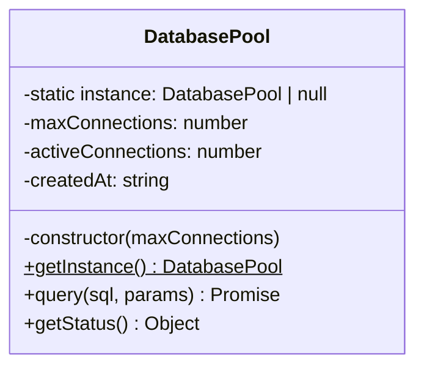
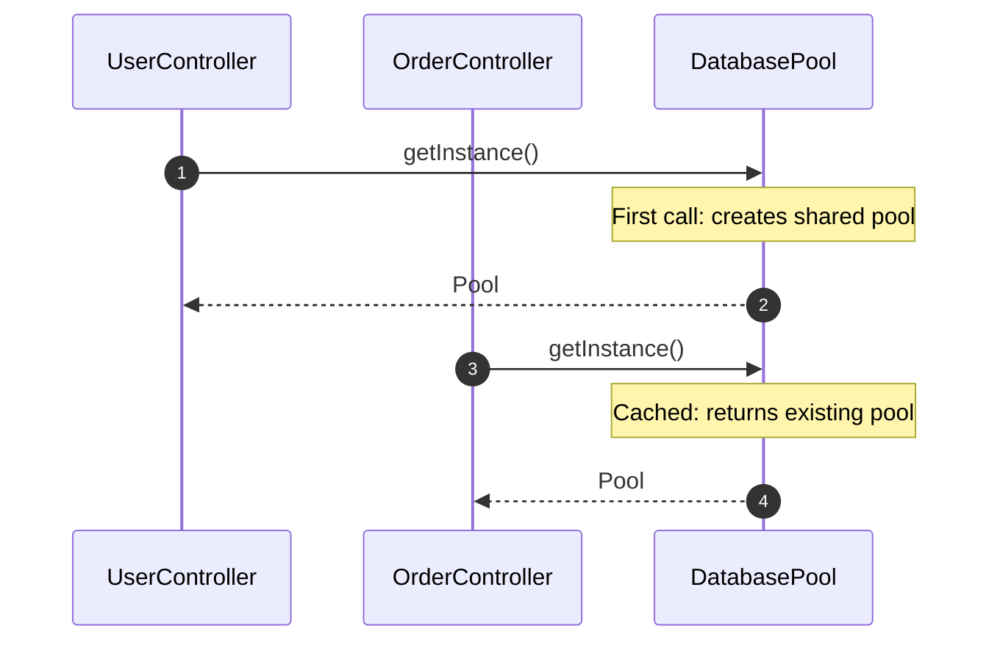

# 1. Singleton Pattern — Database Connection Pool Manager

## 🚨 The Real Production Problem
In a Node.js API server, every incoming HTTP request needs to query PostgreSQL or MySQL. If each controller or repository calls `new Pool()` per request, a traffic spike of 500 concurrent requests opens 500 separate TCP connections—immediately crashing the database with `FATAL: too many clients already` and wasting memory on repeated TLS handshakes.

```typescript
// ❌ Anti-pattern: New pool on every request
app.get("/users", async (req, res) => {
  const db = new DatabasePool(); // Opens new TCP sockets every single call!
  res.json(await db.query("SELECT * FROM users"));
});
```

## 💡 How Singleton Solves It
The **Singleton Pattern** ensures a class has **only one instance** and provides a single global access point (`getInstance()`):
- `private constructor()` blocks external `new DatabasePool()` calls.
- `private static instance` caches the single pool in memory.
- `public static getInstance()` lazily creates it on first call and returns the exact same instance forever.

## 📊 Diagrams

### Class Diagram


### Sequence Diagram


## 💻 Code Walkthrough
- [index.ts](file:///d:/Desgin-Patterns/src/01-creational/01-singleton/index.ts): `DatabasePool` tracks `activeConnections` against `maxConnections` and exposes `getInstance()`, `query()`, and `getStatus()`.
- [route.ts](file:///d:/Desgin-Patterns/src/01-creational/01-singleton/route.ts): Calls `DatabasePool.getInstance()` twice (`poolA === poolB`) to prove both references point to the exact same object.

## 🧪 How to Test
```bash
# 1. Check pool status
curl http://localhost:3000/api/singleton/status

# 2. Run a query and verify sameInstance === true
curl -X POST http://localhost:3000/api/singleton/query \
  -H "Content-Type: application/json" \
  -d '{"sql": "SELECT * FROM users WHERE active = true"}'
```

## ⚖️ When to Use / When NOT to Use
- **Use:** Database pools, Redis clients, configuration loaders, logger instances.
- **Avoid:** Mutable per-request state (causes data leaks between users) or when unit tests need isolated fresh state without dependency injection.
