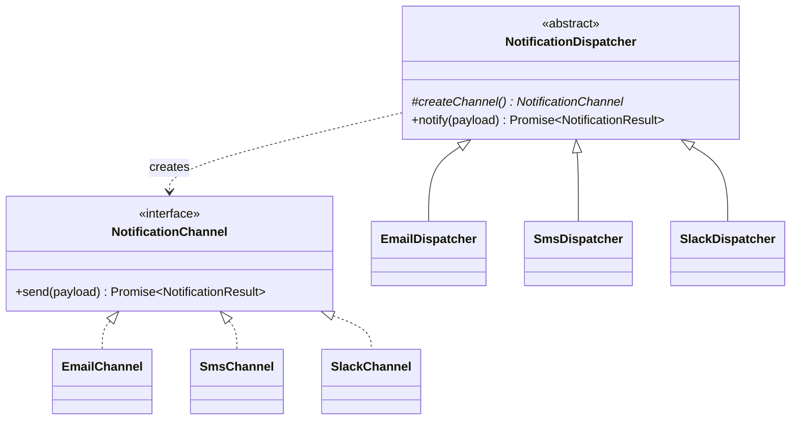
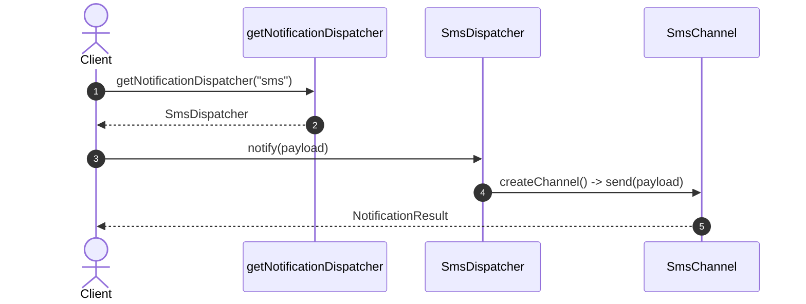

# 2. Factory Method Pattern — Multi-Channel Notification Dispatcher

## 🚨 The Real Production Problem
Every SaaS app sends notifications across multiple providers (SendGrid for Email, Twilio for SMS, Slack Webhooks). Without a Factory Method, controllers accumulate giant `if/else` blocks importing every SDK directly—violating the **Open/Closed Principle**.

```typescript
// ❌ Anti-pattern: Tight coupling to every provider SDK
if (channel === "email") new SendGrid().send(...);
else if (channel === "sms") new Twilio().messages.create(...);
else if (channel === "slack") new SlackWebhook().post(...);
```

## 💡 How Factory Method Solves It
The **Factory Method Pattern** defines an abstract creator (`NotificationDispatcher`) with a `createChannel()` method, letting subclasses (`EmailDispatcher`, `SmsDispatcher`, `SlackDispatcher`) decide which concrete `NotificationChannel` to instantiate. Adding WhatsApp later only requires adding a new channel + dispatcher—zero edits to existing dispatchers.

## 📊 Diagrams

### Class Diagram


### Sequence Diagram


## 💻 Code Walkthrough
- [index.ts](file:///d:/Desgin-Patterns/src/01-creational/02-factory-method/index.ts): Defines `NotificationChannel`, `NotificationDispatcher` (the abstract creator), concrete dispatchers, and `getNotificationDispatcher()`.
- [route.ts](file:///d:/Desgin-Patterns/src/01-creational/02-factory-method/route.ts): Exposes `POST /api/factory-method/send`.

## 🧪 How to Test
```bash
# Send Email
curl -X POST http://localhost:3000/api/factory-method/send \
  -H "Content-Type: application/json" \
  -d '{"channel":"email","recipient":"dev@company.com","subject":"Alert","body":"Server healthy"}'

# Send SMS
curl -X POST http://localhost:3000/api/factory-method/send \
  -H "Content-Type: application/json" \
  -d '{"channel":"sms","recipient":"+15551234567","body":"OTP: 918273"}'
```

## ⚖️ When to Use / When NOT to Use
- **Use:** Multiple providers behind one contract (payments, notifications, parsers, auth strategies).
- **Avoid:** When there is only one implementation that will never vary.
