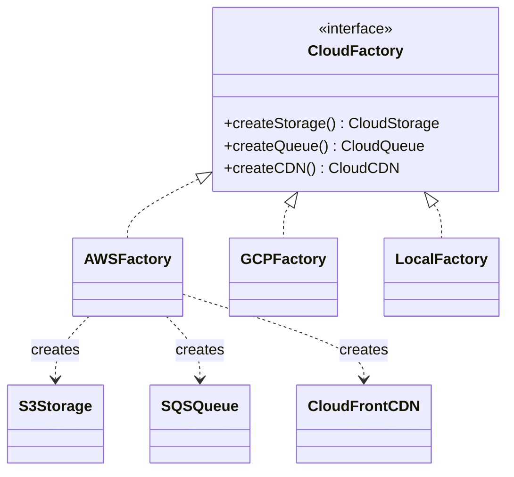
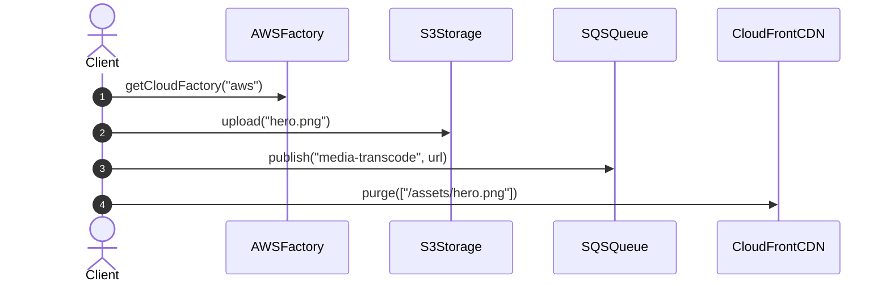

# 3. Abstract Factory Pattern — Multi-Cloud Infrastructure Suite

## 🚨 The Real Production Problem
Production services rarely use just one cloud SDK—they combine **Storage** (S3/GCS), **Queues** (SQS/PubSub), and **CDN** (CloudFront/Cloud CDN). If code directly instantiates `new S3()` and `new SQS()`, you get vendor lock-in, cannot run offline tests without live AWS credentials, and risk mixing incompatible services (e.g., S3 event pushed to GCP Pub/Sub).

## 💡 How Abstract Factory Solves It
The **Abstract Factory Pattern** defines a single factory interface (`CloudFactory`) that creates a **matching family of related objects** (`createStorage()`, `createQueue()`, `createCDN()`). Switching from AWS to GCP or Local offline mode requires changing just one environment flag (`provider`).

## 📊 Diagrams

### Class Diagram


### Sequence Diagram


## 💻 Code Walkthrough
- [index.ts](file:///d:/Desgin-Patterns/src/01-creational/03-abstract-factory/index.ts): Defines `CloudStorage`, `CloudQueue`, `CloudCDN`, `CloudFactory`, and three concrete families (`AWSFactory`, `GCPFactory`, `LocalFactory`).
- [route.ts](file:///d:/Desgin-Patterns/src/01-creational/03-abstract-factory/route.ts): Runs the full upload → queue → CDN purge pipeline against whichever family `provider` selects.

## 🧪 How to Test
```bash
# AWS family
curl -X POST http://localhost:3000/api/abstract-factory/process-media \
  -H "Content-Type: application/json" -d '{"provider":"aws","fileName":"report.pdf"}'

# Offline Local family
curl -X POST http://localhost:3000/api/abstract-factory/process-media \
  -H "Content-Type: application/json" -d '{"provider":"local","fileName":"test.png"}'
```

## ⚖️ When to Use / When NOT to Use
- **Use:** Cross-provider suites (AWS/GCP/Local), multi-theme UI kits, multi-DB ecosystems.
- **Avoid:** When you only have a single product type (use **Factory Method** instead).
