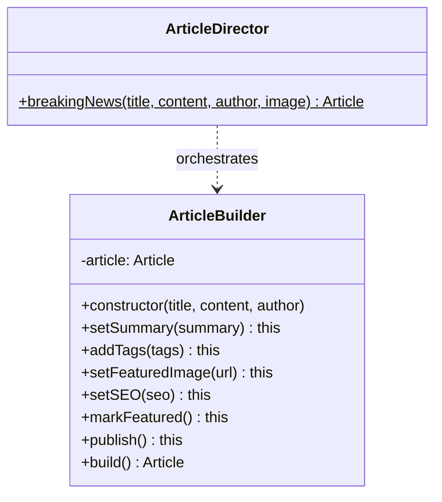
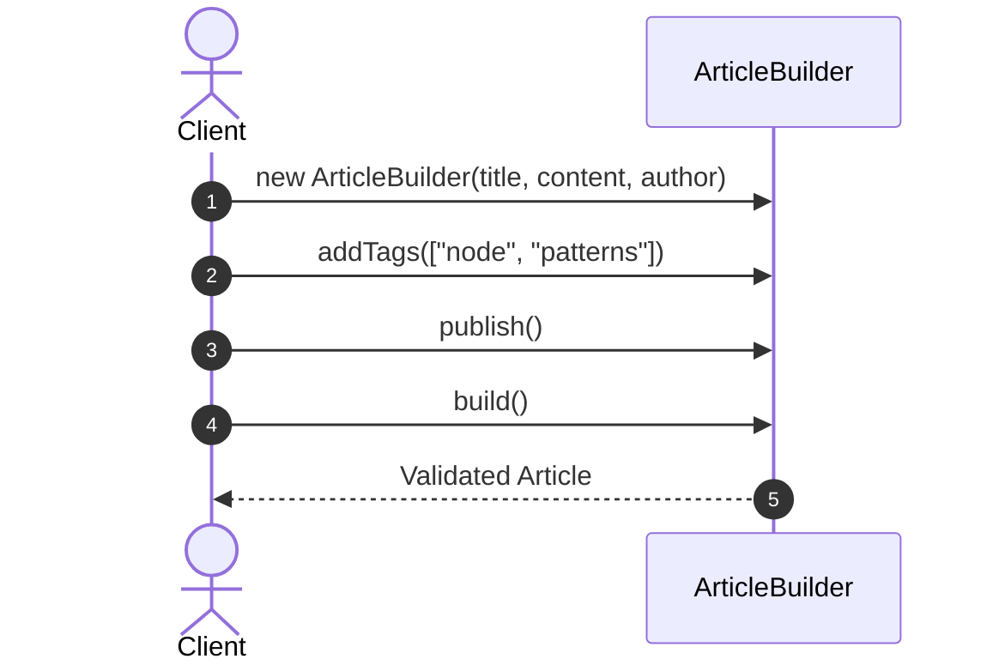

# 4. Builder Pattern — Complex CMS Article & SEO Aggregate

## 🚨 The Real Production Problem
Domain entities like CMS articles, invoices, or SQL queries have 10–20 optional fields (`summary`, `tags`, `seo`, `featuredImage`, `publishDate`). Passing them into a single constructor creates the **telescoping constructor anti-pattern** (`new Article("Title", "Body", "Bob", undefined, null, ["news"], undefined, true)`), which is unreadable and error-prone.

## 💡 How Builder Solves It
The **Builder Pattern** separates complex object construction into small, fluent steps (`setSummary().addTags().publish().build()`). Mandatory fields are enforced in the constructor, derived fields (`slug`, `readingTimeMinutes`) are computed automatically, and `ArticleDirector` provides reusable recipes like `breakingNews()`.

## 📊 Diagrams

### Class Diagram


### Sequence Diagram


## 💻 Code Walkthrough
- [index.ts](file:///d:/Desgin-Patterns/src/01-creational/04-builder/index.ts): `ArticleBuilder` validates mandatory fields, computes `slug` + `readingTimeMinutes`, and chains optional setters. `ArticleDirector` wraps common presets.
- [route.ts](file:///d:/Desgin-Patterns/src/01-creational/04-builder/route.ts): Supports both custom fluent builds and `recipe: "breaking-news"`.

## 🧪 How to Test
```bash
# Fluent build
curl -X POST http://localhost:3000/api/builder/create \
  -H "Content-Type: application/json" \
  -d '{"title":"Node Design Patterns","content":"Full guide...","author":"Dev","tags":["node"],"publish":true}'

# Director recipe
curl -X POST http://localhost:3000/api/builder/create \
  -H "Content-Type: application/json" \
  -d '{"title":"Outage Resolved","content":"Details...","author":"SRE","recipe":"breaking-news"}'
```

## ⚖️ When to Use / When NOT to Use
- **Use:** Objects with many optional parameters, step-by-step assembly, or reusable recipes.
- **Avoid:** Simple DTOs with 2–4 fields (a plain object literal is simpler).
