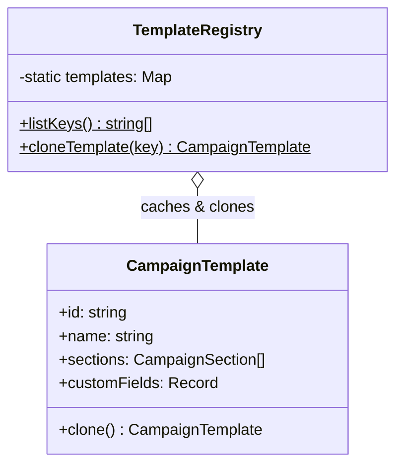
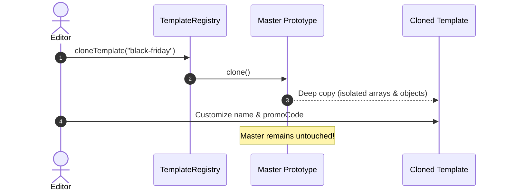

# 5. Prototype Pattern — Deep-Cloneable Campaign Blueprint Registry

## 🚨 The Real Production Problem
When users duplicate a complex campaign, email template, or workflow, two production bugs happen:
1. **Expensive DB Re-hydration:** Re-running multi-table joins and JSON parsing for every duplicate wastes latency.
2. **Shallow Copy Corruption:** Using `{ ...template }` copies only top-level primitives. Modifying `clone.sections[0].heading` silently mutates the master template for every other user!

## 💡 How Prototype Solves It
The **Prototype Pattern** caches master blueprints in `TemplateRegistry` and exposes a `.clone()` method that performs a **deep copy** (`structuredClone` + array mapping). Every clone gets a fresh `id` and isolated nested objects in sub-millisecond time.

## 📊 Diagrams

### Class Diagram


### Sequence Diagram


## 💻 Code Walkthrough
- [index.ts](file:///d:/Desgin-Patterns/src/01-creational/05-prototype/index.ts): `CampaignTemplate.clone()` deep-clones `sections` and `customFields`. `TemplateRegistry` stores master instances.
- [route.ts](file:///d:/Desgin-Patterns/src/01-creational/05-prototype/route.ts): Exposes `GET /templates` and `POST /clone`.

## 🧪 How to Test
```bash
# 1. List available blueprints
curl http://localhost:3000/api/prototype/templates

# 2. Clone and customize without mutating master
curl -X POST http://localhost:3000/api/prototype/clone \
  -H "Content-Type: application/json" \
  -d '{"templateKey":"black-friday","newName":"Cyber Monday","overrideCustomFields":{"promoCode":"CYBER70"}}'
```

## ⚖️ When to Use / When NOT to Use
- **Use:** Duplicating expensive pre-configured objects or avoiding shallow-copy state bugs.
- **Avoid:** Simple objects with no nested references where `new Class()` is trivial.
