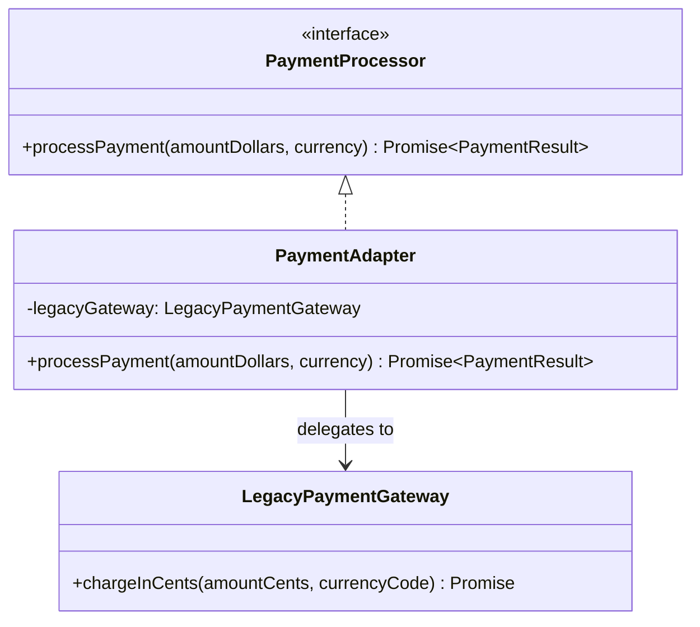
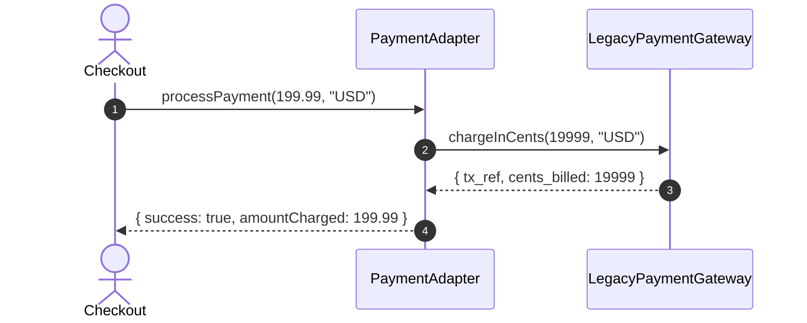

# 6. Adapter Pattern — Legacy Payment Gateway Adapter

## 🚨 The Real Production Problem
Your checkout service expects `processPayment(amountDollars, "USD")`, but you must integrate a legacy bank SDK that only accepts `chargeInCents(amountCents, currencyCode)` and returns `{ tx_ref, cents_billed }`. Rewriting the bank SDK is impossible, and changing your entire checkout codebase risks regressions.

## 💡 How Adapter Solves It
The **Adapter Pattern** wraps the incompatible `LegacyPaymentGateway` inside `PaymentAdapter`, which implements your modern `PaymentProcessor` interface—converting dollars ↔ cents and translating the response shape transparently.

## 📊 Diagrams

### Class Diagram


### Sequence Diagram


## 💻 Code Walkthrough
- [index.ts](file:///d:/Desgin-Patterns/src/02-structural/06-adapter/index.ts): `PaymentAdapter` converts `amountDollars` to integer cents, calls `chargeInCents()`, and maps the legacy response to `PaymentResult`.
- [route.ts](file:///d:/Desgin-Patterns/src/02-structural/06-adapter/route.ts): Exposes `POST /api/adapter/process`.

## 🧪 How to Test
```bash
curl -X POST http://localhost:3000/api/adapter/process \
  -H "Content-Type: application/json" \
  -d '{"amount": 199.99, "currency": "USD"}'
```

## ⚖️ When to Use / When NOT to Use
- **Use:** Integrating 3rd-party SDKs, legacy SOAP/XML APIs, or incompatible data formats.
- **Avoid:** When you own both interfaces and can simply align them directly.
