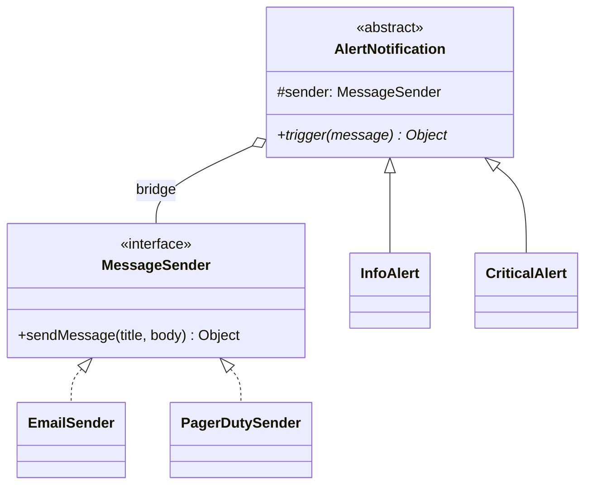
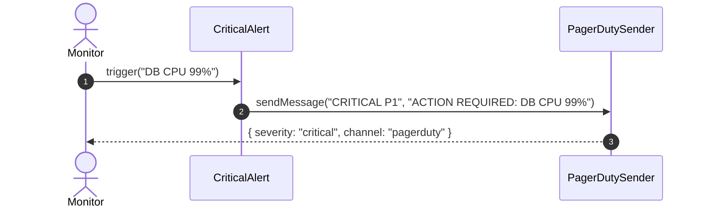

# 7. Bridge Pattern — Decoupled Alerting & Delivery Channels

## 🚨 The Real Production Problem
You have 2 alert severities (`Info`, `Critical`) and 2 delivery channels (`Email`, `PagerDuty`). Using inheritance creates `InfoEmailAlert`, `InfoPagerDutyAlert`, `CriticalEmailAlert`, `CriticalPagerDutyAlert`—a **class explosion** ($M \times N$ subclasses) whenever you add Slack or Warning alerts.

## 💡 How Bridge Solves It
The **Bridge Pattern** splits the hierarchy into two independent dimensions connected by composition:
- **Abstraction:** `AlertNotification` (`InfoAlert`, `CriticalAlert`)
- **Implementation:** `MessageSender` (`EmailSender`, `PagerDutySender`)
Adding a new channel or severity now adds only **1 class** instead of multiplying combinations.

## 📊 Diagrams

### Class Diagram


### Sequence Diagram


## 💻 Code Walkthrough
- [index.ts](file:///d:/Desgin-Patterns/src/02-structural/07-bridge/index.ts): `AlertNotification` holds a `MessageSender` reference (`this.sender`) injected via constructor.
- [route.ts](file:///d:/Desgin-Patterns/src/02-structural/07-bridge/route.ts): Mixes any `severity` with any `channel` at runtime.

## 🧪 How to Test
```bash
curl -X POST http://localhost:3000/api/bridge/alert \
  -H "Content-Type: application/json" \
  -d '{"severity":"critical","channel":"pagerduty","message":"Primary DB unreachable"}'
```

## ⚖️ When to Use / When NOT to Use
- **Use:** When a class varies along two or more independent axes (e.g., Shapes × Renderers, Alerts × Channels).
- **Avoid:** When there is only one dimension of variation.
