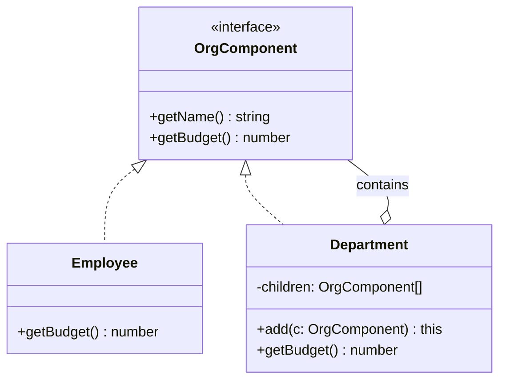
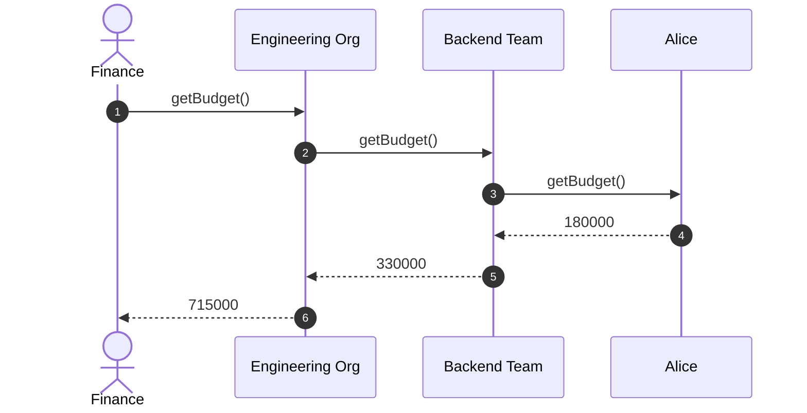

# 8. Composite Pattern — Hierarchical Organization Budget Tree

## 🚨 The Real Production Problem
In enterprise apps (org charts, CMS folders, nested permissions, UI trees), a `Department` can contain both individual `Employee` records and nested sub-`Department`s. Writing `if (item instanceof Department) ... else ...` everywhere leads to brittle recursive code.

## 💡 How Composite Solves It
The **Composite Pattern** gives both leaves (`Employee`) and containers (`Department`) the same `OrgComponent` interface (`getBudget()`). Calling `engineering.getBudget()` recursively sums the entire tree uniformly without type checks.

## 📊 Diagrams

### Class Diagram


### Sequence Diagram


## 💻 Code Walkthrough
- [index.ts](file:///d:/Desgin-Patterns/src/02-structural/08-composite/index.ts): `Department.getBudget()` delegates `reduce()` to all children, whether leaf or sub-department.
- [route.ts](file:///d:/Desgin-Patterns/src/02-structural/08-composite/route.ts): Builds a 3-level org tree and returns the aggregated budget and JSON tree.

## 🧪 How to Test
```bash
curl -X POST http://localhost:3000/api/composite/budget \
  -H "Content-Type: application/json" \
  -d '{"engineeringBonus": 10000}'
```

## ⚖️ When to Use / When NOT to Use
- **Use:** Tree structures (file systems, org charts, nested menus, ASTs).
- **Avoid:** Flat lists where parent/child nesting doesn't exist.
