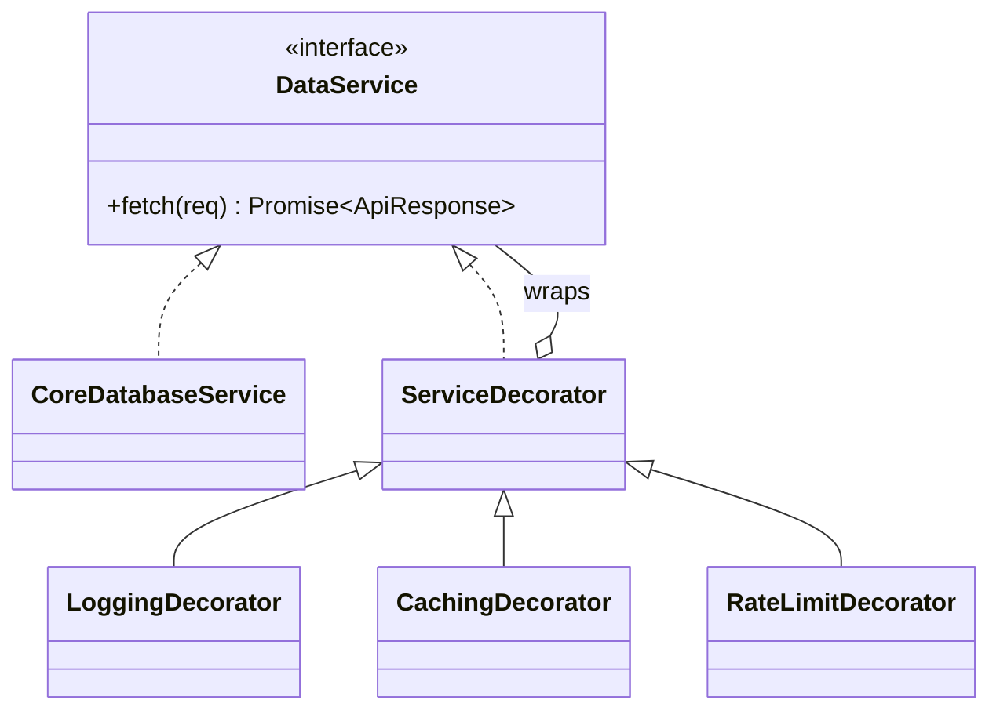
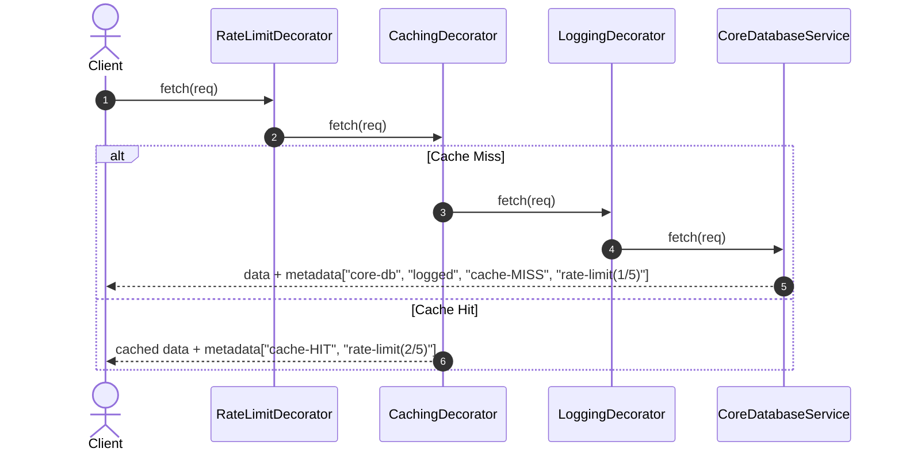

# 9. Decorator Pattern — Composable API Service Pipeline

## 🚨 The Real Production Problem
In production APIs, endpoints need cross-cutting features: **Rate Limiting**, **Caching**, and **Logging**. Using inheritance (`CachedLoggedRateLimitedService`) creates an unmaintainable explosion of subclasses, and you can't toggle features per route at runtime.

## 💡 How Decorator Solves It
The **Decorator Pattern** wraps the core `DataService` in layers that all implement the same `DataService` interface (`RateLimitDecorator(CachingDecorator(LoggingDecorator(CoreDatabaseService)))`). Each layer adds behavior before/after delegating to the wrapped service.

## 📊 Diagrams

### Class Diagram


### Sequence Diagram


## 💻 Code Walkthrough
- [index.ts](file:///d:/Desgin-Patterns/src/02-structural/09-decorator/index.ts): Defines `CoreDatabaseService` and three composable decorators (`LoggingDecorator`, `CachingDecorator`, `RateLimitDecorator`).
- [route.ts](file:///d:/Desgin-Patterns/src/02-structural/09-decorator/route.ts): Composes the pipeline once; call twice with the same `userId`/`resource` to see `cache-MISS` then `cache-HIT`, or 6 times to trigger `429 Rate limit exceeded`.

## 🧪 How to Test
```bash
# Call 1 -> cache-MISS, Call 2 -> cache-HIT
curl -X POST http://localhost:3000/api/decorator/fetch \
  -H "Content-Type: application/json" \
  -d '{"userId":"u1","resource":"orders"}'
```

## ⚖️ When to Use / When NOT to Use
- **Use:** Adding optional, stackable behaviors (middleware, streams, caching, retries).
- **Avoid:** When wrapper ordering becomes confusing or a simple middleware array suffices.
