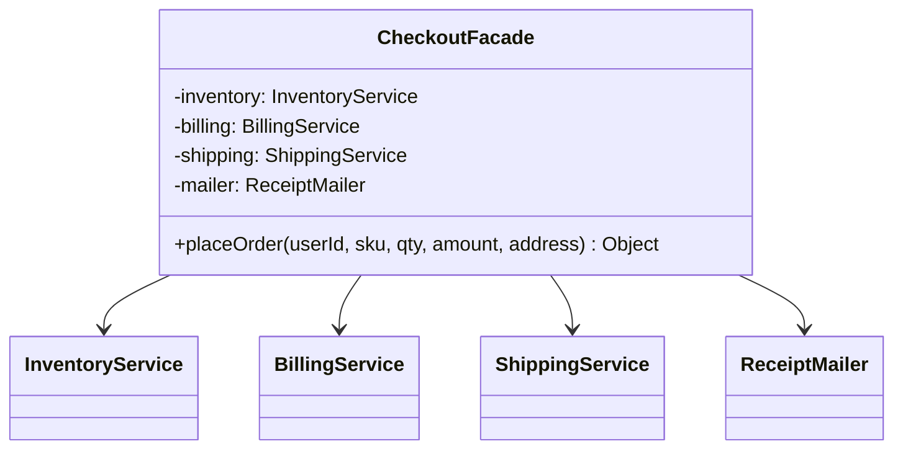
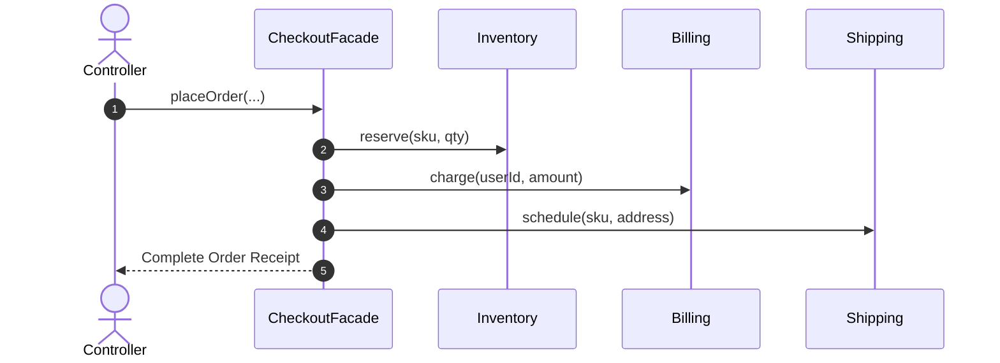

# 10. Facade Pattern — Order Checkout Orchestrator

## 🚨 The Real Production Problem
Placing an e-commerce order requires coordinating 4 separate subsystems: `InventoryService`, `BillingService`, `ShippingService`, and `ReceiptMailer`. If every controller or CLI script calls all 4 in the right order, business logic is duplicated and fragile.

## 💡 How Facade Solves It
The **Facade Pattern** provides a single, simple entry point (`CheckoutFacade.placeOrder(...)`) that coordinates the messy subsystem calls behind the scenes—without hiding the subsystems if advanced callers still need them.

## 📊 Diagrams

### Class Diagram


### Sequence Diagram


## 💻 Code Walkthrough
- [index.ts](file:///d:/Desgin-Patterns/src/02-structural/10-facade/index.ts): `CheckoutFacade` orchestrates the 4 internal services in one method.
- [route.ts](file:///d:/Desgin-Patterns/src/02-structural/10-facade/route.ts): Calls `checkout.placeOrder(...)` in a single line.

## 🧪 How to Test
```bash
curl -X POST http://localhost:3000/api/facade/checkout \
  -H "Content-Type: application/json" \
  -d '{"userId":"u_99","sku":"KEYB-01","qty":2,"amount":199,"address":"Cairo, EG"}'
```

## ⚖️ When to Use / When NOT to Use
- **Use:** Simplifying multi-step workflows or wrapping complex 3rd-party SDKs.
- **Avoid:** Letting a Facade turn into a "God Object" that does everything in the app.
