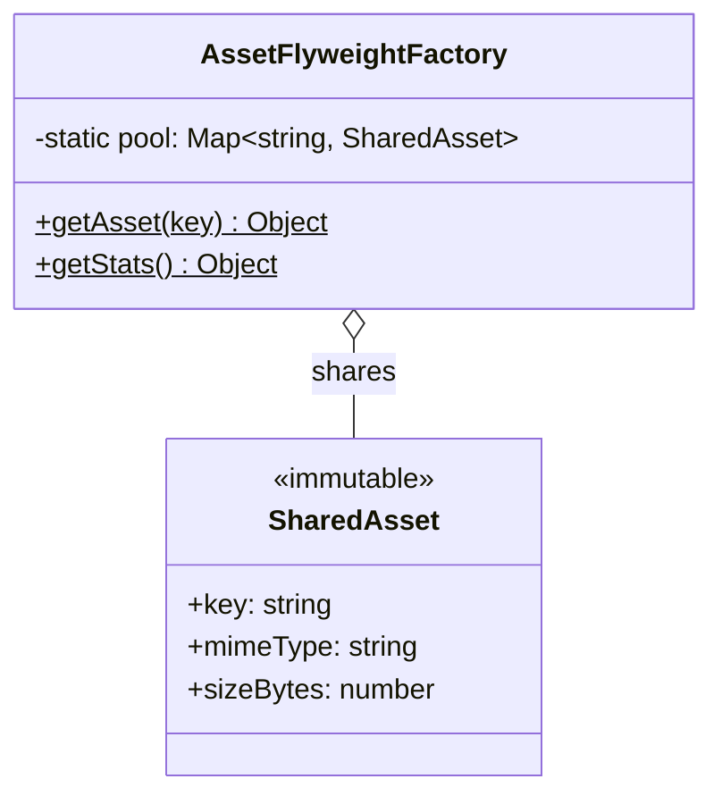
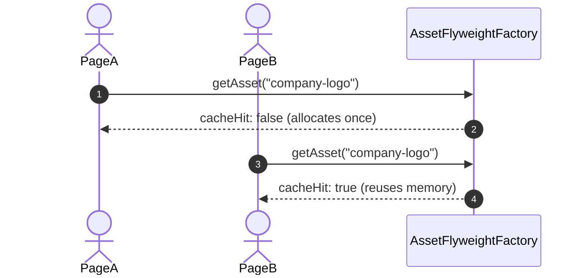

# 11. Flyweight Pattern — Shared Media Asset Registry

## 🚨 The Real Production Problem
Rendering 10,000 UI cards or map markers that each load their own 45KB `company-logo.png` buffer into memory consumes 450 MB of RAM for identical data—causing Node.js `Out Of Memory` crashes.

## 💡 How Flyweight Solves It
The **Flyweight Pattern** splits state in two:
- **Intrinsic State (Shared & Immutable):** The 45KB asset metadata stored once in `AssetFlyweightFactory.pool`.
- **Extrinsic State (Unique per use):** Coordinates `{ page, x, y }` passed at render time.
10,000 renders share **1** immutable object in memory.

## 📊 Diagrams

### Class Diagram


### Sequence Diagram


## 💻 Code Walkthrough
- [index.ts](file:///d:/Desgin-Patterns/src/02-structural/11-flyweight/index.ts): `AssetFlyweightFactory.getAsset()` freezes and caches shared `SharedAsset` objects by key.
- [route.ts](file:///d:/Desgin-Patterns/src/02-structural/11-flyweight/route.ts): Call `POST /render` twice with the same `assetKey` and watch `cacheHit` flip from `false` to `true` while `uniqueAssetsInMemory` stays `1`.

## 🧪 How to Test
```bash
# Call twice with same assetKey to observe memory sharing
curl -X POST http://localhost:3000/api/flyweight/render \
  -H "Content-Type: application/json" -d '{"assetKey":"logo-main","page":"/pricing","x":10,"y":20}'

curl http://localhost:3000/api/flyweight/stats
```

## ⚖️ When to Use / When NOT to Use
- **Use:** Massive counts of objects sharing identical heavy intrinsic data (icons, fonts, map tiles).
- **Avoid:** Small object counts where caching adds unnecessary complexity.
