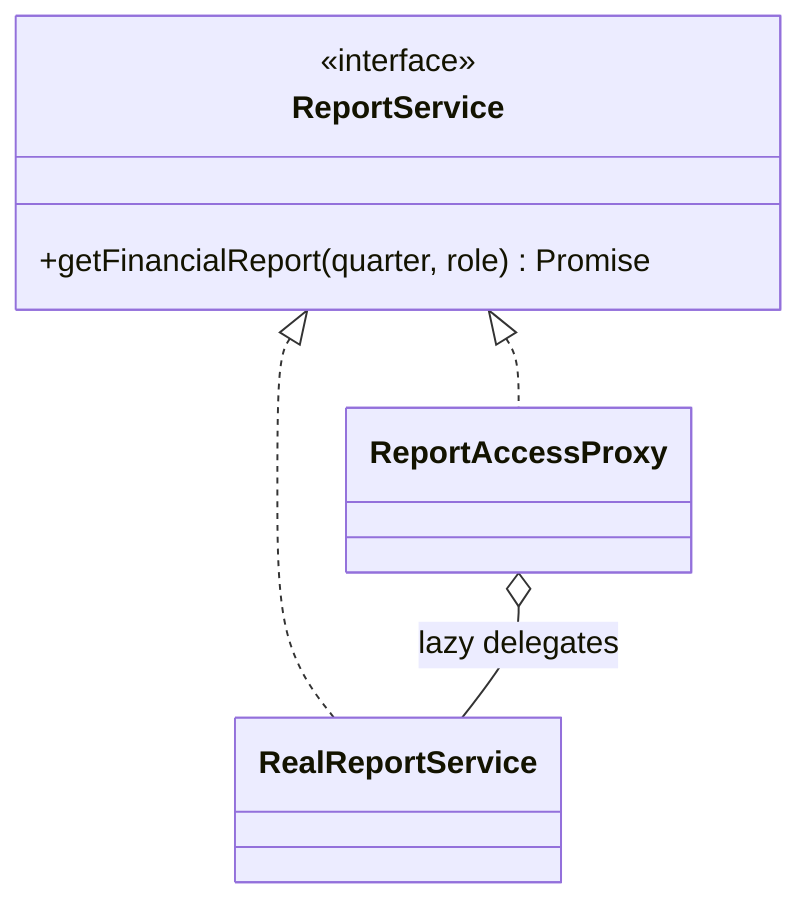
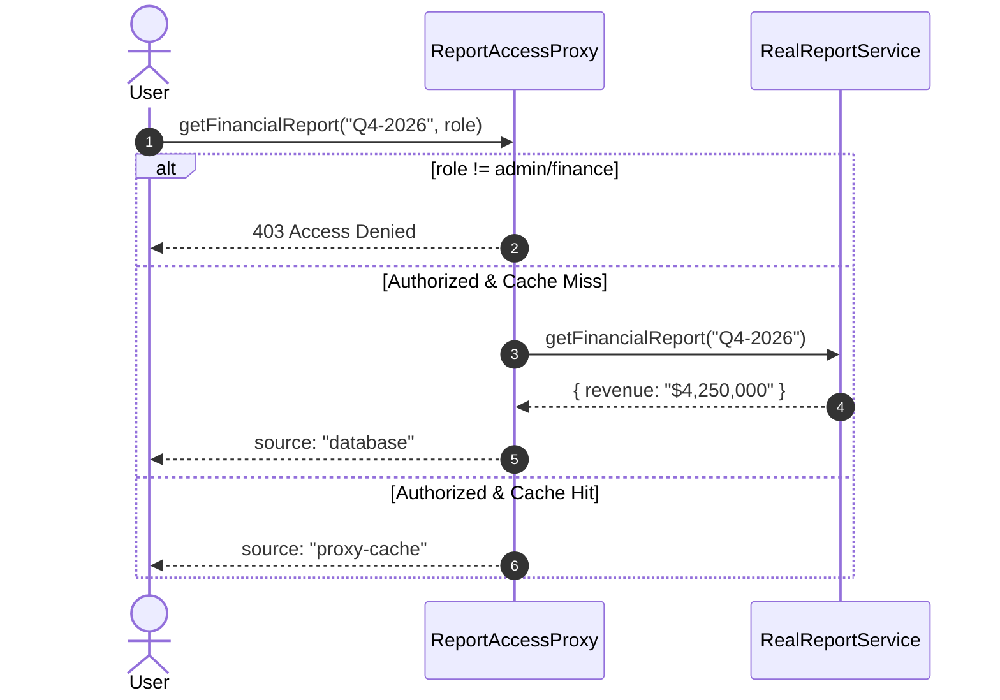

# 12. Proxy Pattern — RBAC & Lazy Caching Report Proxy

## 🚨 The Real Production Problem
Generating quarterly financial reports runs expensive SQL aggregations and exposes sensitive revenue data. Putting authorization checks and caching directly inside `RealReportService` violates Single Responsibility, and instantiating heavy report engines on startup wastes resources.

## 💡 How Proxy Solves It
The **Proxy Pattern** places `ReportAccessProxy` in front of `RealReportService` using the **same** `ReportService` interface:
1. **Protection Proxy:** Blocks unauthorized roles (`guest`) with `403 Forbidden`.
2. **Virtual Proxy:** Lazy-loads `RealReportService` only after auth succeeds.
3. **Caching Proxy:** Serves repeat requests from cache (`source: "proxy-cache"`).

## 📊 Diagrams

### Class Diagram


### Sequence Diagram


## 💻 Code Walkthrough
- [index.ts](file:///d:/Desgin-Patterns/src/02-structural/12-proxy/index.ts): `ReportAccessProxy` combines RBAC guard, lazy instantiation, and in-memory caching.
- [route.ts](file:///d:/Desgin-Patterns/src/02-structural/12-proxy/route.ts): Reads `x-user-role` header and `quarter` query param.

## 🧪 How to Test
```bash
# 1. Blocked (403)
curl "http://localhost:3000/api/proxy/report?quarter=Q4-2026"

# 2. Allowed - First hit (database) then second hit (proxy-cache)
curl -H "x-user-role: finance" "http://localhost:3000/api/proxy/report?quarter=Q4-2026"
```

## ⚖️ When to Use / When NOT to Use
- **Use:** Access control, lazy loading heavy objects, caching, or remote RPC stubs.
- **Avoid:** When you want to dynamically stack multiple independent behaviors (use **Decorator**).
