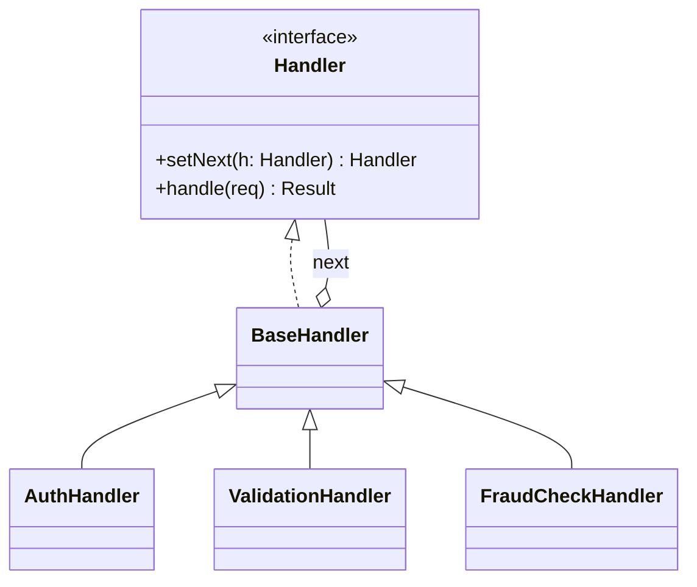
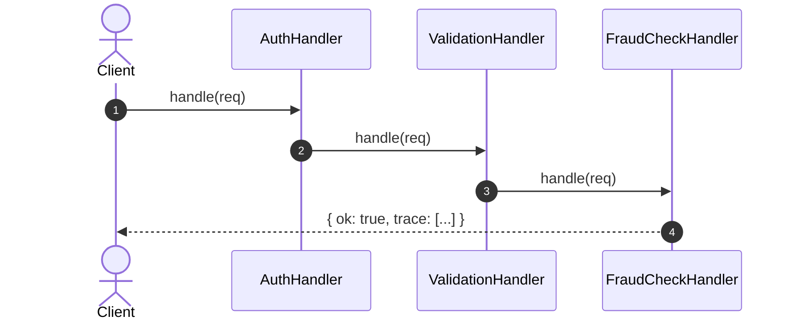

# 13. Chain of Responsibility — Request Security & Validation Pipeline

## 🚨 The Real Production Problem
API endpoints often need sequential checks (Auth → Input Validation → Fraud Check). Putting all checks in one deeply nested `if/else` function couples every rule together and makes reordering or adding checks painful.

## 💡 How Chain of Responsibility Solves It
Each check is an independent `Handler` linked via `.setNext()`. A request travels down the chain; any handler can either pass it to `super.handle(req)` or **short-circuit** immediately with an error.

## 📊 Diagrams

### Class Diagram


### Sequence Diagram


## 💻 Code Walkthrough
- [index.ts](file:///d:/Desgin-Patterns/src/03-behavioral/13-chain-of-responsibility/index.ts): `AuthHandler`, `ValidationHandler`, and `FraudCheckHandler` append to `trace` and short-circuit on invalid input.
- [route.ts](file:///d:/Desgin-Patterns/src/03-behavioral/13-chain-of-responsibility/route.ts): Chains all three handlers and exposes `POST /api/chain-of-responsibility/process`.

## 🧪 How to Test
```bash
# 1. Pass all handlers
curl -X POST http://localhost:3000/api/chain-of-responsibility/process \
  -H "Content-Type: application/json" -H "Authorization: Bearer valid-token-123" \
  -d '{"email":"alice@company.com","amount":500}'

# 2. Short-circuit at AuthHandler (missing token)
curl -X POST http://localhost:3000/api/chain-of-responsibility/process \
  -H "Content-Type: application/json" -d '{"email":"alice@company.com","amount":500}'
```

## ⚖️ When to Use / When NOT to Use
- **Use:** Middleware pipelines, approval workflows, support ticket escalation.
- **Avoid:** When every step must always execute regardless of earlier failures.
