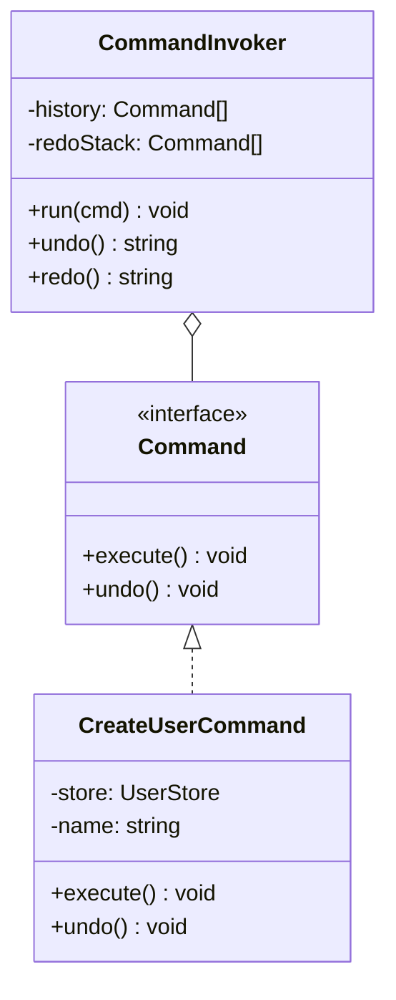
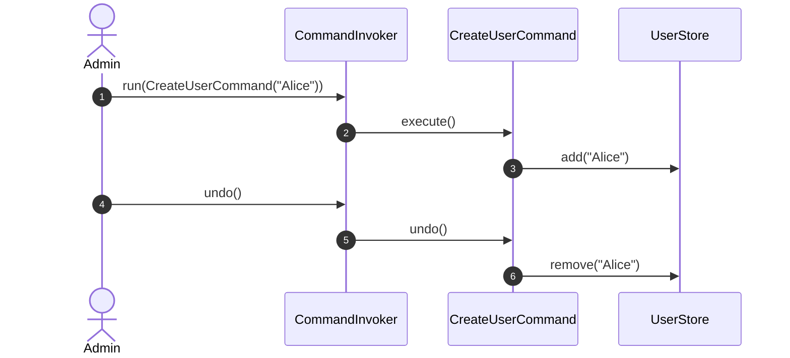

# 14. Command Pattern — Undoable Operations & Audit Stack

## 🚨 The Real Production Problem
Admin dashboards, editors, and job queues need **Undo/Redo**, **audit logs**, and **queued retries**. Calling `userStore.add("Alice")` directly leaves no record of what happened or how to reverse it.

## 💡 How Command Solves It
The **Command Pattern** turns each request into a standalone `Command` object with `execute()` and `undo()`. `CommandInvoker` runs commands and pushes them onto `history` and `redoStack` without knowing the internal details.

## 📊 Diagrams

### Class Diagram


### Sequence Diagram


## 💻 Code Walkthrough
- [index.ts](file:///d:/Desgin-Patterns/src/03-behavioral/14-command/index.ts): `CreateUserCommand` encapsulates `add`/`remove`; `CommandInvoker` manages `history` and `redoStack`.
- [route.ts](file:///d:/Desgin-Patterns/src/03-behavioral/14-command/route.ts): Exposes `/create`, `/undo`, `/redo`, and `/history`.

## 🧪 How to Test
```bash
curl -X POST http://localhost:3000/api/command/create -H "Content-Type: application/json" -d '{"name":"Alice"}'
curl -X POST http://localhost:3000/api/command/undo
curl -X POST http://localhost:3000/api/command/redo
```

## ⚖️ When to Use / When NOT to Use
- **Use:** Undo/Redo, job queues, transaction rollbacks, audit trails.
- **Avoid:** Simple one-off CRUD calls that never need queuing or reversal.
