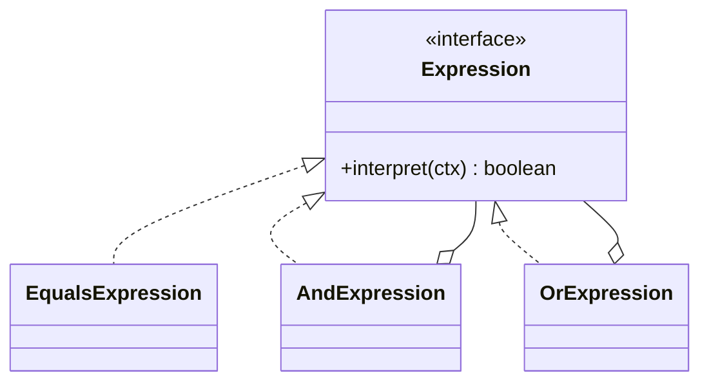
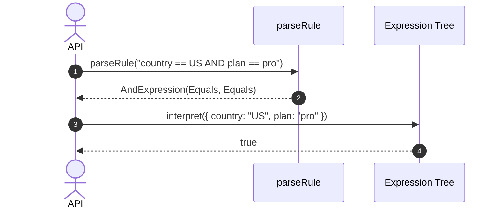

# 15. Interpreter Pattern — Feature-Flag Rule Engine

## 🚨 The Real Production Problem
Product teams want dynamic targeting rules like `"country == US AND plan == pro OR role == admin"` stored in a database. Hardcoding `if` statements requires a code deploy for every rule change, and using `eval()` is a critical **Remote Code Execution (RCE)** security vulnerability.

## 💡 How Interpreter Solves It
The **Interpreter Pattern** defines a safe grammar of AST nodes (`EqualsExpression`, `AndExpression`, `OrExpression`) implementing `interpret(context)`. `parseRule()` safely turns the string into an expression tree with zero `eval()`.

## 📊 Diagrams

### Class Diagram


### Sequence Diagram


## 💻 Code Walkthrough
- [index.ts](file:///d:/Desgin-Patterns/src/03-behavioral/15-interpreter/index.ts): Implements terminal (`EqualsExpression`) and non-terminal (`AndExpression`, `OrExpression`) AST nodes plus `parseRule()`.
- [route.ts](file:///d:/Desgin-Patterns/src/03-behavioral/15-interpreter/route.ts): Evaluates any rule against a JSON `context`.

## 🧪 How to Test
```bash
curl -X POST http://localhost:3000/api/interpreter/evaluate \
  -H "Content-Type: application/json" \
  -d '{"rule":"country == US AND plan == pro","context":{"country":"US","plan":"pro"}}'
```

## ⚖️ When to Use / When NOT to Use
- **Use:** Small DSLs (feature-flag rules, search filters, math/tax formulas).
- **Avoid:** Complex full programming languages (use a real parser generator instead).
