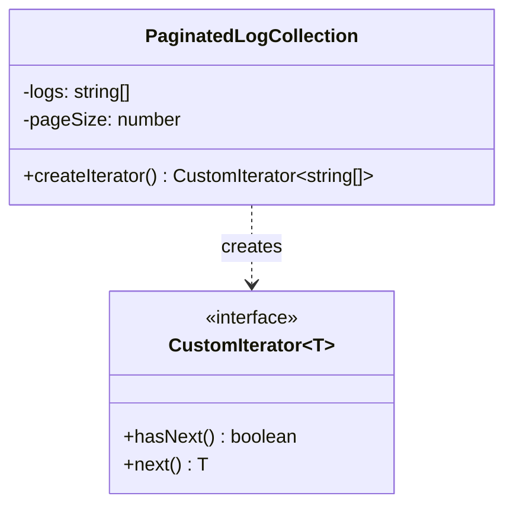
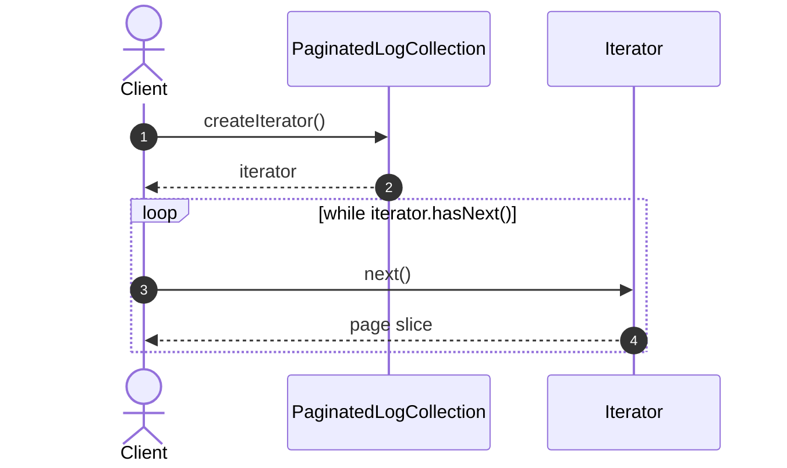

# 16. Iterator Pattern — Paginated Log Streamer

## 🚨 The Real Production Problem
Exporting millions of audit logs or database rows at once crashes Node.js with Out-Of-Memory errors, and exposing internal array/cursor indexing leaks storage details into every caller.

## 💡 How Iterator Solves It
The **Iterator Pattern** encapsulates traversal (`hasNext()`, `next()`) inside a dedicated iterator object so clients walk through pages uniformly without knowing whether data comes from memory, SQL cursors, or S3.

## 📊 Diagrams

### Class Diagram


### Sequence Diagram


## 💻 Code Walkthrough
- [index.ts](file:///d:/Desgin-Patterns/src/03-behavioral/16-iterator/index.ts): `PaginatedLogCollection.createIterator()` maintains a private `cursor` closure and yields slices of `pageSize`.
- [route.ts](file:///d:/Desgin-Patterns/src/03-behavioral/16-iterator/route.ts): Traverses all log pages via `while (iterator.hasNext())`.

## 🧪 How to Test
```bash
curl "http://localhost:3000/api/iterator/demo?pageSize=2"
```

## ⚖️ When to Use / When NOT to Use
- **Use:** Paginated APIs, tree/graph traversals, lazy streams (`Symbol.iterator` / generators).
- **Avoid:** Simple in-memory arrays where `.map()` / `for..of` already works.
