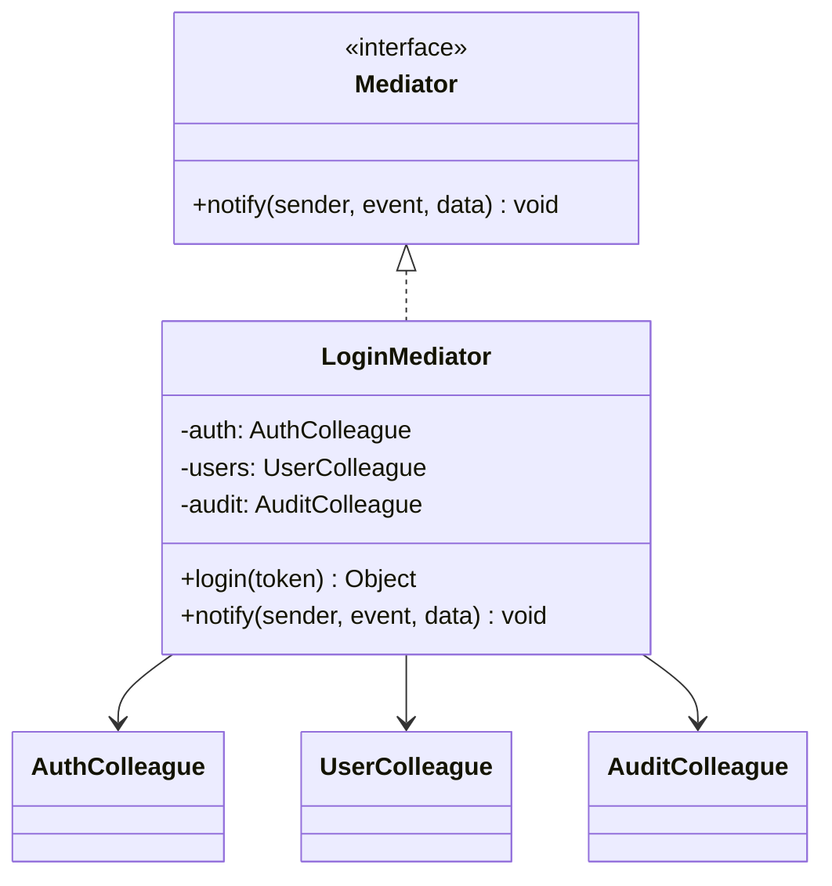
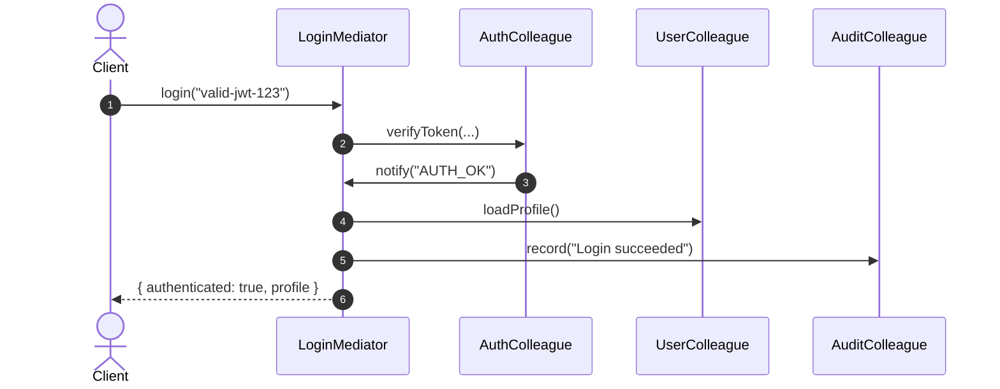

# 17. Mediator Pattern — Microservice Login Orchestrator

## 🚨 The Real Production Problem
When `AuthService`, `UserService`, `BillingService`, and `AuditService` call each other directly, you get **many-to-many spaghetti dependencies** and circular imports (`Auth` imports `User`, `User` imports `Audit`, `Audit` imports `Auth`).

## 💡 How Mediator Solves It
The **Mediator Pattern** centralizes communication inside `LoginMediator`. Colleagues (`AuthColleague`, `UserColleague`, `AuditColleague`) never reference each other—they only notify the mediator, turning a tangled mesh into a clean hub-and-spoke.

## 📊 Diagrams

### Class Diagram


### Sequence Diagram


## 💻 Code Walkthrough
- [index.ts](file:///d:/Desgin-Patterns/src/03-behavioral/17-mediator/index.ts): `LoginMediator` reacts to `AUTH_OK` and `AUTH_FAIL` events from `AuthColleague`.
- [route.ts](file:///d:/Desgin-Patterns/src/03-behavioral/17-mediator/route.ts): Exposes `POST /api/mediator/login`.

## 🧪 How to Test
```bash
# Valid token -> 200
curl -X POST http://localhost:3000/api/mediator/login \
  -H "Content-Type: application/json" -d '{"token":"valid-jwt-123"}'

# Invalid token -> 401
curl -X POST http://localhost:3000/api/mediator/login \
  -H "Content-Type: application/json" -d '{"token":"bad"}'
```

## ⚖️ When to Use / When NOT to Use
- **Use:** Complex multi-service workflows, chat rooms, UI form controllers.
- **Avoid:** Letting the Mediator grow into a bloated God Object.
