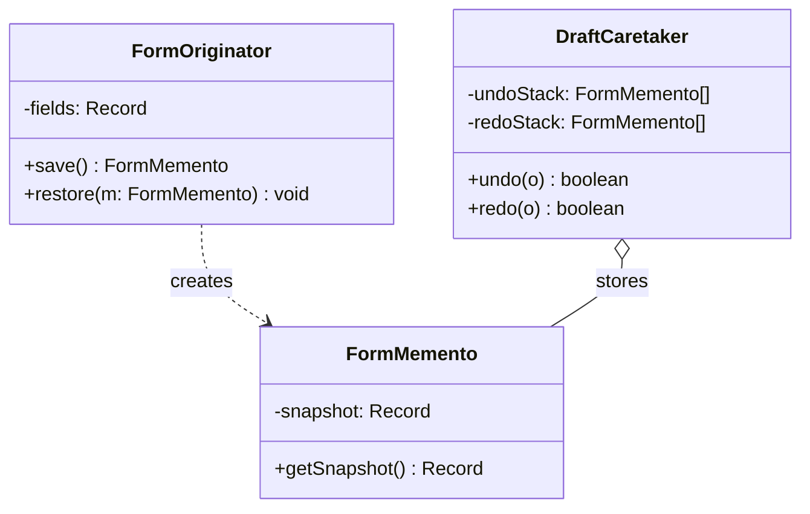
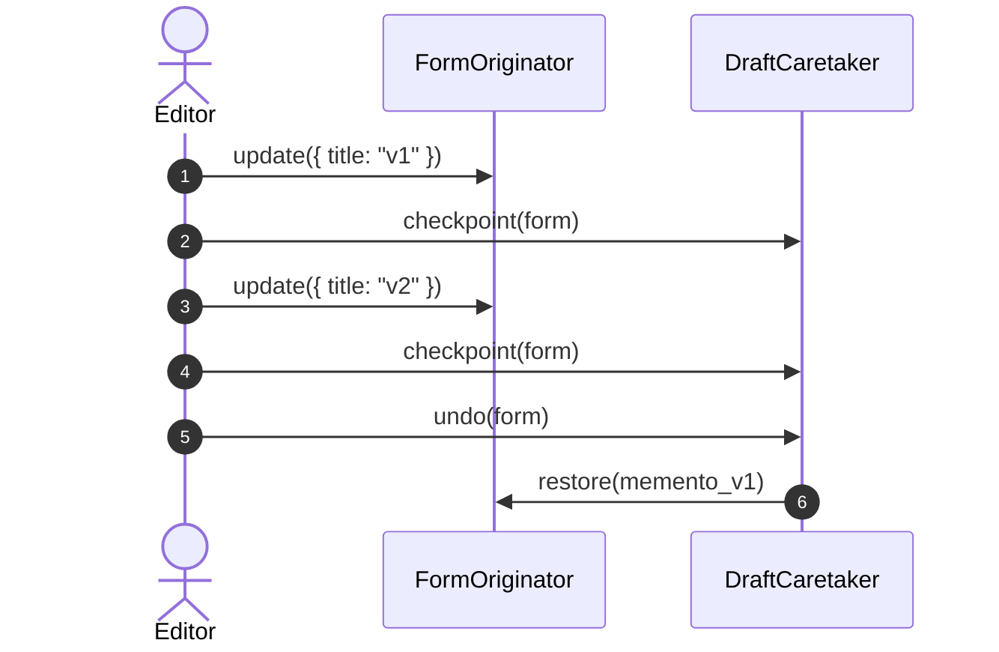

# 18. Memento Pattern — Document & Form Draft Snapshots

## 🚨 The Real Production Problem
Multi-step wizards, CMS editors, and config panels need **"Undo / Restore Draft"** without leaking private internal state or forcing the history manager to understand every field in the form.

## 💡 How Memento Solves It
The **Memento Pattern** separates three roles:
- **Originator (`FormOriginator`):** Creates (`save()`) and restores (`restore()`) snapshots.
- **Memento (`FormMemento`):** Immutable snapshot object.
- **Caretaker (`DraftCaretaker`):** Stores snapshots in `undoStack`/`redoStack` without ever inspecting or mutating their contents.

## 📊 Diagrams

### Class Diagram


### Sequence Diagram


## 💻 Code Walkthrough
- [index.ts](file:///d:/Desgin-Patterns/src/03-behavioral/18-memento/index.ts): `FormOriginator`, `FormMemento`, and `DraftCaretaker`.
- [route.ts](file:///d:/Desgin-Patterns/src/03-behavioral/18-memento/route.ts): Exposes `/save`, `/undo`, `/redo`.

## 🧪 How to Test
```bash
curl -X POST http://localhost:3000/api/memento/save -H "Content-Type: application/json" -d '{"title":"Draft 1"}'
curl -X POST http://localhost:3000/api/memento/save -H "Content-Type: application/json" -d '{"title":"Draft 2"}'
curl -X POST http://localhost:3000/api/memento/undo
```

## ⚖️ When to Use / When NOT to Use
- **Use:** Snapshots, draft history, transaction checkpoints.
- **Avoid:** Huge objects saved every millisecond without memory limits (consider **Command** deltas instead).
