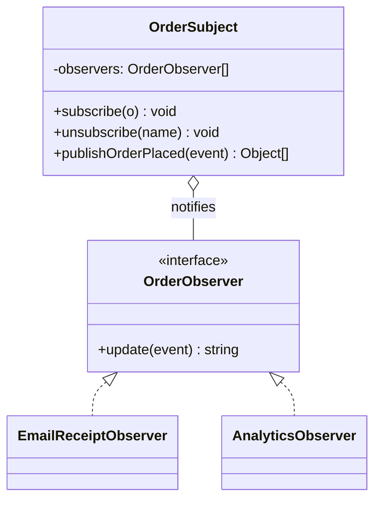
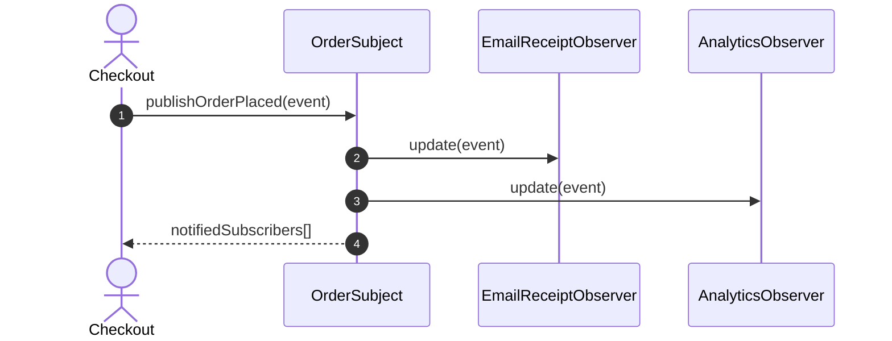

# 19. Observer Pattern — Event-Driven Order Pub/Sub

## 🚨 The Real Production Problem
When an order is placed, 5 side effects must run (email receipt, analytics, warehouse alert, loyalty points, webhook). Hardcoding all 5 inside `placeOrder()` turns it into a brittle monolith where every new team has to edit checkout code.

## 💡 How Observer Solves It
The **Observer Pattern** (Pub/Sub) lets `OrderSubject` maintain a list of `OrderObserver` subscribers and notify all of them automatically on `publishOrderPlaced()`—without knowing what each subscriber does.

## 📊 Diagrams

### Class Diagram


### Sequence Diagram


## 💻 Code Walkthrough
- [index.ts](file:///d:/Desgin-Patterns/src/03-behavioral/19-observer/index.ts): `OrderSubject` manages subscriptions and broadcasts `OrderEvent`.
- [route.ts](file:///d:/Desgin-Patterns/src/03-behavioral/19-observer/route.ts): Pre-subscribes `EmailReceiptObserver` and `AnalyticsObserver` and triggers `POST /api/observer/order-placed`.

## 🧪 How to Test
```bash
curl -X POST http://localhost:3000/api/observer/order-placed \
  -H "Content-Type: application/json" -d '{"orderId":"ORD-900","total":299.50}'
```

## ⚖️ When to Use / When NOT to Use
- **Use:** Domain events, UI state binding, webhooks, Node.js `EventEmitter` architectures.
- **Avoid:** When strict execution order or transactional rollback across subscribers is required.
