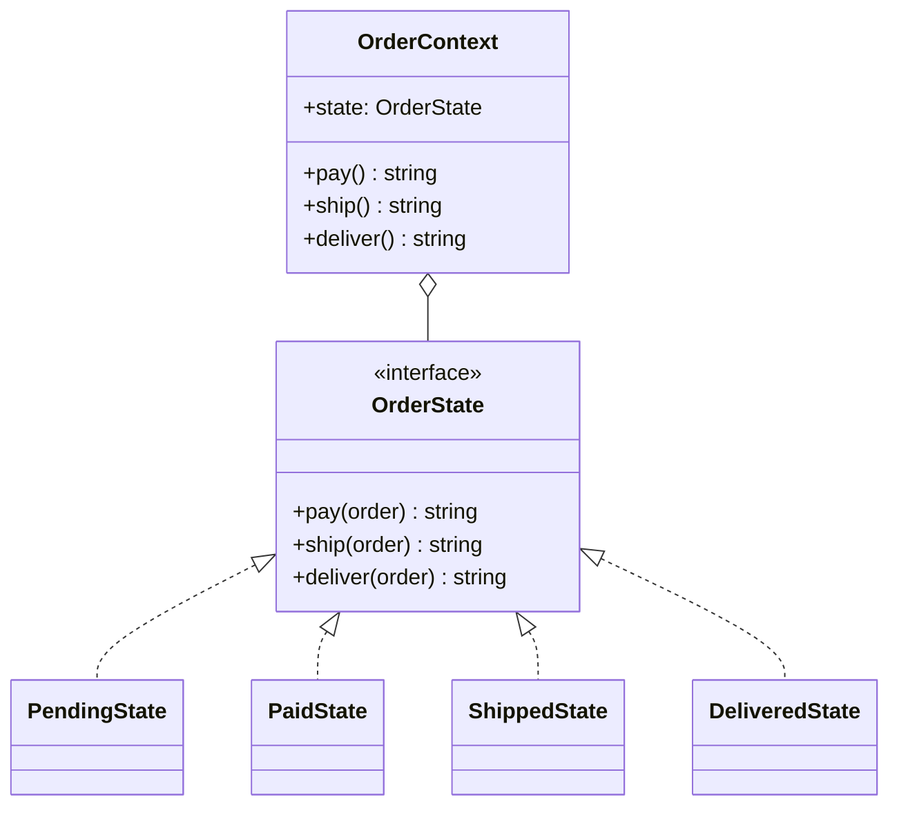
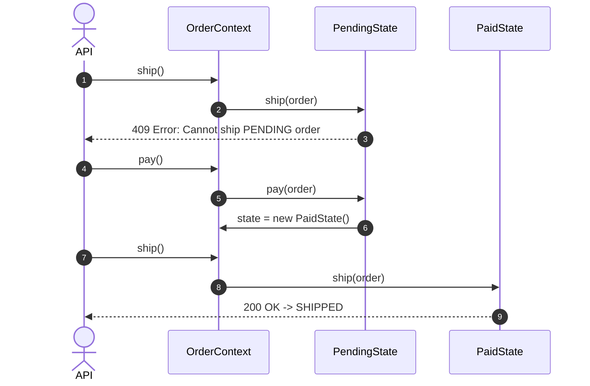

# 20. State Pattern — Order Lifecycle State Machine

## 🚨 The Real Production Problem
E-commerce orders move through `PENDING → PAID → SHIPPED → DELIVERED`. Without the State pattern, every endpoint (`ship()`, `refund()`, `deliver()`) checks `if (order.status === "PAID" && !order.isCancelled ...)`—leading to illegal state transitions like shipping unpaid orders.

## 💡 How State Solves It
The **State Pattern** models each lifecycle stage as a class (`PendingState`, `PaidState`, `ShippedState`, `DeliveredState`). `OrderContext` delegates `pay()`, `ship()`, and `deliver()` to its current state object, which either transitions to the next state or throws a `409 Conflict` on illegal transitions.

## 📊 Diagrams

### Class Diagram


### Sequence Diagram


## 💻 Code Walkthrough
- [index.ts](file:///d:/Desgin-Patterns/src/03-behavioral/20-state/index.ts): Defines `OrderContext` and the 4 concrete states.
- [route.ts](file:///d:/Desgin-Patterns/src/03-behavioral/20-state/route.ts): Exposes `POST /api/state/reset`, `/pay`, `/ship`, `/deliver`.

## 🧪 How to Test
```bash
curl -X POST http://localhost:3000/api/state/reset
curl -X POST http://localhost:3000/api/state/ship     # 409 Conflict (unpaid!)
curl -X POST http://localhost:3000/api/state/pay      # 200 OK -> PAID
curl -X POST http://localhost:3000/api/state/ship     # 200 OK -> SHIPPED
curl -X POST http://localhost:3000/api/state/deliver  # 200 OK -> DELIVERED
```

## ⚖️ When to Use / When NOT to Use
- **Use:** Order lifecycles, subscription billing states, TCP/connection state machines.
- **Avoid:** Objects with only 2 simple boolean states.
