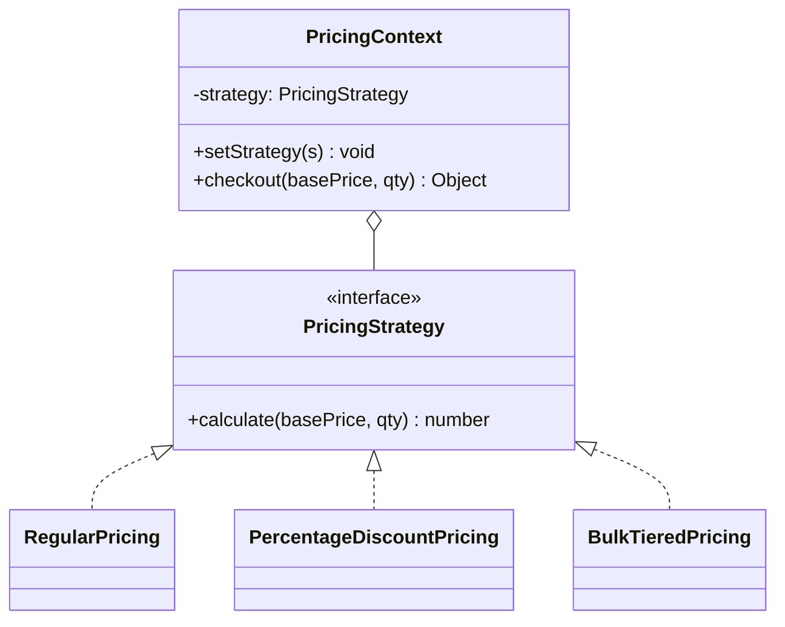
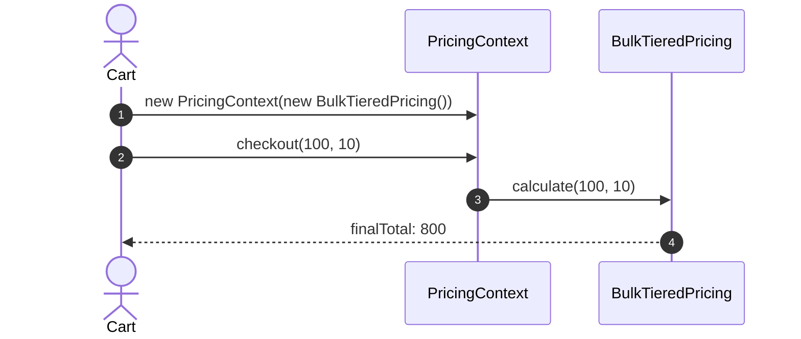

# 21. Strategy Pattern — Dynamic Pricing & Discount Engine

## 🚨 The Real Production Problem
Checkout services support regular pricing, percentage promo codes, and bulk tiered discounts. Hardcoding `if (promo === "PERCENT") ... else if (promo === "TIERED") ...` inside checkout mixes unrelated math formulas and forces risky edits whenever marketing launches a new campaign.

## 💡 How Strategy Solves It
The **Strategy Pattern** extracts each algorithm into its own `PricingStrategy` class (`RegularPricing`, `PercentageDiscountPricing`, `BulkTieredPricing`). `PricingContext` delegates calculation to whichever strategy is injected at runtime.

## 📊 Diagrams

### Class Diagram


### Sequence Diagram


## 💻 Code Walkthrough
- [index.ts](file:///d:/Desgin-Patterns/src/03-behavioral/21-strategy/index.ts): Defines `PricingStrategy` and 3 interchangeable implementations.
- [route.ts](file:///d:/Desgin-Patterns/src/03-behavioral/21-strategy/route.ts): Picks the strategy dynamically based on `req.body.strategy`.

## 🧪 How to Test
```bash
curl -X POST http://localhost:3000/api/strategy/calculate \
  -H "Content-Type: application/json" -d '{"strategy":"tiered","basePrice":100,"qty":10}'
```

## ⚖️ When to Use / When NOT to Use
- **Use:** Interchangeable algorithms (pricing, sorting, compression, auth providers, shipping rates).
- **Avoid:** When you only have one algorithm that never changes.
