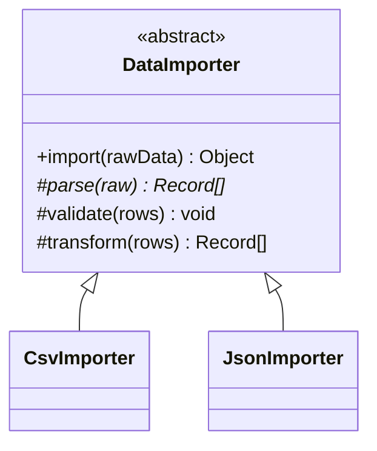
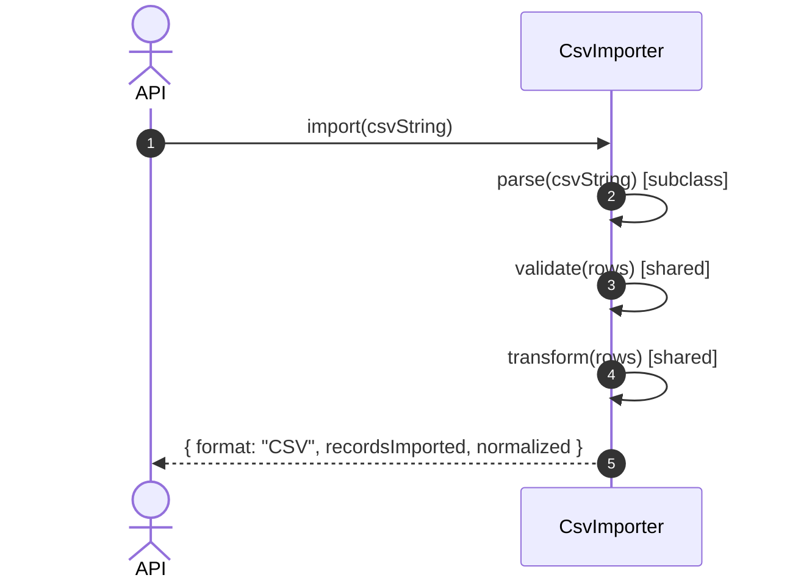

# 22. Template Method Pattern — Standardized Data Importer

## 🚨 The Real Production Problem
Your SaaS platform imports customer records from both **CSV** and **JSON**. Both importers duplicate the exact same validation, timestamp enrichment, and error handling—only the `parse()` step differs. Copy-pasting that pipeline across files causes validation drift.

## 💡 How Template Method Solves It
The **Template Method Pattern** puts the invariant workflow (`parse → validate → transform`) inside `DataImporter.import()`. Subclasses (`CsvImporter`, `JsonImporter`) only override `parse()` and `getFormatName()` while inheriting the shared pipeline.

## 📊 Diagrams

### Class Diagram


### Sequence Diagram


## 💻 Code Walkthrough
- [index.ts](file:///d:/Desgin-Patterns/src/03-behavioral/22-template-method/index.ts): `DataImporter.import()` defines the fixed skeleton; `CsvImporter` and `JsonImporter` implement `parse()`.
- [route.ts](file:///d:/Desgin-Patterns/src/03-behavioral/22-template-method/route.ts): Exposes `POST /api/template-method/import`.

## 🧪 How to Test
```bash
# CSV Import
curl -X POST http://localhost:3000/api/template-method/import \
  -H "Content-Type: application/json" \
  -d '{"format":"csv","data":"name,role\nAlice,Admin\nBob,User"}'

# JSON Import
curl -X POST http://localhost:3000/api/template-method/import \
  -H "Content-Type: application/json" \
  -d '{"format":"json","data":"[{\"name\":\"Alice\",\"role\":\"Admin\"}]"}'
```

## ⚖️ When to Use / When NOT to Use
- **Use:** Fixed multi-step workflows where only 1–2 steps vary across formats or tenants.
- **Avoid:** When you need to swap algorithms dynamically at runtime on the same object (use **Strategy**).
