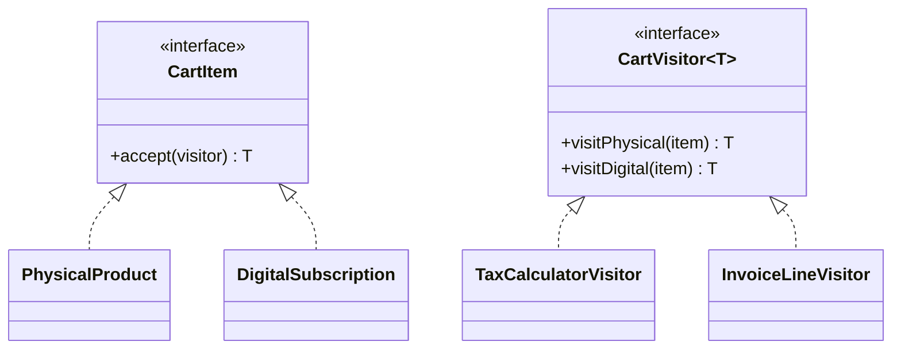
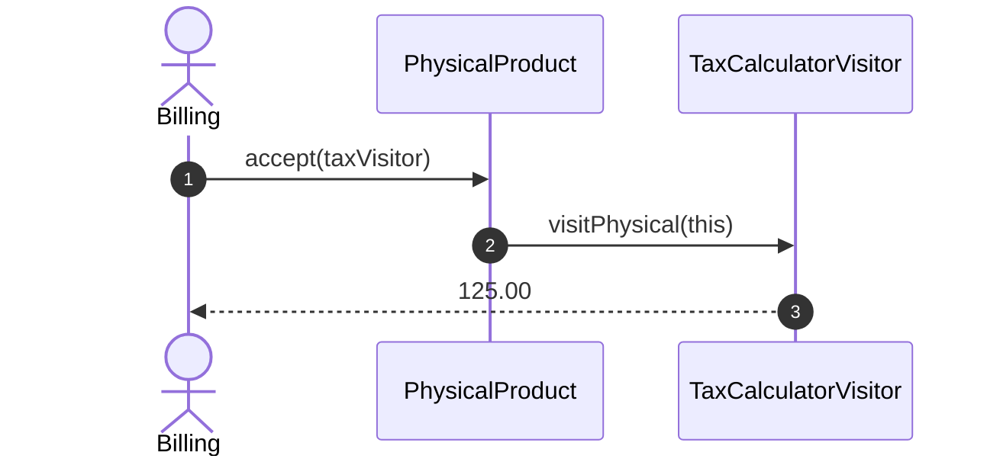

# 23. Visitor Pattern — Multi-Operation Cart & Tax Engine

## 🚨 The Real Production Problem
Your domain models (`PhysicalProduct`, `DigitalSubscription`) are stable, but finance, analytics, and PDF teams keep asking for new operations (`calculateTax()`, `exportInvoiceLine()`, `auditCompliance()`). Adding every new method directly to the item classes bloats them with unrelated concerns.

## 💡 How Visitor Solves It
The **Visitor Pattern** uses **double dispatch**: items only implement `accept(visitor)` once, while each new operation lives in its own `CartVisitor` (`TaxCalculatorVisitor`, `InvoiceLineVisitor`). You can add 10 new report/tax operations without touching the product classes.

## 📊 Diagrams

### Class Diagram


### Sequence Diagram


## 💻 Code Walkthrough
- [index.ts](file:///d:/Desgin-Patterns/src/03-behavioral/23-visitor/index.ts): `PhysicalProduct` and `DigitalSubscription` implement `accept()`; `TaxCalculatorVisitor` and `InvoiceLineVisitor` implement separate operations.
- [route.ts](file:///d:/Desgin-Patterns/src/03-behavioral/23-visitor/route.ts): Runs both visitors over the same cart and returns invoice lines + total tax.

## 🧪 How to Test
```bash
curl -X POST http://localhost:3000/api/visitor/invoice \
  -H "Content-Type: application/json" \
  -d '{"laptopPrice": 1500, "subscriptionMonths": 6}'
```

## ⚖️ When to Use / When NOT to Use
- **Use:** Stable element hierarchies that need many unrelated operations (AST compilers, billing/tax engines).
- **Avoid:** When you add new element subclasses every week (each new element forces updating every visitor).
