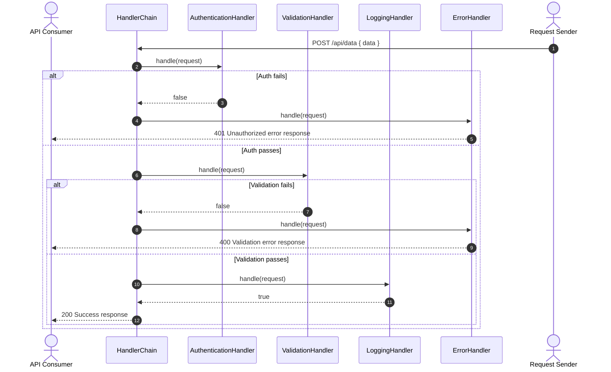

# 🎯 Chain of Responsibility: Distributed Error Handling Pipeline

## 1. 🚨 The Real Production Problem
In Node.js/Express applications and microservices, error handling and validation often require multiple steps that must be executed in sequence. Without Chain of Responsibility:

- **Nested Try/Catch Hell:** Every endpoint wraps logic in try/catch, leading to repetitive error handling code
- **Conditional Middleware Chaos:** Complex `if/else` chains to decide which validator/middleware runs
- **Difficulty Adding New Validators:** Must modify existing handler code to insert new validation steps
- **Inconsistent Error Responses:** Different endpoints format errors differently
- **Tight Coupling:** Request handler directly depends on specific validator/middleware classes

## 2. 💡 How Chain of Responsibility Solves It
The **Chain of Responsibility Pattern** gives users the ability to send a request along a chain of handlers. Upon receiving a request, each handler decides either to process the request or to pass it to the next handler in the chain.

### Core Benefits:
* **Decoupling:** Sender doesn't need to know which handler will process the request
* **Dynamic Reordering:** Add, remove, or reorder handlers at runtime without code changes
* **Single Responsibility:** Each handler has one concern (validation, auth, logging, etc.)
* **Open/Closed:** Add new handlers without modifying existing chain
* **Short-Circuiting:** Handlers can stop the chain early (e.g., auth failure → no need to validate)

## 3. 📊 Visual Diagram (Flow & Structure)

### Class Diagram
```mermaid
classDiagram
    class RequestHandler {
        +handle(request: Request): boolean
        +setNext(handler: RequestHandler): RequestHandler
    }

    class ValidationHandler {
        +handle(request: Request): boolean
    }

    class AuthenticationHandler {
        +handle(request: Request): boolean
    }

    class LoggingHandler {
        +handle(request: Request): boolean
    }

    class ErrorHandler {
        +handle(request: Request): boolean
    }

    RequestHandler <|-- ValidationHandler
    RequestHandler <|-- AuthenticationHandler
    RequestHandler <|-- LoggingHandler
    RequestHandler <|-- ErrorHandler

    ValidationHandler --> AuthenticationHandler : passes to
    AuthenticationHandler --> LoggingHandler : passes to
    LoggingHandler --> ErrorHandler : passes to

    Note for Chain "Each handler can: process or pass to next<br/>Short-circuit on failure"
```

### Execution Flow


## 4. 💻 Code Implementation

### Step 1: Define Handler Interface
```typescript
export interface RequestHandler {
  handle(request: any): boolean;
  setNext(handler: RequestHandler): RequestHandler;
}
```

### Step 2: Create Abstract Base Handler
```typescript
export abstract class AbstractHandler implements RequestHandler {
  private nextHandler: RequestHandler | null = null;

  public setNext(handler: RequestHandler): RequestHandler {
    this.nextHandler = handler;
    return handler;
  }

  public abstract handle(request: any): boolean;
}
```

### Step 3: Implement Concrete Handlers

#### Authentication Handler
```typescript
export class AuthenticationHandler extends AbstractHandler {
  public handle(request: any): boolean {
    // Check for auth token in header
    const authHeader = request.headers?.authorization;
    
    if (!authHeader || !authHeader.startsWith('Bearer ')) {
      console.log("[AuthenticationHandler] Missing or invalid auth token");
      return false; // Short-circuit: stop chain
    }

    const token = authHeader.split(' ')[1];
    // Simulate token validation
    const isValid = token === 'valid-token-123';
    
    if (!isValid) {
      console.log("[AuthenticationHandler] Invalid token");
      return false; // Short-circuit
    }

    console.log("[AuthenticationHandler] Token validated successfully");
    
    // Pass to next handler if exists
    if (this.nextHandler) {
      return this.nextHandler.handle(request);
    }
    
    return true; // Chain completed successfully
  }
}
```

#### Validation Handler
```typescript
export class ValidationHandler extends AbstractHandler {
  public handle(request: any): boolean {
    const { name, email } = request.body;
    
    if (!name || name.trim().length === 0) {
      console.log("[ValidationHandler] Missing or empty 'name' field");
      return false; // Short-circuit
    }
    
    if (!email || !email.includes('@')) {
      console.log("[ValidationHandler] Invalid email format");
      return false; // Short-circuit
    }
    
    console.log("[ValidationHandler] Request validated successfully");
    
    // Pass to next handler if exists
    if (this.nextHandler) {
      return this.nextHandler.handle(request);
    }
    
    return true; // Chain completed successfully
  }
}
```

#### Logging Handler
```typescript
export class LoggingHandler extends AbstractHandler {
  public handle(request: any): boolean {
    console.log(`[LoggingHandler] Processing request: ${request.method} ${request.path}`);
    console.log(`[LoggingHandler] Request body keys: ${Object.keys(request.body).join(', ')}`);
    
    // Always pass to next - logging is additive
    if (this.nextHandler) {
      return this.nextHandler.handle(request);
    }
    
    return true;
  }
}
```

#### Error Handler (final in chain)
```typescript
export class ErrorHandler extends AbstractHandler {
  public handle(request: any): boolean {
    // This is the fallback - if any previous handler didn't process,
    // we here mean the request fully passed all checks
    console.log("[ErrorHandler] Request passed all middleware - proceeding to handler");
    
    // In a real app, this might trigger the actual route handler
    // For this demo, we just indicate success
    return true;
  }
}
```

### Usage / Chain Construction
```typescript
// Build the chain: Auth → Validation → Logging → Error
const auth = new AuthenticationHandler();
const validation = new ValidationHandler();
const logging = new LoggingHandler();
const error = new ErrorHandler();

// Set up the chain: Auth → Validation → Logging → Error
auth.setNext(validation).setNext(logging).setNext(error);

// Client code - send request through chain
const request = {
  method: "POST",
  path: "/api/users",
  headers: { authorization: "Bearer valid-token-123" },
  body: { name: "John Doe", email: "john@example.com" }
};

const result = auth.handle(request);
console.log(`Chain result: ${result ? "SUCCESS" : "FAILED"}`);
```

## 5. 🔧 Production Enhancements
- **Metrics:** Track success/failure rates per handler
- **Timeouts:** Add timeout per handler to prevent hung chains
- **Circuit Breaker:** Stop chain if handler fails repeatedly
- **Logging Correlation IDs:** Pass request ID through chain
- **Priority Ordering:** Configure handler execution order via config file