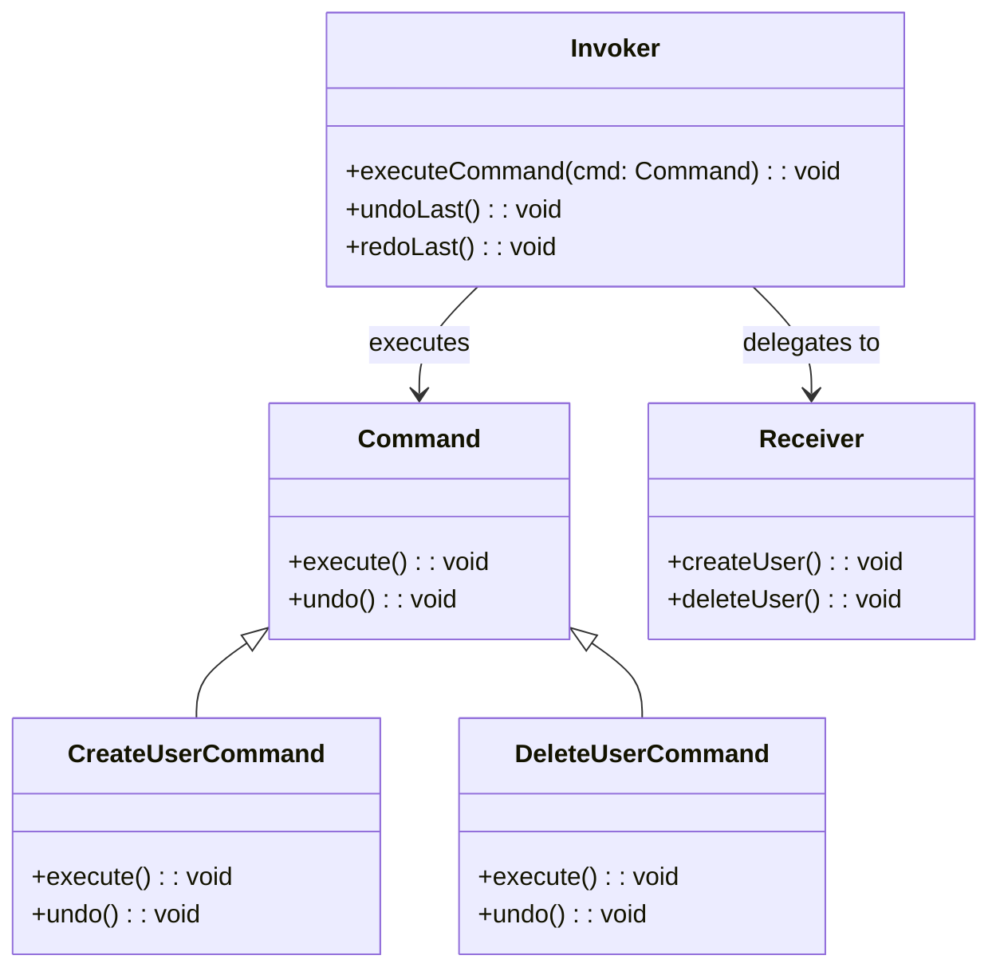

# ⚡ Command Pattern: Request Queuing and Undo/Redo Operations

## 1. 🚨 The Real Production Problem
In web applications and workflow systems, operations often need to be queued, logged, undone, or retried. Without Command Pattern:

- **Imperative Calls:** Business logic directly calls database operations, API calls, etc.
- **No Undo/Redo:** Cannot reverse operations; critical for transactional workflows
- **Difficult Auditing:** Cannot track what operations were performed and when
- **Request Replay Issues:** Cannot replay failed operations without duplicating side effects
- **Tight Coupling:** Caller must know exact implementation details of the operation

## 2. 💡 How Command Solves It
The **Command Pattern** turns requests into stand-alone objects. It allows you to parameterize methods with different requests, queue or log operations, and support undo/redo.

### Core Benefits:
* **Parameterize Objects with Operations:** Pass commands as arguments, return them, store them
* **Undo/Redo Support:** Each command knows how to reverse its effects
* **Queuing:** Store commands in queues for later execution
* **Logging:** Record all operations for audit trails
* **Decoupling:** Sender doesn't need to know receiver or how to execute the operation

## 3. 📊 Visual Diagram (Flow & Structure)

### Class Diagram


### Execution Flow
```mermaid
sequenceDiagram
    autonumber
    actor User as UI
    participant Invoker as CommandInvoker
    participant Cmd as CreateUserCommand
    participant Receiver as UserService
    actor DB as Database

    User->>Invoker: execute createUser command
    Invoker->>Cmd: execute()
    Cmd->>Receiver: createUser("John")
    Receiver-->>Cmd: User created
    Cmd-->>Invoker: execution complete
    Invoker-->>User: command executed
    
    User->>Invoker: undo last command
    Invoker->>Cmd: undo()
    Cmd->>Receiver: deleteUser("John")  ^^^ undo is opposite operation
    Receiver-->>Cmd: user deleted
    Cmd-->>Invoker: undo complete
    Invoker-->>User: undo performed
</mermermaid>
```

## 4. 💻 Code Implementation

### Step 1: Define Command Interface
```typescript
export interface Command {
  execute(): void;
  undo(): void;
}
```

### Step 2: Create Receiver (Business Logic)
```typescript
export class UserService {
  private users: string[] = [];

  public createUser(name: string): void {
    this.users.push(name);
    console.log(`[UserService] Created user: ${name}`);
  }

  public deleteUser(name: string): void {
    const index = this.users.indexOf(name);
    if (index > -1) {
      this.users.splice(index, 1);
    }
    console.log(`[UserService] Deleted user: ${name}`);
  }

  public getUsers(): string[] {
    return this.users;
  }
}
```

### Step 3: Implement Concrete Commands

#### CreateUserCommand
```typescript
export class CreateUserCommand implements Command {
  private userService: UserService;
  private name: string;
  private previousState: string[];

  constructor(userService: UserService, name: string) {
    this.userService = userService;
    this.name = name;
  }

  public execute(): void {
    // Capture state before execution (for undo)
    this.previousState = [...this.userService.getUsers()];
    
    this.userService.createUser(this.name);
    console.log(`[CreateUserCommand] Executed: ${this.name}`);
  }

  public undo(): void {
    // Restore previous state
    this.userService.users = [...this.previousState];
    console.log(`[CreateUserCommand] Undone: ${this.name} removed, state restored to: ${this.previousState.join(', ')}`);
  }
}
```

#### DeleteUserCommand
```typescript
export class DeleteUserCommand implements Command {
  private userService: UserService;
  private name: string;
  private deletedUser: string | null;

  constructor(userService: UserService, name: string) {
    this.userService = userService;
    this.name = name;
  }

  public execute(): void {
    this.deletedUser = this.userService.users.find(u => u === this.name) || null;
    this.userService.deleteUser(this.name);
    console.log(`[DeleteUserCommand] Executed: deleted ${this.name}`);
  }

  public undo(): void {
    // Restore the deleted user
    if (this.deletedUser) {
      this.userService.users.push(this.deletedUser);
      console.log(`[DeleteUserCommand] Undone: restored ${this.deletedUser}`);
    }
  }
}
```

### Step 4: Create Invoker
```typescript
export class CommandInvoker {
  private history: Command[] = [];
  private redoStack: Command[] = [];
  private maxHistory: number = 100;

  public executeCommand(cmd: Command): void {
    cmd.execute();
    this.history.push(cmd);
    
    // Trim history if exceeds max
    if (this.history.length > this.maxHistory) {
      this.history.shift();
    }
    
    // Clear redo stack when new command executed
    this.redoStack = [];
  }

  public undoLast(): void {
    const lastCmd = this.history.pop();
    if (lastCmd) {
      lastCmd.undo();
      this.redoStack.push(lastCmd);
    }
  }

  public redoLast(): void {
    const lastRedo = this.redoStack.pop();
    if (lastRedo) {
      lastRedo.execute();
      this.history.push(lastRedo);
    }
  }

  public getHistory(): Command[] {
    return [...this.history];
  }

  public getRedoStack(): Command[] {
    return [...this.redoStack];
  }
}
```

### Usage
```typescript
// Setup
const userService = new UserService();
const invoker = new CommandInvoker();

// Execute create command
const createCmd = new CreateUserCommand(userService, "Alice");
invoker.executeCommand(createCmd);

// Execute another create command
const createCmd2 = new CreateUserCommand(userService, "Bob");
invoker.executeCommand(createCmd2);

// Check state
console.log(`Users after 2 creates: ${invoker.getHistory().length} commands executed`);

// Undo last command
invoker.undoLast();
console.log(`Users after 1 undo: ${userService.getUsers().join(', ')}`);

// Redo last undone command
invoker.redoLast();
console.log(`Users after 1 redo: ${userService.getUsers().join(', ')}`);
```

## 5. 🔧 Production Enhancements
- **Command Batching:** Execute multiple commands as one transaction
- **Timeout/Retries:** Add retry logic to command execute/undo
- **Persistence:** Save commands to database for crash recovery
- **Command History UI:** Visual history of operations with undo/redo buttons
- **Selective Undo:** Undo/redo specific command types, not just last-in-first-out