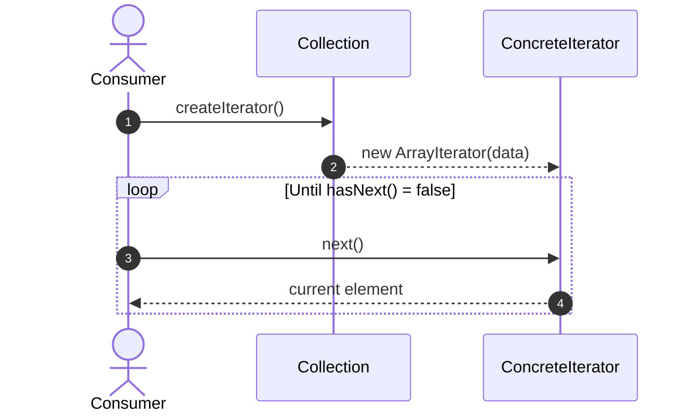

# 🧭 Iterator Pattern: Safe Collection Traversal

## 1. 🚨 The Real Production Problem
In applications dealing with complex data structures (databases, file systems, in-memory caches), iterating over collections safely while avoiding concurrent modification issues is critical. Without Iterator:

- **Manual Index Management:** Developers use `for (let i = 0; i < array.length; i++)` which breaks with concurrent modifications
- **Duplicated Iteration Logic:** Same `while`/`for` loops copied across multiple services
- **Concurrent Modification Errors:** `ConcurrentModificationException`-like bugs when iterating while modifying
- **Inconsistent Interfaces:** Different collection types have different iteration APIs
- **Inability to Traverse Complex Structures:** Trees, graphs, and custom containers require custom iteration code each time

## 2. 💡 How Iterator Solves It
The **Iterator Pattern** provides a way to access the elements of an aggregate object sequentially without exposing its underlying representation. It decouples the iteration logic from the collection's internal structure.

### Core Benefits:
* **Uniform Interface:** Same `next()`/`hasNext()` API for all collection types
* **Safe Traversal:** Iterator handles bounds checking and modification detection
* **Multiple Simultaneous Iterations:** Can iterate over same collection multiple ways at once
* **Encapsulation:** Collection internals hidden behind iterator
* **Composability:** Can combine iterators, filter, map operations

## 3. 📊 Visual Diagram (Flow & Structure)

### Class Diagram
```mermaid
classDiagram
    class Iterator {
        +hasNext(): boolean
        +next(): any
    }

    class Aggregate {
        +createIterator(): Iterator
    }

    class ArrayIterator {
        +position: number
        +data: any[]
        +hasNext(): boolean
        +next(): any
    }

    class LinkedListIterator {
        +position: number
        +node: Node
        +hasNext(): boolean
        +next(): any
    }

    class PeekingIterator {
        +hasPeeked: boolean
        +peekedValue: any
        +hasNext(): boolean
        +next(): any
        +peek(): any
    }

    Aggregate <|-- ArrayCollection
    Aggregate <|-- LinkedList
    ArrayCollection --> ArrayIterator : creates
    LinkedList --> LinkedListIterator : creates

    Note for Iterator "Traversal logic encapsulated in iterator objects"
```

### Execution Flow


## 4. 💻 Code Implementation

### Step 1: Define Iterator Interface
```typescript
export interface Iterator {
  hasNext(): boolean;
  next(): any;
}
```

### Step 2: Define Aggregate Interface
```typescript
export interface Aggregate {
  createIterator(): Iterator;
}
```

### Step 3: Implement Concrete Iterator for Array
```typescript
export class ArrayIterator implements Iterator {
  private position: number = 0;
  private data: any[];

  constructor(data: any[]) {
    this.data = data;
  }

  public hasNext(): boolean {
    return this.position < this.data.length;
  }

  public next(): any {
    if (this.hasNext()) {
      return this.data[this.position++];
    }
    return null;
  }

  // Additional helpful methods
  public peek(): any {
    if (this.hasNext()) {
      return this.data[this.position];
    }
    return null;
  }

  public reset(): void {
    this.position = 0;
  }

  public getPosition(): number {
    return this.position;
  }
}
```

### Step 4: Implement Concrete Aggregate for Array Collection
```typescript
export class ArrayCollection implements Aggregate {
  private data: any[];

  constructor(data: any[] = []) {
    this.data = data;
  }

  public createIterator(): Iterator {
    return new ArrayIterator([...this.data]); // Spread to avoid external modification
  }

  public add(element: any): void {
    this.data.push(element);
  }

  public remove(element: any): void {
    const index = this.data.indexOf(element);
    if (index > -1) {
      this.data.splice(index, 1);
    }
  }

  public getData(): any[] {
    return [...this.data]; // Return copy for encapsulation
  }

  public size(): number {
    return this.data.length;
  }
}
```

### Step 5: Additional Iterator Variations

#### Peeking Iterator (optional enhancement)
```typescript
export class PeekingIterator implements Iterator {
  private iterator: Iterator;
  private hasPeeked: boolean = false;
  private peekedValue: any;

  constructor(iterator: Iterator) {
    this.iterator = iterator;
  }

  public hasNext(): boolean {
    if (this.hasPeeked) {
      return true;
    }
    return this.iterator.hasNext();
  }

  public next(): any {
    if (this.hasPeeked) {
      const value = this.peekedValue;
      this.hasPeeked = false;
      return value;
    }
    return this.iterator.next();
  }

  public peek(): any {
    if (!this.hasPeeked && this.iterator.hasNext()) {
      this.peekedValue = this.iterator.next();
      this.hasPeeked = true;
    }
    return this.peekedValue;
  }

  public reset(): void {
    this.hasPeeked = false;
    this.iterator.reset();
  }
}
```

### Usage
```typescript
// Client code - uniform iteration across collection types
const collection = new ArrayCollection([1, 2, 3, 4, 5]);
const iterator = collection.createIterator();

console.log("Iterating through collection:");
while (iterator.hasNext()) {
  const value = iterator.next();
  console.log(`  Got: ${value}`);
}

// Reset and iterate again
iterator.reset();
console.log("Iterating again (reset):");
while (iterator.hasNext()) {
  console.log(`  Got: ${iterator.next()}`);
}

// Peeking iterator
const peekIter = new PeekingIterator(collection.createIterator());
console.log("Peeking at first element:", peekIter.peek());
console.log("Then normal iteration:");
while (peekIter.hasNext()) {
  console.log(`  Got: ${peekIter.next()}`);
}
```

## 5. 🔧 Production Enhancements
- **Filtering Iterator:** Iterator that only yields elements matching a predicate
- **Mapping Iterator:** Transforms each element as it's yielded
- **Limited Iterator:** Yields only first N elements
- **Reverse Iterator:** Traverses collection in reverse order
- **Concurrent Iterator:** Thread-safe iteration with snapshot semantics