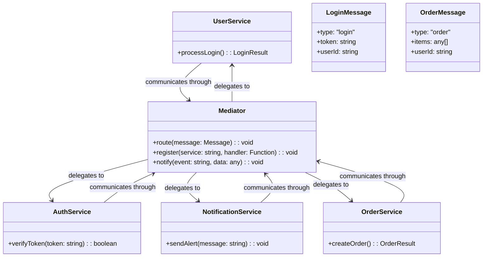
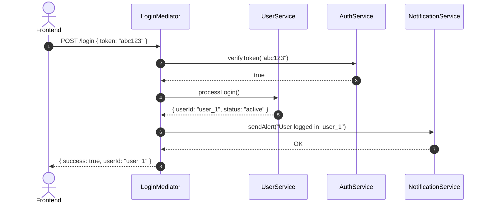

# 🏛️ Mediator Pattern: Decoupled Microservice Communication

## 1. 🚨 The Real Production Problem
In microservice architectures, services often need to communicate and coordinate without creating tight coupling. Without Mediator:

- **Direct Service Dependencies:** Service A must import and call Service B directly
- **Circular Import Issues:** Services referencing each other creates dependency cycles
- **Hard to Test:** Cannot mock individual services without affecting the whole chain
- **Rigged Change Management:** Adding Service C requires modifying Service A and B code
- **Message Routing Complexity:** Point-to-point messaging becomes unmanageable at scale

## 2. 💡 How Mediator Solves It
The **Mediator Pattern** defines an object that encapsulates how a set of objects interact. It promotes loose coupling by keeping objects from referring to each other explicitly, and it lets you vary their interaction independently.

### Core Benefits:
* **Zero Direct Dependencies:** Services communicate through mediator, not each other
* **Single Point of Control:** Centralized logic for request routing, transformations, error handling
* **Open/Closed:** Add new services/communication patterns without modifying existing ones
* **Testable:** Mock the mediator in unit tests; test services in isolation
* **Observable Patterns:** Can emit events for observability and analytics

## 3. 📊 Visual Diagram (Flow & Structure)

### Class Diagram


### Execution Flow


## 4. 💻 Code Implementation

### Step 1: Define Message Interface
```typescript
export interface Message {
  type: string;
  from: string;
  to?: string;
  payload: any;
  timestamp: string;
}
```

### Step 2: Define Mediator Interface
```typescript
export interface Mediator {
  register(serviceName: string, handler: (message: Message) => void): void;
  route(message: Message): void;
  notify(event: string, data: any): void;
}
```

### Step 3: Create Concrete Mediator
```typescript
export class LoginMediator implements Mediator {
  private handlers: Map<string, (message: Message) => void> = new Map();

  public register(serviceName: string, handler: (message: Message) => void): void {
    this.handlers.set(serviceName, handler);
    console.log(`[LoginMediator] Registered: ${serviceName}`);
  }

  public route(message: Message): void {
    const handler = this.handlers.get(message.type);
    if (handler) {
      handler(message);
    } else {
      console.log(`[LoginMediator] No handler for message type: ${message.type}`);
    }
  }

  public notify(event: string, data: any): void {
    // Broadcast event to all registered handlers
    this.handlers.forEach((handler, serviceName) => {
      try {
        handler({ type: event, payload: data, from: "mediator", timestamp: new Date().toISOString() });
      } catch (error) {
        console.error(`[LoginMediator] Error notifying ${serviceName}:`, error);
      }
    });
  }
}
```

### Step 4: Implement Concrete Handlers

#### Auth Service Handler
```typescript
export class AuthServiceHandler {
  private jwtSecret: string = process.env.JWT_SECRET || "default-secret";

  public handle(message: Message): void {
    if (message.type !== "login") {
      return;
    }

    const { token } = message.payload;
    if (!token) {
      console.log("[AuthService] Login message missing token");
      return;
    }

    // Simulate JWT verification
    const isValid = token === "valid-jwt-token-123";
    
    if (isValid) {
      const userId = `user_${Math.floor(Math.random() * 10000)}`;
      console.log(`[AuthService] Token verified for user: ${userId}`);
      
      // Notify other services about successful login
      message.payload.userId = userId;
      message.payload.loginSuccessful = true;
      
      // Can notify mediator to propagate further
    } else {
      console.log("[AuthService] Invalid token rejected");
    }
  }
}
```

#### User Service Handler
```typescript
export class UserServiceHandler {
  public handle(message: Message): void {
    if (message.type !== "login") {
      return;
    }

    const { userId, loginSuccessful } = message.payload;
    if (loginSuccessful && userId) {
      console.log(`[UserService] User ${userId} login processed, setting session`);
      // Initialize user session, create user record, etc.
    }
  }
}
```

#### Notification Service Handler
```typescript
export class NotificationServiceHandler {
  public handle(message: Message): void {
    if (message.type !== "login") {
      return;
    }

    const { userId, loginSuccessful } = message.payload;
    if (loginSuccessful && userId) {
      console.log(`[NotificationService] Sending login notification to user: ${userId}`);
      // Send welcome email, SMS, push notification
    }
  }
}
```

### Usage
```typescript
// Setup mediator and register services
const mediator = new LoginMediator();

// Register auth service
mediator.register("auth", new AuthServiceHandler().handle.bind(new AuthServiceHandler()));

// Register user service
mediator.register("user", new UserServiceHandler().handle.bind(new UserServiceHandler()));

// Register notification service
mediator.register("notification", new NotificationServiceHandler().handle.bind(new NotificationServiceHandler()));

// Client sends login request through mediator
const loginMessage: Message = {
  type: "login",
  from: "frontend",
  payload: { token: "valid-jwt-token-123" },
  timestamp: new Date().toISOString()
};

mediator.route(loginMessage);
```

## 5. 🔧 Production Enhancements
- **Priority Routing:** Some services get priority based on SLA
- **Circuit Breaker:** Wrap service calls with circuit breaker
- **Retry Logic:** Automatic retry on transient failures
- **Dead Letter Queue:** Messages that fail after max retries
- **Event Sourcing:** Persist all messages for audit and recovery
- **Rate Limiting:** Per-service rate limiting on message processing