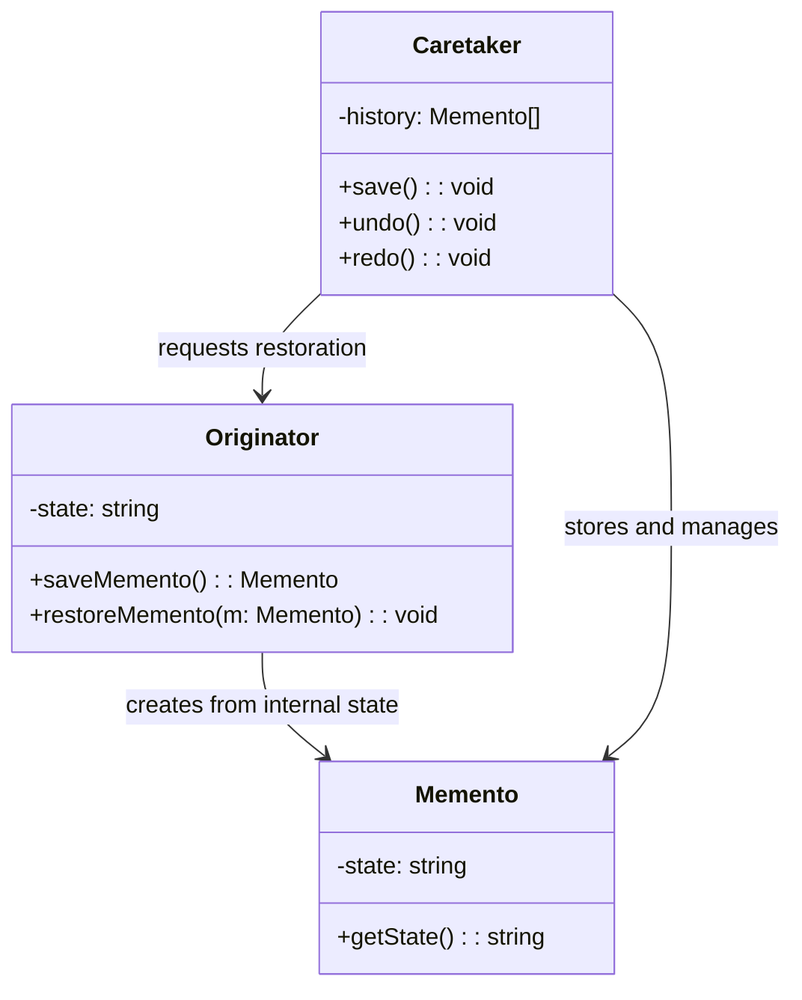
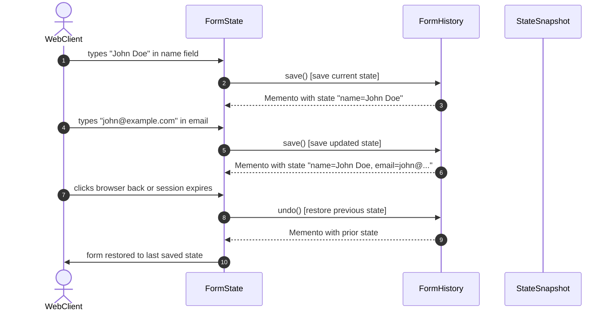

# 💾 Memento Pattern: Session State Recovery

## 1. 🚨 The Real Production Problem
In web applications, users frequently need to recover form data after session timeouts, browser crashes, or accidental navigation away. Without Memento:

- **Data Loss on Timeout:** Form data lost when session expires after 15-30 minutes of inactivity
- **No Undo/Redo for Forms:** Users cannot recover from changes they made moments ago
- **Browser Back Button Frustration:** Navigating back loses all previously entered data
- **POOR User Experience:** Must re-fill entire forms, leading to user abandonment
- **No Audit Trail:** Cannot track what changes were made and when

## 2. 💡 How Memento Solves It
The **Memento Pattern** without violating encapsulation captures and externalizes an object's internal state so that the object can be restored to this state later.

### Core Benefits:
* **Encapsulation Preserved:** Originator's internal state is not exposed to caretaker
* **Selective Snapshotting:** Can save entire state or specific fields
* **Undo/Redo Support:** Restore to any previous state in history
* **Session Recovery:** Recover form data after session expiration
* **Audit Capability:** Track state changes over time

## 3. 📊 Visual Diagram (Flow & Structure)

### Class Diagram


### Execution Flow


## 4. 💻 Code Implementation

### Step 1: Define Memento Class
```typescript
export class Memento {
  private state: string;

  constructor(state: string) {
    this.state = state;
  }

  public getState(): string {
    return this.state;
  }
}
```

### Step 2: Create Originator (Form State)
```typescript
export class FormState {
  private state: string = "";

  // Save current state and return memento
  public saveMemento(): Memento {
    const previousState = this.state;
    return new Memento(previousState);
  }

  // Restore from memento
  public restoreMemento(memento: Memento): void {
    this.state = memento.getState();
    console.log(`[FormState] Restored state: "${this.state}"`);
  }

  // Get current state (for demo)
  public getCurrentState(): string {
    return this.state;
  }

  // Simulate form input
  public setState(newState: string): void {
    this.state = newState;
  }
}
```

### Step 3: Create Caretaker (Form History)
```typescript
export class FormHistory {
  private history: Memento[] = [];
  private currentIndex: number = -1;
  private maxHistory: number = 50; // Prevent memory bloat

  public save(formState: FormState): void {
    // Discard any states after current index (for new branch)
    this.history = this.history.slice(0, this.currentIndex + 1);
    
    // Save current state
    const memento = formState.saveMemento();
    this.history.push(memento);
    this.currentIndex++;
    
    // Trim if exceeds max
    if (this.history.length > this.maxHistory) {
      this.history.shift();
      this.currentIndex--;
    }
    
    console.log(`[FormHistory] Saved state. History size: ${this.history.length}, index: ${this.currentIndex}`);
  }

  public undo(formState: FormState): boolean {
    if (this.currentIndex <= 0) {
      console.log("[FormHistory] Nothing to undo - at earliest state");
      return false;
    }
    
    this.currentIndex--;
    const memento = this.history[this.currentIndex];
    formState.restoreMemento(memento);
    console.log(`[FormHistory] Undo to state index: ${this.currentIndex}`);
    return true;
  }

  public redo(formState: FormState): boolean {
    if (this.currentIndex >= this.history.length - 1) {
      console.log("[FormHistory] Nothing to redo - at latest state");
      return false;
    }
    
    this.currentIndex++;
    const memento = this.history[this.currentIndex];
    formState.restoreMemento(memento);
    console.log(`[FormHistory] Redo to state index: ${this.currentIndex}`);
    return true;
  }

  public getHistorySize(): number {
    return this.history.length;
  }

  public canUndo(): boolean {
    return this.currentIndex > 0;
  }

  public canRedo(): boolean {
    return this.currentIndex < this.history.length - 1;
  }
}
```

### Usage
```typescript
// Client code - form with undo/redo support
const formState = new FormState();
const history = new FormHistory();

// User starts filling form
formState.setState(""); // Initial state
history.save(formState); // Save initial (empty) state

// User types name
formState.setState("John Doe");
history.save(formState); // Save after name entered

// User types email
formState.setState("john@example.com");
history.save(formState); // Save after email entered

// User types phone
formState.setState("555-123-4567");
history.save(formState); // Save after phone entered

// Now user clicks "undo" to go back one step
history.undo(formState);
console.log(`After undo: "${formState.getCurrentState()}"`); // "john@example.com"

// User clicks "redo" to go forward
history.redo(formState);
console.log(`After redo: "${formState.getCurrentState()}"`); // "555-123-4567"
```

## 5. 🔧 Production Enhancements
- **Comprehensive State:** Save not just string state but complex objects (JSON.stringify)
- **Expiration:** Auto-expire old history entries after TTL
- **Selective Mementos:** Only save specific fields, not entire state
- **Persistent Storage:** Save mementos to IndexedDB/localStorage for session recovery
- **Versioning:** Version mementos for long-term audit trails
- **Concurrent Access:** Thread-safe history management for multi-user environments

---

## 6. 🧪 How to Test

### Prerequisites
```bash
# Build and start the server
npm run build
npm start
# Server runs on http://localhost:3000
```

### Test 1: Save Form State (Initial)
```bash
curl -X POST http://localhost:3000/api/memento/form \
  -H "Content-Type: application/json" \
  -d '{
    "action": "save",
    "formData": "name=John Doe"
  }'
```

**Expected Result:** Returns `200 OK` with:
```json
{
  "message": "Form state saved",
  "historySize": 1,
  "currentIndex": 0,
  "canUndo": false,
  "canRedo": false
}
```

### Test 2: Save Additional Form State
```bash
curl -X POST http://localhost:3000/api/memento/form \
  -H "Content-Type: application/json" \
  -d '{
    "action": "save",
    "formData": "name=John Doe, email=john@example.com"
  }'
```

### Test 3: Save Another Form State
```bash
curl -X POST http://localhost:3000/api/memento/form \
  -H "Content-Type: application/json" \
  -d '{
    "action": "save",
    "formData": "name=John Doe, email=john@example.com, phone=555-123-4567"
  }'
```

### Test 4: Undo Last Change
```bash
curl -X POST http://localhost:3000/api/memento/undo \
  -H "Content-Type: application/json"
```

**Expected Result:** Returns `200 OK` with restored state showing previous form data.

### Test 5: Redo Undone Change
```bash
curl -X POST http://localhost:3000/api/memento/redo \
  -H "Content-Type: application/json"
```

**Expected Result:** Returns `200 OK` with restored state showing the phone number again.

### Test 6: Check History Size
```bash
# The history size should reflect the number of saved states
```

### Test 7: Invalid Action
```bash
curl -X POST http://localhost:3000/api/memento/form \
  -H "Content-Type: application/json" \
  -d '{
    "action": "invalid",
    "formData": "test"
  }'
```

**Expected Result:** Returns `400 Bad Request` with error about invalid action.