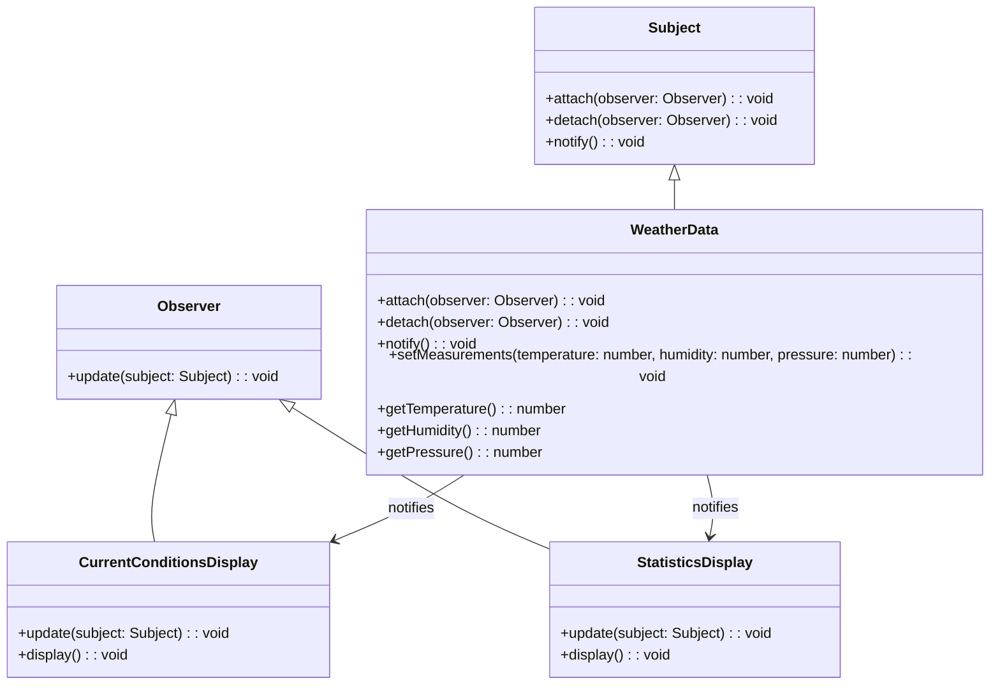
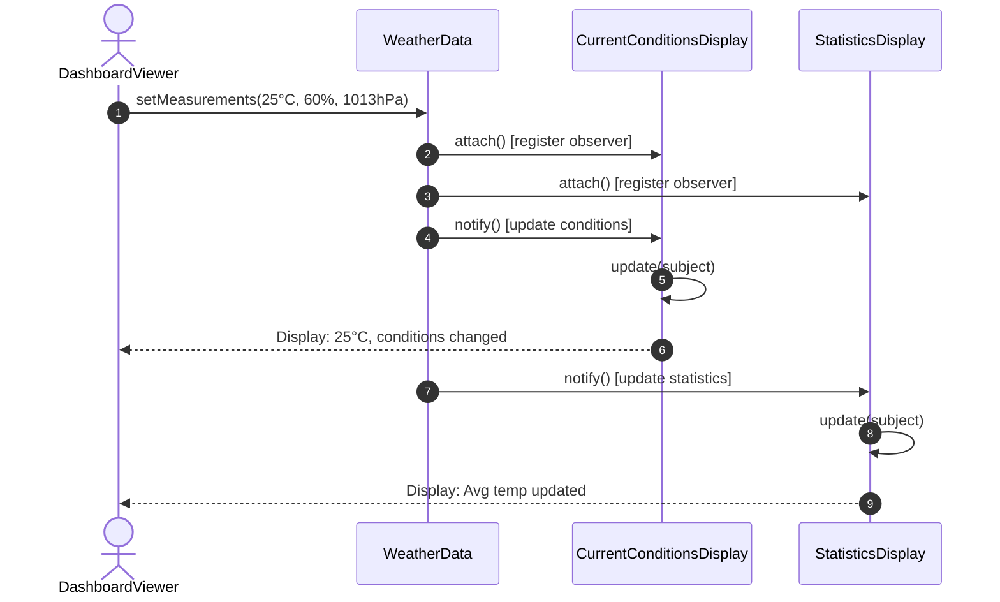

# 👁️ Observer Pattern: Real-time Notification System

## 1. 🚨 The Real Production Problem
In web applications and dashboard systems, components often need to react to state changes from a central data source. Without Observer:

- **Tight Coupling:** UI components directly call data source methods and must check for updates manually
- **Missed Updates:** Components poll for changes at fixed intervals, wasting resources or missing real-time updates
- **Hard to Scale:** Adding new observers requires modifying the data source code
- **Circular Dependencies:** Components depend on each other directly, creating complex dependency graphs
- **Poor Testability:** Cannot easily test components in isolation without the data source

## 2. 💡 How Observer Solves It
The **Observer Pattern** defines a one-to-many dependency between objects so that when one object (subject) changes state, all its dependers (observers) are notified and updated automatically.

### Core Benefits:
* **Loose Coupling:** Subject and observers don't depend on concrete implementations, only on interfaces
* **Automatic Notification:** Observers are notified immediately when subject state changes
* **Dynamic Subscription:** Observers can subscribe and unsubscribe at runtime
* **Open/Closed:** Add new observer types without modifying the subject
* **Scalability:** Handle any number of observers without changing the subject's core logic

## 3. 📊 Visual Diagram (Flow & Structure)

### Class Diagram


### Execution Flow


## 4. 💻 Code Implementation

### Step 1: Define Observer Interface
```typescript
export interface Observer {
  update(subject: Subject): void;
}
```

### Step 2: Define Subject Interface
```typescript
export interface Subject {
  attach(observer: Observer): void;
  detach(observer: Observer): void;
  notify(): void;
}
```

### Step 3: Create Concrete Subject
```typescript
export class WeatherData implements Subject {
  private observers: Observer[] = [];
  private temperature: number = 0;
  private humidity: number = 0;
  private pressure: number = 1013;

  public attach(observer: Observer): void {
    this.observers.push(observer);
    console.log(`[WeatherData] Attached observer: ${observer.constructor.name}`);
  }

  public detach(observer: Observer): void {
    this.observers = this.observers.filter(obs => obs !== observer);
    console.log(`[WeatherData] Detached observer: ${observer.constructor.name}`);
  }

  public notify(): void {
    this.observers.forEach(observer => {
      observer.update(this);
    });
  }

  public setMeasurements(temperature: number, humidity: number, pressure: number): void {
    this.temperature = temperature;
    this.humidity = humidity;
    this.pressure = pressure;
    console.log(`[WeatherData] Measurements updated: ${temperature}°C, ${humidity}%, ${pressure} hPa`);
    this.notify();
  }

  public getTemperature(): number {
    return this.temperature;
  }

  public getHumidity(): number {
    return this.humidity;
  }

  public getPressure(): number {
    return this.pressure;
  }
}
```

### Step 4: Create Concrete Observers

#### Current Conditions Display
```typescript
export class CurrentConditionsDisplay implements Observer {
  private temperature: number = 0;
  private humidity: number = 0;

  public update(subject: Subject): void {
    const weatherData = subject as WeatherData;
    this.temperature = weatherData.getTemperature();
    this.humidity = weatherData.getHumidity();
    this.display();
  }

  public display(): void {
    console.log(`Current conditions: ${this.temperature}°C, ${this.humidity}% humidity`);
  }
}
```

#### Statistics Display
```typescript
export class StatisticsDisplay implements Observer {
  private maxTemperature: number = -100;
  private minTemperature: number = 100;
  private temperatureSum = 0;
  private temperatureCount = 0;
  private humiditySum = 0;
  private humidityCount = 0;

  public update(subject: Subject): void {
    const weatherData = subject as WeatherData;
    const temp = weatherData.getTemperature();
    const humidity = weatherData.getHumidity();

    if (temp > this.maxTemperature) {
      this.maxTemperature = temp;
    }
    if (temp < this.minTemperature) {
      this.minTemperature = temp;
    }

    this.temperatureSum += temp;
    this.temperatureCount++;
    this.humiditySum += humidity;
    this.humidityCount++;

    this.display();
  }

  public display(): void {
    const avgTemp = this.temperatureCount > 0 ? this.temperatureSum / this.temperatureCount : 0;
    console.log(`Statistics: avg/max/min temp = ${avgTemp.toFixed(1)}/${this.maxTemperature.toFixed(1)}/${this.minTemperature.toFixed(1)}°C, avg humidity = ${(this.humiditySum / this.humidityCount).toFixed(1)}%`);
  }
}
```

### Step 5: Usage
```typescript
// Client code - set up observer pattern
const weatherData = new WeatherData();
const currentDisplay = new CurrentConditionsDisplay();
const statsDisplay = new StatisticsDisplay();

weatherData.attach(currentDisplay);
weatherData.attach(statsDisplay);

// Measurements change - all observers are automatically notified
weatherData.setMeasurements(25, 60, 1013);
weatherData.setMeasurements(28, 55, 1012);
```

---

## 5. 🧪 How to Test

### Prerequisites
```bash
# Build and start the server
npm run build
npm start
# Server runs on http://localhost:3000
```

### Test 1: Subscribe Observer (Current Conditions Display)
```bash
curl -X POST http://localhost:3000/api/observer/measurements \
  -H "Content-Type: application/json" \
  -d '{
    "action": "subscribe",
    "observerType": "current-conditions"
  }'
```

**Expected Result:** Returns `200 OK` with observer registered confirmation.

### Test 2: Set Measurements (Notifies All Observers)
```bash
curl -X POST http://localhost:3000/api/observer/measurements \
  -H "Content-Type: application/json" \
  -d '{
    "action": "set-measurements",
    "temperature": 25,
    "humidity": 60,
    "pressure": 1013
  }'
```

**Expected Result:** Returns `200 OK` and triggers updates in all subscribed observers. Check server console for log output showing both observers updated.

### Test 3: Subscribe Second Observer (Statistics Display)
```bash
curl -X POST http://localhost:3000/api/observer/measurements \
  -H "Content-Type: application/json" \
  -d '{
    "action": "subscribe",
    "observerType": "statistics"
  }'
```

### Test 4: Set Measurements (Notifies Both Observers)
```bash
curl -X POST http://localhost:3000/api/observer/measurements \
  -H "Content-Type: application/json" \
  -d '{
    "action": "set-measurements",
    "temperature": 28,
    "humidity": 55,
    "pressure": 1012
  }'
```

**Expected Result:** Both observers receive updates. Server console should show:
- `[CurrentConditionsDisplay] update()` called with 28°C, 55% humidity
- `[StatisticsDisplay] update()` called, new statistics calculated

### Test 5: Unsubscribe Observer
```bash
curl -X POST http://localhost:3000/api/observer/measurements \
  -H "Content-Type: application/json" \
  -d '{
    "action": "unsubscribe",
    "observerType": "current-conditions"
  }'
```

### Test 6: Set Measurements (Only Statistics Receives Update)
```bash
# After unsubscribing current-conditions, only statistics should be notified
curl -X POST http://localhost:3000/api/observer/measurements \
  -H "Content-Type: application/json" \
  -d '{
    "action": "set-measurements",
    "temperature": 30,
    "humidity": 50,
    "pressure": 1011
  }'
```

**Expected Result:** Server console shows only `[StatisticsDisplay] update()` called, not `[CurrentConditionsDisplay]`.

### Test 7: Check Server Console Logs
```bash
# Observe the complete flow:
# 1. Observers subscribe to WeatherData
# 2. setMeasurements() calls notify() 
# 3. All registered observers' update() method is called
# 4. Observers call display() to render their specific view
```