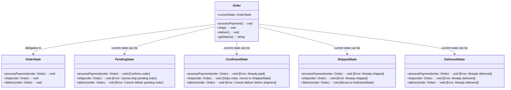
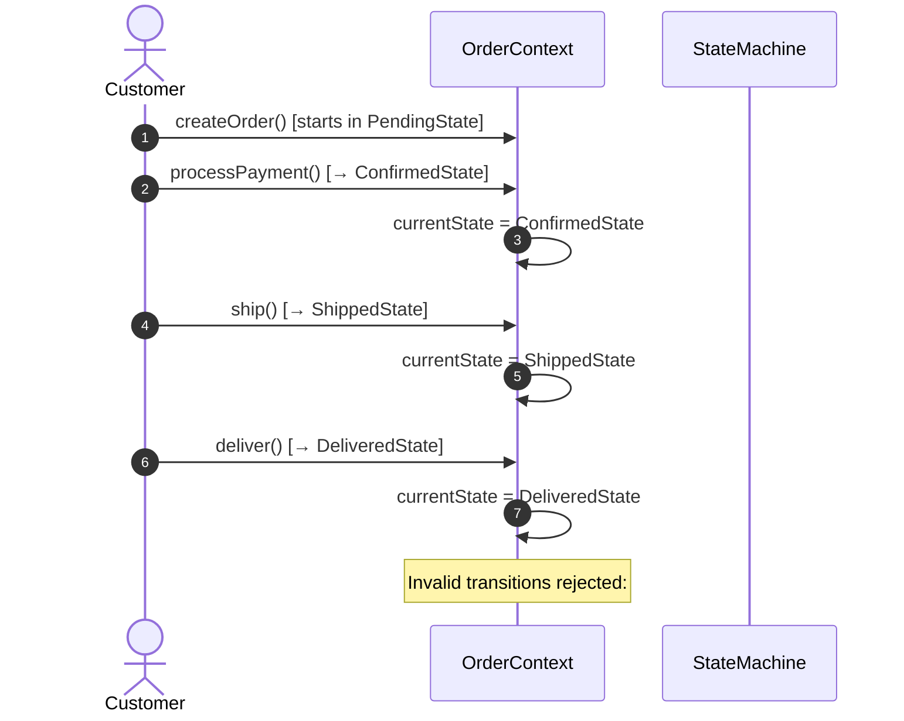

# 🎮 State Pattern: Dynamic Order Workflow Engine

## 1. 🚨 The Real Production Problem
In e-commerce and workflow systems, objects often change their behavior based on their internal state (e.g., an order being Pending → Confirmed → Shipped → Delivered). Without State:

- **Massive if/else Switch Statements:** Every method checks the current state and branches accordingly
- **State Transition Logic Scattered:** Valid transitions duplicated across multiple classes/methods
- **Invalid State Combinations:** System allows transitions like "Delivered → Pending" which make no business sense
- **Hard to Extend:** Adding a new state requires modifying all existing state-checking code
- **Bugs from Mishandled Transitions:** Order can be shipped without payment, or delivered before shipping

## 2. 💡 How State Solves It
The **State Pattern** allows an object to alter its behavior when its internal state changes. The object appears to change its class. Each concrete state class encapsulates behavior associated with that state and valid transitions to other states.

### Core Benefits:
* **Encapsulated State Behavior:** Each state class contains its own logic and valid transitions
* **Valid Transitions Only:** State pattern enforces which transitions are allowed
* **Open/Closed:** Add new states without modifying existing state classes
* **Clear State Machine:** Visual representation of allowed transitions
* **Reduced Bugs:** Invalid transitions simply can't happen (or throw clear errors)

## 3. 📊 Visual Diagram (Flow & Structure)

### Class Diagram


### Execution Flow


## 4. 💻 Code Implementation

### Step 1: Define OrderState Interface
```typescript
export interface OrderState {
  processPayment(order: Order): void;
  ship(order: Order): void;
  deliver(order: Order): void;
}
```

### Step 2: Create Concrete State - Pending
```typescript
export class PendingState implements OrderState {
  processPayment(order: Order): void {
    console.log("[PendingState] Processing payment...");
    order.setState(new ConfirmedState());
    console.log("[PendingState] Payment confirmed - order is now Confirmed");
  }

  ship(order: Order): void {
    console.log("[PendingState] Error: Cannot ship order - payment not processed");
    throw new Error("Cannot ship order - payment not processed. Please process payment first.");
  }

  deliver(order: Order): void {
    console.log("[PendingState] Error: Cannot deliver order - payment not processed");
    throw new Error("Cannot deliver order - payment not processed. Please process payment first.");
  }
}
```

### Step 3: Create Concrete State - Confirmed
```typescript
export class ConfirmedState implements OrderState {
  processPayment(order: Order): void {
    console.log("[ConfirmedState] Error: Payment already processed");
    throw new Error("Payment already processed. Order is already confirmed.");
  }

  ship(order: Order): void {
    console.log("[ConfirmedState] Shipping order...");
    order.setState(new ShippedState());
    console.log("[ConfirmedState] Order shipped - moving to ShippedState");
  }

  deliver(order: Order): void {
    console.log("[ConfirmedState] Error: Cannot deliver - order not yet shipped");
    throw new Error("Cannot deliver order - order has not been shipped yet.");
  }
}
```

### Step 4: Create Concrete State - Shipped
```typescript
export class ShippedState implements OrderState {
  processPayment(order: Order): void {
    console.log("[ShippedState] Error: Payment already processed - order shipped");
    throw new Error("Payment already processed. Order is already shipped.");
  }

  ship(order: Order): void {
    console.log("[ShippedState] Error: Order already shipped");
    throw new Error("Order already shipped.");
  }

  deliver(order: Order): void {
    console.log("[ShippedState] Delivering order...");
    order.setState(new DeliveredState());
    console.log("[ShippedState] Order delivered - moving to DeliveredState");
  }
}
```

### Step 5: Create Concrete State - Delivered
```typescript
export class DeliveredState implements OrderState {
  processPayment(order: Order): void {
    console.log("[DeliveredState] Error: Payment already processed - order delivered");
    throw new Error("Payment already processed. Order is already delivered.");
  }

  ship(order: Order): void {
    console.log("[DeliveredState] Error: Order already delivered");
    throw new Error("Order already delivered.");
  }

  deliver(order: Order): void {
    console.log("[DeliveredState] Error: Order already delivered");
    throw new Error("Order already delivered.");
  }
}
```

### Step 6: Create Order Context
```typescript
export class Order {
  private currentState: OrderState = new PendingState();

  constructor() {
    console.log("[Order] Order created - initial state: Pending");
  }

  public getStatus(): string {
    return this.currentState.constructor.name;
  }

  public setState(state: OrderState): void {
    const oldState = this.currentState.constructor.name;
    this.currentState = state;
    console.log(`[Order] State changed: ${oldState} → ${state.constructor.name}`);
  }

  public processPayment(): void {
    this.currentState.processPayment(this);
  }

  public ship(): void {
    this.currentState.ship(this);
  }

  public deliver(): void {
    this.currentState.deliver(this);
  }
}
```

### Step 7: Usage
```typescript
// Client code - order workflow
const order = new Order();

// Order starts in Pending state
console.log(`Initial state: ${order.getStatus()}`);

// User processes payment - transitions to Confirmed
order.processPayment();
console.log(`After payment: ${order.getStatus()}`);

// User ships the order - transitions to Shipped
order.ship();
console.log(`After ship: ${order.getStatus()}`);

// User delivers the order - transitions to Delivered
order.deliver();
console.log(`After deliver: ${order.getStatus()}`);

// Attempt invalid transition - should throw error
try {
  order.deliver();
} catch (e) {
  console.log(`Error (expected): ${e.message}`);
}
```

---

## 5. 🧪 How to Test

### Prerequisites
```bash
# Build and start the server
npm run build
npm start
# Server runs on http://localhost:3000
```

### Test 1: Create Order and Process Payment
```bash
curl -X POST http://localhost:3000/api/state/create-order
```

**Expected Result:** Returns order created with initial status: `Pending`

### Test 2: Process Payment (Transitions to Confirmed)
```bash
curl -X POST http://localhost:3000/api/state/process-payment
```

**Expected Result:** Returns `200 OK` with status changed to `ConfirmedState`.

### Test 3: Ship Order (Transitions to Shipped)
```bash
curl -X POST http://localhost:3000/api/state/ship-order
```

**Expected Result:** Returns `200 OK` with status changed to `ShippedState`.

### Test 4: Deliver Order (Transitions to Delivered)
```bash
curl -X POST http://localhost:3000/api/state/deliver-order
```

**Expected Result:** Returns `200 OK` with status changed to `DeliveredState`.

### Test 5: Attempt Invalid Transition (Deliver Already-Delivered Order)
```bash
curl -X POST http://localhost:3000/api/state/deliver-order
```

**Expected Result:** Returns `400 Bad Request` with error: `"Cannot deliver order - order already delivered."`

### Test 6: Attempt Invalid Transition (Ship Already-Shipped Order)
```bash
# First reset by creating new order
curl -X POST http://localhost:3000/api/state/create-order
# Then try to ship again
curl -X POST http://localhost:3000/api/state/ship-order
```

**Expected Result:** Returns `400 Bad Request` with error: `"Order already shipped."`

### Test 7: Attempt Invalid Transition (Process Payment Already-Confirmed)
```bash
# Create order, pay, ship, then try to pay again
curl -X POST http://localhost:3000/api/state/create-order
curl -X POST http://localhost:3000/api/state/process-payment
curl -X POST http://localhost:3000/api/state/process-payment
```

**Expected Result:** Returns `400 Bad Request` with error: `"Payment already processed."`

### Test 8: Check Order Status
```bash
# The API should track the current state and respond accordingly
```