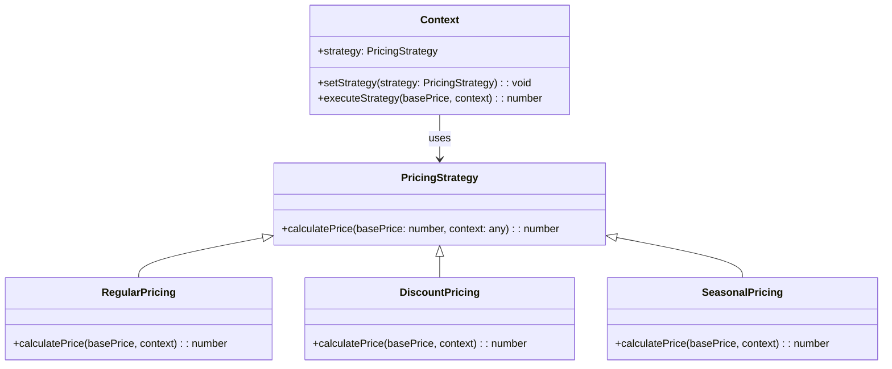
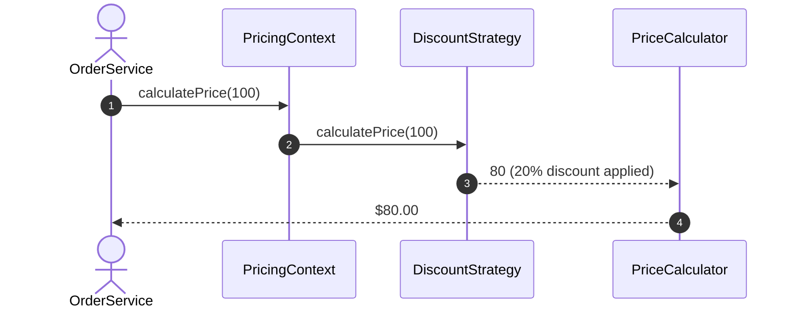

# 🎯 Strategy Pattern: Dynamic Pricing Engine

## 1. 🚨 The Real Production Problem
In e-commerce and SaaS platforms, pricing strategies frequently change based on seasons, user segments, promotions, or market conditions. Without Strategy:

- **Rigid if/else Pricing Logic:** Every price calculation requires checking conditions with nested if/else blocks
- **Difficult to Add New Strategies:** Adding "Black Friday" or "Student Discount" requires modifying core pricing code
- **Violates Open/Closed Principle:** Must modify existing price calculation code for new strategies
- **Testing Nightmares:** Need to test all condition combinations; easy to introduce regressions
- **Tight Coupling:** Business logic directly depends on specific pricing implementation

## 2. 💡 How Strategy Solves It
The **Strategy Pattern** defines a family of algorithms, encapsulates each one, and makes them interchangeable. Strategy lets the algorithm vary independently from clients that use it.

### Core Benefits:
* **Interchangeable Algorithms:** Swap pricing strategies at runtime without changing client code
* **Open/Closed Friendly:** Add new pricing strategies without modifying existing code
* **Single Responsibility:** Each strategy class has one reason to change (its pricing algorithm)
* **Testable:** Each strategy can be unit tested in isolation
* **Runtime Flexibility:** Switch strategies based on config, user tier, or conditions

## 3. 📊 Visual Diagram (Flow & Structure)

### Class Diagram


### Execution Flow


## 4. 💻 Code Implementation

### Step 1: Define Strategy Interface
```typescript
export interface PricingStrategy {
  calculatePrice(basePrice: number, context?: any): number;
}
```

### Step 2: Implement Concrete Strategies

#### Regular Pricing (No Discount)
```typescript
export class RegularPricing implements PricingStrategy {
  public calculatePrice(basePrice: number, context?: any): number {
    return basePrice;
  }
}
```

#### Percentage Discount Pricing
```typescript
export class PercentageDiscountPricing implements PricingStrategy {
  private discountPercentage: number;

  constructor(discountPercentage: number) {
    if (discountPercentage < 0 || discountPercentage > 100) {
      throw new Error("Discount percentage must be between 0 and 100");
    }
    this.discountPercentage = discountPercentage;
  }

  public calculatePrice(basePrice: number, context?: any): number {
    const discount = basePrice * (this.discountPercentage / 100);
    const finalPrice = basePrice - discount;
    console.log(`[PercentageDiscountPricing] ${this.discountPercentage}% off ${basePrice} = ${finalPrice}`);
    return Math.max(finalPrice, 0); // Ensure price doesn't go negative
  }
}
```

#### Fixed Amount Discount Pricing
```typescript
export class FixedAmountDiscountPricing implements PricingStrategy {
  private discountAmount: number;

  constructor(discountAmount: number) {
    if (discountAmount < 0) {
      throw new Error("Discount amount cannot be negative");
    }
    this.discountAmount = discountAmount;
  }

  public calculatePrice(basePrice: number, context?: any): number {
    const finalPrice = basePrice - this.discountAmount;
    console.log(`[FixedAmountDiscountPricing] ${this.discountAmount} off ${basePrice} = ${finalPrice}`);
    return Math.max(finalPrice, 0); // Ensure price doesn't go negative
  }
}
```

#### Tiered Pricing (Bulk Discounts)
```typescript
export class TieredPricing implements PricingStrategy {
  private tiers: Array<{ minQuantity: number; discountPercentage: number }>;

  constructor(tiers: Array<{ minQuantity: number; discountPercentage: number }>) {
    this.tiers = tiers.sort((a, b) => a.minQuantity - b.minQuantity);
  }

  public calculatePrice(basePrice: number, context?: any): number {
    if (!context || !context.quantity) {
      return basePrice; // No quantity info, return base price
    }

    const { quantity } = context;
    
    // Find the applicable tier
    for (const tier of this.tiers) {
      if (quantity >= tier.minQuantity) {
        const discount = basePrice * (tier.discountPercentage / 100);
        const finalPrice = basePrice - discount;
        console.log(`[TieredPricing] Quantity ${quantity} qualifies for ${tier.discountPercentage}% discount: ${basePrice} -> ${finalPrice}`);
        return Math.max(finalPrice, 0);
      }
    }
    
    // No tier applies, return base price
    return basePrice;
  }
}
```

### Step 3: Create Pricing Context
```typescript
export class PricingContext {
  private strategy: PricingStrategy;

  constructor(strategy: PricingStrategy) {
    this.strategy = strategy;
  }

  public setStrategy(strategy: PricingStrategy): void {
    this.strategy = strategy;
    console.log(`[PricingContext] Strategy switched to: ${strategy.constructor.name}`);
  }

  public executeStrategy(basePrice: number, context?: any): number {
    return this.strategy.calculatePrice(basePrice, context);
  }
}
```

### Usage
```typescript
// Client code - can switch strategies at runtime
const context = new PricingContext(new RegularPricing());

// Regular price
let price = context.executeStrategy(100);
console.log(`Regular: $${price}`); // $100

// Switch to 20% discount
context.setStrategy(new PercentageDiscountPricing(20));
price = context.executeStrategy(100);
console.log(`20% off: $${price}`); // $80

// Switch to $15 fixed discount
context.setStrategy(new FixedAmountDiscountPricing(15));
price = context.executeStrategy(100);
console.log("$15 off: $${price}"); // $85

// Switch to tiered pricing (buy 5+ get 10% off)
context.setStrategy(new TieredPricing([
  { minQuantity: 5, discountPercentage: 10 },
  { minQuantity: 10, discountPercentage: 15 }
]));
price = context.executeStrategy(100, { quantity: 7 });
console.log("7 items, 10% off: $${price}"); // $90

price = context.executeStrategy(100, { quantity: 12 });
console.log("12 items, 15% off: $${price}"); // $85
```

## 5. 🔧 Production Enhancements
- **Strategy Factory:** Create strategies based on config or user tier
- **Strategy Composition:** Combine multiple strategies (e.g., seasonal + tiered)
- **Priority Ordering:** When multiple strategies apply, determine priority order
- **Audit Logging:** Track which strategy was applied and when
- **Caching:** Cache price calculations for frequently requested combinations
- **Minimum/Maximum Price Enforcement:** Ensure prices stay within valid ranges