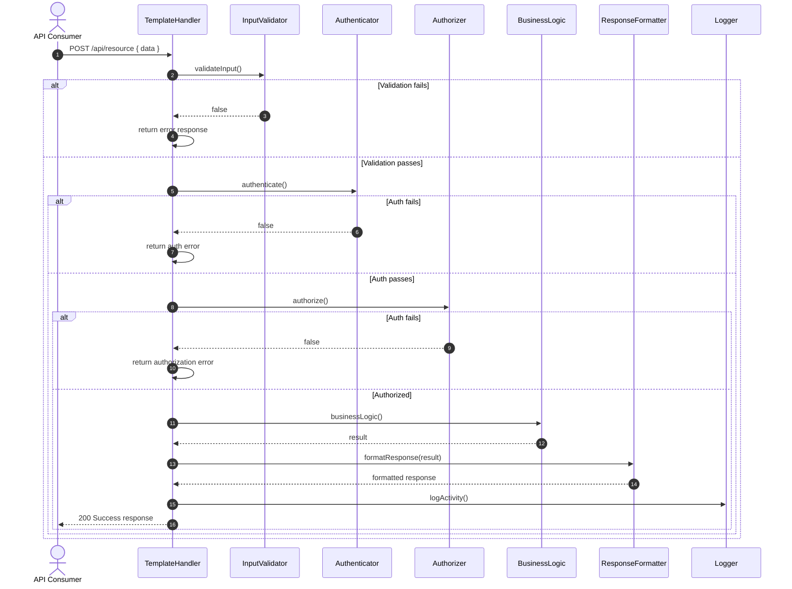

# 📜 Template Method: Standardized API Request Lifecycle

## 1. 🚨 The Real Production Problem
In Node.js/Express applications, API endpoints often follow the same lifecycle pattern: validate input → authenticate → authorize → process business logic → validate business rules → format response → log activity. Without Template Method:

- **Duplicate Lifecycle Code:** Every endpoint repeats the same validation, auth, and logging steps
- **Inconsistent Error Handling:** Different endpoints handle errors differently
- **Hard to Maintain:** Changing the lifecycle requires modifying every single endpoint
- **Violates DRY Principle:** Same code copied across 20+ route handlers
- **Difficult to Extend:** Adding a new lifecycle step requires changing all endpoints

## 2. 💡 How Template Method Solves It
The **Template Method Pattern** defines the skeleton of an algorithm in an operation, deferring some steps to subclasses. It lets subclasses redefine certain steps of an algorithm without changing the algorithm's structure.

### Core Benefits:
* **Single Source of Truth:** Lifecycle defined in one place (base class)
* **Hook Points:** Subclasses can override specific steps without rewriting entire flow
* **Consistent Structure:** All endpoints follow the same pattern
* **Open/Closed:** Add new lifecycle steps or modify existing ones without affecting other endpoints
* **Testable:** Test the template once; test hooks separately

## 3. 📊 Visual Diagram (Flow & Structure)

### Class Diagram
```mermaid
classDiagram
    class APIHandler {
        +handle(request: Request): Response
        +validateInput(request: Request): boolean
        +authenticate(request: Request): boolean
        +authorize(request: Request): boolean
        +businessLogic(request: Request): any
        +validateBusinessRules(result: any): boolean
        +formatResponse(result: any): any
        +logActivity(request: Request, result: any): void
    }

    class AuthenticatedHandler {
        +handle(request: Request): Response
        +validateInput(request: Request): boolean  ^^^ overrides
    }

    class AdminHandler {
        +handle(request: Request): Response
        +authorize(request: Request): boolean  ^^^ overrides
    }

    APIHandler <|-- AuthenticatedHandler
    APIHandler <|-- AdminHandler

    Note for APIHandler "Template method: executeLifecycle() calls all steps in order"
```

### Execution Flow


## 4. 💻 Code Implementation

### Step 1: Define Abstract Handler (Template)
```typescript
import { Request, Response } from "express";

export abstract class APIHandler {
  // Template Method - defines the skeleton
  public handle(request: Request, response: Response): void {
    try {
      this.executeLifecycle(request, response);
    } catch (error) {
      console.error("[APIHandler] Unexpected error in lifecycle:", error);
      response.status(500).json({
        error: "Internal server error",
        status: "error",
      });
    }
  }

  // Template method - calls steps in order
  private executeLifecycle(request: Request, response: Response): void {
    // Step 1: Validate input
    const inputValid = this.validateInput(request);
    if (!inputValid) {
      response.status(400).json({
        error: "Invalid input",
        status: "validation_error",
      });
      return;
    }

    // Step 2: Authenticate
    const authValid = this.authenticate(request);
    if (!authValid) {
      response.status(401).json({
        error: "Unauthorized",
        status: "auth_error",
      });
      return;
    }

    // Step 3: Authorize
    const authzValid = this.authorize(request);
    if (!authzValid) {
      response.status(403).json({
        error: "Forbidden",
        status: "authorization_error",
      });
      return;
    }

    // Step 4: Execute business logic
    const businessResult = this.businessLogic(request);
    
    // Step 5: Validate business rules
    const rulesValid = this.validateBusinessRules(businessResult);
    if (!rulesValid) {
      response.status(422).json({
        error: "Business rule violation",
        status: "business_rule_error",
        details: businessResult,
      });
      return;
    }

    // Step 6: Format response
    const formattedResponse = this.formatResponse(businessResult);
    
    // Step 7: Log activity
    this.logActivity(request, businessResult);
    
    // Step 8: Send success response
    response.status(200).json({
      ...formattedResponse,
      status: "success",
    });
  }

  // Hook methods - can be overridden by subclasses

  protected abstract validateInput(request: Request): boolean;

  protected abstract authenticate(request: Request): boolean;

  protected abstract authorize(request: Request): boolean;

  protected abstract businessLogic(request: Request): any;

  protected validateBusinessRules(result: any): boolean {
    // Default implementation - always passes
    return true;
  }

  protected formatResponse(result: any): any {
    // Default implementation - return result as-is
    return { data: result };
  }

  protected logActivity(request: Request, result: any): void {
    // Default implementation - log to console
    console.log(`[APIHandler] ${request.method} ${request.path} - success`);
  }
}
```

### Step 2: Create Concrete Handler - Authenticated

```typescript
export class AuthenticatedHandler extends APIHandler {
  protected validateInput(request: Request): boolean {
    const { name, email } = request.body;
    return !!(name && email && email.includes('@'));
  }

  protected authenticate(request: Request): boolean {
    const authHeader = request.headers?.authorization;
    return authHeader === 'Bearer valid-token';
  }

  protected authorize(request: Request): boolean {
    // Authenticated handlers are always authorized
    return true;
  }

  protected businessLogic(request: Request): any {
    const { name, email } = request.body;
    return { name, email, processedAt: new Date().toISOString() };
  }
}
```

### Step 3: Create Concrete Handler - Admin (overrides some hooks)

```typescript
export class AdminHandler extends APIHandler {
  protected validateInput(request: Request): boolean {
    // Admin requires additional validation
    const { name, email, department } = request.body;
    return !!(name && email && department);
  }

  protected authenticate(request: Request): boolean {
    // Admin has stricter auth
    const authHeader = request.headers?.authorization;
    return authHeader === 'Bearer admin-token';
  }

  protected authorize(request: Request): boolean {
    // Check for admin role
    return request.headers?.['x-admin-role'] === 'true';
  }

  protected businessLogic(request: Request): any {
    const { name, email, department } = request.body;
    return { name, email, department, role: "admin", processedAt: new Date().toISOString() };
  }

  // Override business rules validation
  protected validateBusinessRules(result: any): boolean {
    // Admin posts must have a department
    return !!result.department;
  }

  // Override response formatting
  protected formatResponse(result: any): any {
    return {
      title: "Admin Resource",
      ...result,
      metadata: { processedBy: "admin-system" }
    };
  }
}
```

### Usage
```typescript
// Client code - use handlers with consistent lifecycle
const authenticatedHandler = new AuthenticatedHandler();
const adminHandler = new AdminHandler();

// Both follow the same lifecycle but with different behavior
const req1 = {
  method: "POST",
  body: { name: "John", email: "john@example.com" },
  headers: { authorization: "Bearer valid-token" }
};

const req2 = {
  method: "POST",
  body: { name: "Admin", email: "admin@example.com", department: "Engineering" },
  headers: { authorization: "Bearer admin-token", "x-admin-role": "true" }
};

// Execute - template method handles the entire lifecycle
authenticatedHandler.handle(req1 as any, {
  status: (code: number) => ({ json: (body: any) => console.log("Response:", code, body) }),
  send: (body: any) => console.log("Sent:", body)
});

adminHandler.handle(req2 as any, {
  status: (code: number) => ({ json: (body: any) => console.log("Response:", code, body) }),
  send: (body: any) => console.log("Sent:", body)
});
```

## 5. 🔧 Production Enhancements
- **Error Handler Hook:** Add `handleError(error: Error)` method for custom error handling
- **Timeout Hooks:** Add timeout support per lifecycle step
- **Metrics Collection:** Track success/failure rates per lifecycle step
- **Circuit Breaker:** Wrap business logic with circuit breaker
- **Audit Logging:** Comprehensive audit trail of all lifecycle executions
- **Configuration-Driven:** Read which hooks to enable from config file