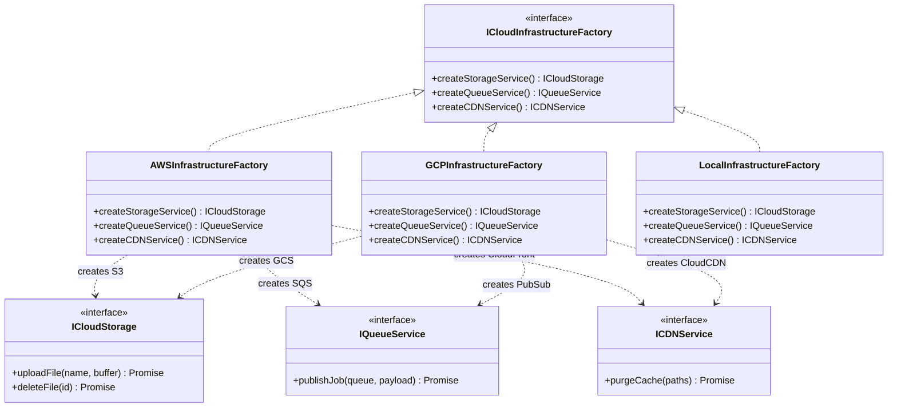
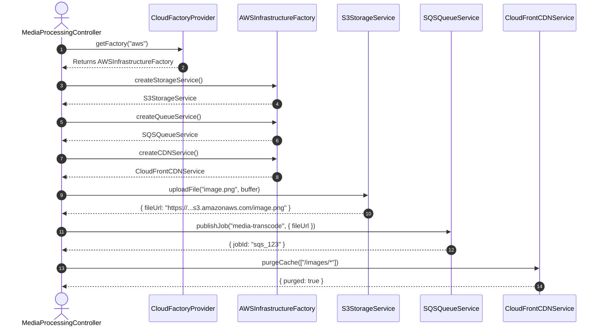

# 🏭 Abstract Factory Pattern: Multi-Cloud Infrastructure Suite

## 1. 🚨 The Real Production Problem
Modern enterprise systems and SaaS applications are frequently deployed across diverse cloud providers (AWS, Google Cloud Platform, Microsoft Azure) or require seamless fallback to an on-premise/local environment during development and automated CI testing.

### What happens without Abstract Factory?
1. **Cloud Vendor Lock-In & Scattered Instantiations:**
   Application services instantiate SDK-specific classes directly throughout the codebase:
   ```typescript
   // ❌ Anti-pattern: High coupling to AWS
   const s3 = new AWS.S3();
   const sqs = new AWS.SQS();
   const cloudfront = new AWS.CloudFront();
   ```
2. **Incompatible Cross-Provider Mix-ups:**
   Without an overarching family contract, code might accidentally attempt to push an AWS S3 upload completion event to a GCP Pub/Sub topic without proper credential bridges, leading to runtime failures.
3. **Impossibility of Local Unit / Integration Testing:**
   Developers cannot run or test services locally without active AWS or GCP credentials or running expensive live infrastructure.

---

## 2. 💡 How Abstract Factory Solves It
The **Abstract Factory Pattern** provides an interface for creating **families of related or dependent objects** (such as Cloud Storage, Messaging Queues, and CDN Invalidation) without specifying their concrete classes.

### Architectural Solution:
* Define product interfaces: `ICloudStorage`, `IQueueService`, `ICDNService`.
* Define the abstract factory: `ICloudInfrastructureFactory` with methods:
  * `createStorageService(): ICloudStorage`
  * `createQueueService(): IQueueService`
  * `createCDNService(): ICDNService`
* Implement concrete factories:
  * `AWSInfrastructureFactory` (S3 + SQS + CloudFront)
  * `GCPInfrastructureFactory` (GCS + Pub/Sub + Cloud CDN)
  * `LocalInfrastructureFactory` (Local Disk + In-Memory Queue + Mock CDN)
* Switching the entire cloud environment requires changing just **one environment variable** (`CLOUD_PROVIDER=aws` or `CLOUD_PROVIDER=gcp` or `CLOUD_PROVIDER=local`).

---

## 3. 📊 Visual Diagram (Flow & Structure)

### Class Diagram


### Flow Sequence


---

## 4. 💻 Code Explanation

### Core Implementation: [CloudInfrastructureFactory.ts](file:///d:/Desgin-Patterns/src/Creational-Patterns/Abstract-Factory/CloudInfrastructureFactory.ts)
1. **Families of Products:**
   Every factory (`AWS`, `GCP`, `Local`) guarantees that storage, queue, and CDN all belong to the same cloud ecosystem and adhere to common product interfaces.
2. **Environment-Driven Configuration:**
   `CloudFactoryProvider.getFactory()` reads `process.env.CLOUD_PROVIDER` or a dynamic parameter, enabling zero-code multi-cloud switching.
3. **Seamless Local Development:**
   `LocalInfrastructureFactory` enables engineers to run the full application pipeline and tests completely offline without third-party network requests.

---

## 5. 🧪 How to Test

### Prerequisites
Make sure the server is running on port 3000 (default):
```bash
npm run dev
# or
npx tsc && node ./dist/server.js
```

### Test 1: Process Media Pipeline with AWS Infrastructure Family
```bash
curl -X POST http://localhost:3000/api/abstract-factory/process-media \
  -H "Content-Type: application/json" \
  -d '{
    "provider": "aws",
    "fileName": "enterprise-report.pdf"
  }'
```
**Expected Response (200 OK):**
```json
{
  "message": "✅ End-to-end media pipeline executed using Abstract Factory (aws)",
  "pipelineResults": {
    "storage": {
      "fileUrl": "https://production-cms-assets.s3.amazonaws.com/enterprise-report.pdf",
      "storageId": "s3_arn_..."
    },
    "queue": {
      "jobId": "sqs_msg_...",
      "status": "queued"
    },
    "cdn": {
      "purged": true,
      "timestamp": "..."
    }
  }
}
```

### Test 2: Process Media Pipeline with GCP (Google Cloud Platform) Family
```bash
curl -X POST http://localhost:3000/api/abstract-factory/process-media \
  -H "Content-Type: application/json" \
  -d '{
    "provider": "gcp",
    "fileName": "avatar.png"
  }'
```
**Expected Response (200 OK):**
```json
{
  "message": "✅ End-to-end media pipeline executed using Abstract Factory (gcp)",
  "pipelineResults": {
    "storage": {
      "fileUrl": "https://storage.googleapis.com/gcp-cms-media/avatar.png",
      "storageId": "gcs_obj_..."
    },
    "queue": {
      "jobId": "pubsub_id_...",
      "status": "published"
    },
    "cdn": {
      "purged": true,
      "timestamp": "..."
    }
  }
}
```

### Test 3: Process Media Pipeline with Local / On-Premise Mock Family (CI & Dev Offline)
```bash
curl -X POST http://localhost:3000/api/abstract-factory/process-media \
  -H "Content-Type: application/json" \
  -d '{
    "provider": "local",
    "fileName": "offline-fixture.json"
  }'
```
**Expected Response (200 OK):**
```json
{
  "message": "✅ End-to-end media pipeline executed using Abstract Factory (local)",
  "pipelineResults": {
    "storage": {
      "fileUrl": "http://localhost:4000/static/offline-fixture.json",
      "storageId": "local_file_..."
    },
    "queue": {
      "jobId": "mem_job_...",
      "status": "queued"
    },
    "cdn": {
      "purged": true,
      "timestamp": "..."
    }
  }
}
```
*Note: The local factory executes completely in-memory and on local disk without requiring any external cloud network credentials.*
