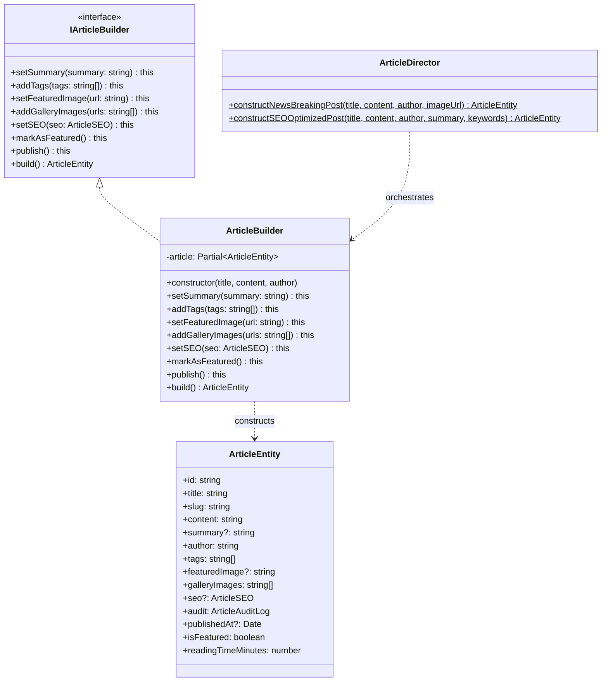
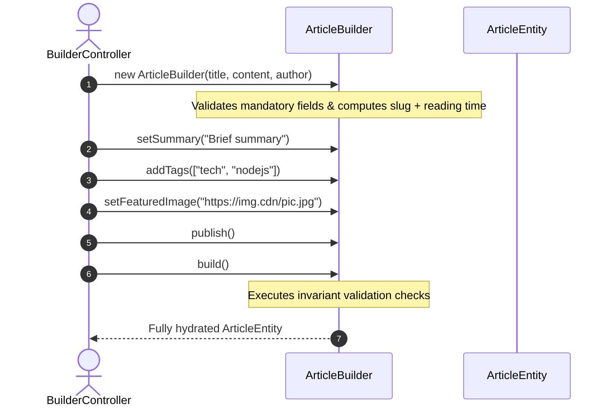

# 🔨 Builder Pattern: Complex Content & Article Construction

## 1. 🚨 The Real Production Problem
In publishing and Content Management Systems (CMS), articles are complex domain aggregates composed of dozens of optional and conditional attributes:
* Basic attributes: `title`, `content`, `author`
* Metadata: `slug`, `readingTime`, `summary`
* Rich Media: `featuredImage`, `galleryImages[]`
* Taxonomies: `tags[]`, `categories[]`
* Search Engine Optimization: `metaTitle`, `metaDescription`, `keywords[]`, `canonicalUrl`
* Lifecycle & Audit: `auditLog`, `publishedAt`, `status`

### What happens without Builder?
1. **Telescoping Constructor Anti-Pattern:** Constructors with 8+ arguments where developers must pass `undefined` or `null` for unused fields:
   ```typescript
   // ❌ Anti-pattern: Hard to read, error-prone parameter ordering
   const post = new Article(
     "My Post", "Body...", "John", undefined, undefined, ["news"], undefined, null, true
   );
   ```
2. **Partially Initialized / Invalid State:** Mutating fields after creation leads to incomplete objects being read by other threads or services before mandatory validation occurs.

---

## 2. 💡 How Builder Solves It
The **Builder Pattern** separates the construction of a complex object from its representation, allowing the same construction process to create various representations step-by-step.

### Key Characteristics:
* **Fluent API (Method Chaining):** Every configuration step returns `this`, making the construction syntax self-documenting.
* **Encapsulated Construction Logic:** Computes derived properties (e.g., auto-generating SEO slugs, calculating reading time).
* **Guaranteed Final Validation:** The `.build()` method performs invariant validation before returning the assembled object.
* **Director Support:** Provides pre-packaged recipes (e.g., `ArticleDirector.constructNewsBreakingPost(...)`).

---

## 3. 📊 Visual Diagram (Flow & Structure)

### Class Diagram


### Flow Sequence


---

## 4. 💻 Code Explanation

### Core Implementation: [ArticleBuilder.ts](file:///d:/Desgin-Patterns/src/Creational-Patterns/Builder/ArticleBuilder.ts)
1. **Mandatory Invariants in Constructor:**
   `constructor(title: string, content: string, author: string)` enforces non-nullable baseline requirements upfront while computing `slug` and `readingTimeMinutes`.
2. **Step-by-step Configuration:**
   Chained methods (`addTags`, `setFeaturedImage`, `setSEO`, `publish`) allow partial or complete configuration depending on client requirements.
3. **Immutability & Safety:**
   `build()` performs final verification and hands over the complete `ArticleEntity`.
4. **Director Recipes:**
   `ArticleDirector` exposes standardized recipes for common article variants like breaking news and SEO-optimized posts.

---

## 5. 🧪 How to Test

### Prerequisites
Make sure the server is running on port 3000 (default):
```bash
npm run dev
# or
npx tsc && node ./dist/server.js
```

### Test 1: Create Full Custom Article (Fluent Builder API)
```bash
curl -X POST http://localhost:3000/api/builder/create \
  -H "Content-Type: application/json" \
  -d '{
    "title": "Architecting Zero Downtime Microservices",
    "content": "Designing high throughput systems requires reliable fault isolation, rate limiting, and database connection pooling strategies...",
    "author": "Chief Architect",
    "summary": "Deep architectural guide to zero-downtime distributed microservices.",
    "tags": ["microservices", "architecture", "distributed-systems"],
    "featuredImage": "https://cdn.example.com/system-design.png",
    "galleryImages": [
      "https://cdn.example.com/diagram1.png",
      "https://cdn.example.com/diagram2.png"
    ],
    "seo": {
      "metaTitle": "Zero Downtime Microservices Guide",
      "metaDescription": "Learn how to build resilient systems with zero downtime.",
      "keywords": ["architecture", "scaling", "microservices"]
    },
    "isFeatured": true,
    "publish": true
  }'
```
**Expected Response (201 Created):**
```json
{
  "message": "✅ Article created successfully using Fluent Builder Pattern!",
  "article": {
    "id": "art_...",
    "title": "Architecting Zero Downtime Microservices",
    "slug": "architecting-zero-downtime-microservices",
    "readingTimeMinutes": 1,
    "isFeatured": true,
    "audit": {
      "status": "published",
      "createdBy": "Chief Architect"
    },
    "publishedAt": "..."
  }
}
```

### Test 2: Standardized Breaking News Recipe (ArticleDirector)
```bash
curl -X POST http://localhost:3000/api/builder/create \
  -H "Content-Type: application/json" \
  -d '{
    "title": "Global Cyber Outage Averted by Security Engineers",
    "content": "A critical patch has resolved the vulnerability across all data centers worldwide...",
    "author": "Security Team Lead",
    "featuredImage": "https://cdn.example.com/breaking-news.jpg",
    "recipe": "news-breaking"
  }'
```
**Expected Response (201 Created):**
```json
{
  "message": "✅ Article assembled via ArticleDirector (Breaking News Recipe)!",
  "article": {
    "title": "Global Cyber Outage Averted by Security Engineers",
    "tags": ["news", "breaking", "hot"],
    "isFeatured": true,
    "audit": {
      "status": "published"
    }
  }
}
```

### Test 3: Standardized SEO-Optimized Recipe (ArticleDirector)
```bash
curl -X POST http://localhost:3000/api/builder/create \
  -H "Content-Type: application/json" \
  -d '{
    "title": "Mastering GoF Creational Design Patterns in 2026",
    "content": "Creational design patterns abstract the instantiation process...",
    "author": "Senior Architect",
    "summary": "Comprehensive tutorial covering Singleton, Factory, Abstract Factory, Builder, and Prototype.",
    "tags": ["patterns", "software-design", "typescript"],
    "recipe": "seo-optimized"
  }'
```
**Expected Response (201 Created):**
```json
{
  "message": "✅ Article assembled via ArticleDirector (SEO Recipe)!",
  "article": {
    "seo": {
      "metaTitle": "Mastering GoF Creational Design Patterns in 2026 | Tech Insights",
      "metaDescription": "Comprehensive tutorial covering Singleton, Factory, Abstract Factory, Builder, and Prototype.",
      "keywords": ["patterns", "software-design", "typescript"]
    }
  }
}
```

### Test 4: Validation Guard (Missing Mandatory Invariants)
```bash
curl -X POST http://localhost:3000/api/builder/create \
  -H "Content-Type: application/json" \
  -d '{
    "title": "Missing Author and Content"
  }'
```
**Expected Response (400 Bad Request):**
```json
{
  "error": "title, content, and author are required."
}
```
