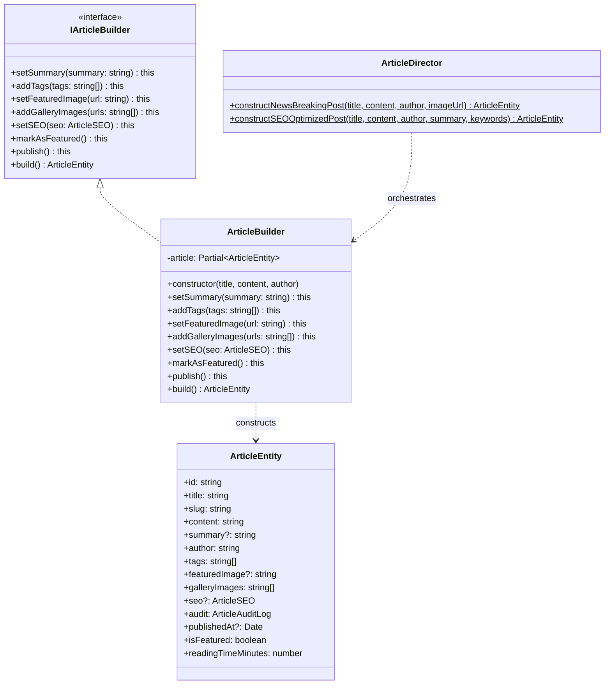
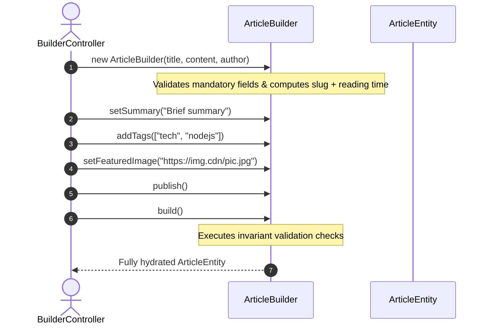

# 🔨 Builder Pattern: Complex Content & Article Construction

## 1. 🚨 The Real Production Problem
In publishing and Content Management Systems (CMS), articles are complex domain aggregates composed of dozens of optional and conditional attributes:
* Basic attributes: `title`, `content`, `author`
* Metadata: `slug`, `readingTime`, `summary`
* Rich Media: `featuredImage`, `galleryImages[]`
* Taxonomies: `tags[]`, `categories[]`
* Search Engine Optimization: `metaTitle`, `metaDescription`, `keywords[]`, `canonicalUrl`
* Lifecycle & Audit: `auditLog`, `publishedAt`, `status`

### What happens without Builder?
1. **Telescoping Constructor Anti-Pattern:** Constructors with 8+ arguments where developers must pass `undefined` or `null` for unused fields:
   ```typescript
   // ❌ Anti-pattern: Hard to read, error-prone parameter ordering
   const post = new Article(
     "My Post", "Body...", "John", undefined, undefined, ["news"], undefined, null, true
   );
   ```
2. **Partially Initialized / Invalid State:** Mutating fields after creation leads to incomplete objects being read by other threads or services before mandatory validation occurs.

---

## 2. 💡 How Builder Solves It
The **Builder Pattern** separates the construction of a complex object from its representation, allowing the same construction process to create various representations step-by-step.

### Key Characteristics:
* **Fluent API (Method Chaining):** Every configuration step returns `this`, making the construction syntax self-documenting.
* **Encapsulated Construction Logic:** Computes derived properties (e.g., auto-generating SEO slugs, calculating reading time).
* **Guaranteed Final Validation:** The `.build()` method performs invariant validation before returning the assembled object.
* **Director Support:** Provides pre-packaged recipes (e.g., `ArticleDirector.constructNewsBreakingPost(...)`).

---

## 3. 📊 Visual Diagram (Flow & Structure)

### Class Diagram


### Flow Sequence


---

## 4. 💻 Code Explanation

### Core Implementation: [ArticleBuilder.ts](file:///d:/Desgin-Patterns/src/Creational-Patterns/Builder/ArticleBuilder.ts)
1. **Mandatory Invariants in Constructor:**
   `constructor(title: string, content: string, author: string)` enforces non-nullable baseline requirements upfront while computing `slug` and `readingTimeMinutes`.
2. **Step-by-step Configuration:**
   Chained methods (`addTags`, `setFeaturedImage`, `setSEO`, `publish`) allow partial or complete configuration depending on client requirements.
3. **Immutability & Safety:**
   `build()` performs final verification and hands over the complete `ArticleEntity`.
4. **Director Recipes:**
   `ArticleDirector` exposes standardized recipes for common article variants like breaking news and SEO-optimized posts.

---

## 5. 🧪 How to Test

### Prerequisites
```bash
# Build and start the server
npm run build
npm start
# Server runs on http://localhost:3000
```

### Test 1: Create Article Using Builder (Fluent API)
```bash
curl -X POST http://localhost:3000/api/builder/create \
  -H "Content-Type: application/json" \
  -d '{
    "title": "Getting Started with TypeScript",
    "content": "TypeScript is a strongly typed superset of JavaScript...",
    "author": "Jane Developer",
    "summary": "Learn TypeScript fundamentals in this comprehensive guide.",
    "tags": ["typescript", "javascript", "programming"],
    "featuredImage": "https://example.com/typescript-guide.jpg",
    "galleryImages": ["https://example.com/img1.jpg", "https://example.com/img2.jpg"],
    "seo": {
      "metaTitle": "TypeScript Guide for Beginners",
      "metaDescription": "Master TypeScript with this step-by-step tutorial",
      "keywords": ["typescript", "tutorial", "guide"],
      "canonicalUrl": "https://blog.example.com/typescript-guide"
    },
    "isFeatured": true,
    "published": true
  }'
```

**Expected Result:** Returns full `ArticleEntity` with auto-generated `id`, `slug`, `readingTimeMinutes`, `auditLog`, and `publishedAt` timestamp.

### Test 2: Create Breaking News Post (Director Recipe)
```bash
curl -X POST http://localhost:3000/api/builder/create \
  -H "Content-Type: application/json" \
  -d '{
    "title": "Major Framework Release Announced",
    "content": "The team behind React has just announced version 19...",
    "author": "Tech News Team",
    "featuredImage": "https://cdn.example.com/react19-banner.png",
    "published": true
  }'
```

**Expected Result:** Returns article with `isFeatured: true`, `tags: ["breaking-news", "announcement"]`, and SEO auto-configured for breaking news.

### Test 3: Create SEO-Optimized Post (Director Recipe)
```bash
curl -X POST http://localhost:3000/api/builder/create \
  -H "Content-Type: application/json" \
  -d '{
    "title": "Complete Guide to Design Patterns",
    "content": "Design patterns are reusable solutions to common problems...",
    "author": "Senior Architect",
    "summary": "Master all 23 GoF design patterns with real-world examples.",
    "tags": ["design-patterns", "architecture", "software-engineering"],
    "seo": {
      "keywords": ["design patterns", "gof", "software architecture", "best practices"]
    },
    "published": true
  }'
```

**Expected Result:** Returns article with enhanced SEO fields and appropriate meta tags.

### Test 4: Validation Error (Missing Required Fields)
```bash
curl -X POST http://localhost:3000/api/builder/create \
  -H "Content-Type: application/json" \
  -d '{
    "title": "Incomplete Article"
  }'
```

**Expected Result:** Returns `400 Bad Request` with validation error: `"content is required"` or `"author is required"`
