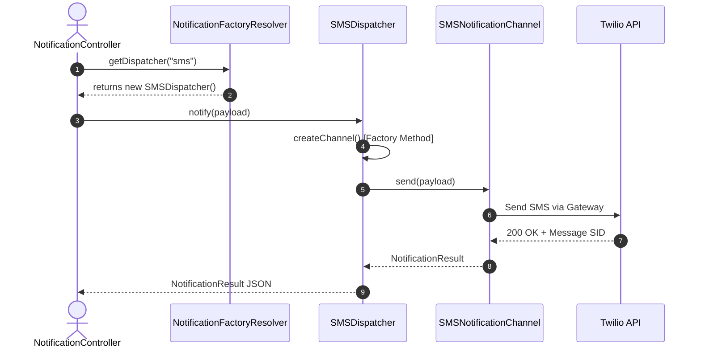

# 🏭 Factory Method Pattern: Multi-Channel Notification Dispatcher

## 1. 🚨 The Real Production Problem
In modern SaaS and CMS platforms, the system must dispatch notifications across multiple providers and channels (SendGrid for Email, Twilio for SMS, Firebase for Mobile Push, and Webhooks for Slack).

### What happens without Factory Method?
* **Tight Coupling & Violation of Open/Closed Principle (OCP):** Controllers and business services end up with sprawling `switch-case` or nested `if-else` blocks importing every 3rd party SDK directly:
```typescript
// ❌ Anti-pattern: High coupling, messy maintenance
if (type === "email") {
  const emailClient = new SendGridClient(process.env.SENDGRID_KEY);
  emailClient.sendEmail(...);
} else if (type === "sms") {
  const twilioClient = new TwilioClient(...);
  twilioClient.messages.create(...);
} else if (type === "push") { ... }
```
* Every time a new channel is added (e.g., Slack, WhatsApp, In-App Webhook), you must modify core business files, risking regressions in unrelated channels.

---

## 2. 💡 How Factory Method Solves It
The **Factory Method Pattern** defines an interface/abstract class for creating an object, but allows subclasses or specific factory creators to determine which class to instantiate.

### Core Benefits:
* **Decoupling:** The client only interacts with the generic `INotificationChannel` interface and the abstract `NotificationDispatcher`.
* **Open/Closed Principle:** Adding a new channel (e.g., WhatsApp) requires creating a new `WhatsAppChannel` and `WhatsAppDispatcher` without editing existing dispatching logic.
* **Separation of Concerns:** Provider-specific configurations (API keys, templates, payload transforms) remain encapsulated within their respective channel creators.

---

## 3. 📊 Visual Diagram (Flow & Structure)

### Class Diagram


### Flow Sequence


---

## 4. 💻 Code Explanation

### 1. Product Interface & Implementations: [Notification.ts](file:///d:/Desgin-Patterns/src/Creational-Patterns/Factory-method/Notification.ts)
* `INotificationChannel`: Uniform contract that every channel must fulfill (`send(payload)`).
* `EmailNotificationChannel`, `SMSNotificationChannel`, `PushNotificationChannel`, `SlackNotificationChannel`: Handle channel-specific logic.

### 2. Abstract Creator & Factory Method: [NotificationFactory.ts](file:///d:/Desgin-Patterns/src/Creational-Patterns/Factory-method/NotificationFactory.ts)
* `NotificationDispatcher`: Declares abstract `createChannel()`. Contains standard dispatch orchestration (`notify(...)`).
* Subclasses (`EmailDispatcher`, `SMSDispatcher`, etc.) implement `createChannel()`.
* `NotificationFactoryResolver`: Static registry mapping runtime strings (`"email"`, `"sms"`, `"push"`, `"slack"`) to the corresponding creator.

---

## 5. 🧪 How to Test

### Prerequisites
Make sure the server is running on port 3000 (default) or the configured port:
```bash
npm run dev
# or
npx tsc && node ./dist/server.js
```

### Test 1: Send Email Notification
```bash
curl -X POST http://localhost:3000/api/factory-method/send \
  -H "Content-Type: application/json" \
  -d '{
    "channel": "email",
    "recipient": "user@example.com",
    "subject": "Account Verification",
    "body": "Your verification code is 894321"
  }'
```
**Expected Response (200 OK):**
```json
{
  "message": "✅ Notification dispatched successfully via Factory Method (email)",
  "result": {
    "success": true,
    "channel": "email",
    "messageId": "email_...",
    "details": {
      "smtpServer": "smtp.sendgrid.net",
      "recipient": "user@example.com"
    }
  }
}
```

### Test 2: Send SMS Notification
```bash
curl -X POST http://localhost:3000/api/factory-method/send \
  -H "Content-Type: application/json" \
  -d '{
    "channel": "sms",
    "recipient": "+15551234567",
    "body": "Your security code is 432198"
  }'
```
**Expected Response (200 OK):**
```json
{
  "message": "✅ Notification dispatched successfully via Factory Method (sms)",
  "result": {
    "success": true,
    "channel": "sms",
    "messageId": "sms_...",
    "details": {
      "provider": "Twilio",
      "recipient": "+15551234567"
    }
  }
}
```

### Test 3: Send Mobile Push Notification
```bash
curl -X POST http://localhost:3000/api/factory-method/send \
  -H "Content-Type: application/json" \
  -d '{
    "channel": "push",
    "recipient": "fcm_device_token_xyz987",
    "subject": "New Order Alert",
    "body": "You received an order for item #1098"
  }'
```
**Expected Response (200 OK):**
```json
{
  "message": "✅ Notification dispatched successfully via Factory Method (push)",
  "result": {
    "success": true,
    "channel": "push",
    "messageId": "push_...",
    "details": {
      "service": "Firebase Cloud Messaging",
      "deviceToken": "fcm_device_token_xyz987"
    }
  }
}
```

### Test 4: Send Slack Webhook Notification
```bash
curl -X POST http://localhost:3000/api/factory-method/send \
  -H "Content-Type: application/json" \
  -d '{
    "channel": "slack",
    "recipient": "#devops-deployments",
    "body": "Production deploy v2.4.0 completed successfully."
  }'
```
**Expected Response (200 OK):**
```json
{
  "message": "✅ Notification dispatched successfully via Factory Method (slack)",
  "result": {
    "success": true,
    "channel": "slack",
    "messageId": "slack_...",
    "details": {
      "platform": "Slack Bot",
      "target": "#devops-deployments"
    }
  }
}
```

### Test 5: Invalid Channel (Error Handling & OCP Boundary)
```bash
curl -X POST http://localhost:3000/api/factory-method/send \
  -H "Content-Type: application/json" \
  -d '{
    "channel": "carrier-pigeon",
    "recipient": "rooftop-nest",
    "body": "Hello world"
  }'
```
**Expected Response (400 Bad Request):**
```json
{
  "error": "Unsupported notification channel: \"carrier-pigeon\". Allowed: email, sms, push, slack."
}
```
