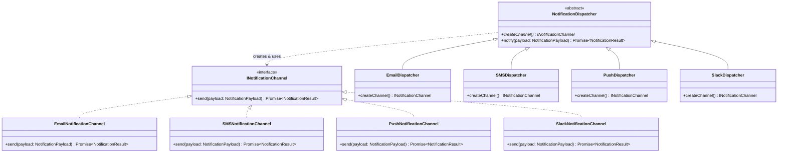
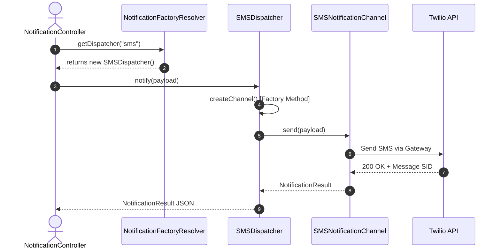

# 🏭 Factory Method Pattern: Multi-Channel Notification Dispatcher

## 1. 🚨 The Real Production Problem
In modern SaaS and CMS platforms, the system must dispatch notifications across multiple providers and channels (SendGrid for Email, Twilio for SMS, Firebase for Mobile Push, and Webhooks for Slack).

### What happens without Factory Method?
* **Tight Coupling & Violation of Open/Closed Principle (OCP):** Controllers and business services end up with sprawling `switch-case` or nested `if-else` blocks importing every 3rd party SDK directly:
```typescript
// ❌ Anti-pattern: High coupling, messy maintenance
if (type === "email") {
  const emailClient = new SendGridClient(process.env.SENDGRID_KEY);
  emailClient.sendEmail(...);
} else if (type === "sms") {
  const twilioClient = new TwilioClient(...);
  twilioClient.messages.create(...);
} else if (type === "push") { ... }
```
* Every time a new channel is added (e.g., Slack, WhatsApp, In-App Webhook), you must modify core business files, risking regressions in unrelated channels.

---

## 2. 💡 How Factory Method Solves It
The **Factory Method Pattern** defines an interface/abstract class for creating an object, but allows subclasses or specific factory creators to determine which class to instantiate.

### Core Benefits:
* **Decoupling:** The client only interacts with the generic `INotificationChannel` interface and the abstract `NotificationDispatcher`.
* **Open/Closed Principle:** Adding a new channel (e.g., WhatsApp) requires creating a new `WhatsAppChannel` and `WhatsAppDispatcher` without editing existing dispatching logic.
* **Separation of Concerns:** Provider-specific configurations (API keys, templates, payload transforms) remain encapsulated within their respective channel creators.

---

## 3. 📊 Visual Diagram (Flow & Structure)

### Class Diagram


### Flow Sequence


---

## 4. 💻 Code Explanation

### 1. Product Interface & Implementations: [Notification.ts](file:///d:/Desgin-Patterns/src/Creational-Patterns/Factory-method/Notification.ts)
* `INotificationChannel`: Uniform contract that every channel must fulfill (`send(payload)`).
* `EmailNotificationChannel`, `SMSNotificationChannel`, `PushNotificationChannel`, `SlackNotificationChannel`: Handle channel-specific logic.

### 2. Abstract Creator & Factory Method: [NotificationFactory.ts](file:///d:/Desgin-Patterns/src/Creational-Patterns/Factory-method/NotificationFactory.ts)
* `NotificationDispatcher`: Declares abstract `createChannel()`. Contains standard dispatch orchestration (`notify(...)`).
* Subclasses (`EmailDispatcher`, `SMSDispatcher`, etc.) implement `createChannel()`.
* `NotificationFactoryResolver`: Static registry mapping runtime strings (`"email"`, `"sms"`, `"push"`, `"slack"`) to the corresponding creator.

---

## 5. 🧪 How to Test

### Prerequisites
```bash
# Build and start the server
npm run build
npm start
# Server runs on http://localhost:3000
```

### Test 1: Send Email Notification
```bash
curl -X POST http://localhost:3000/api/factory-method/send \
  -H "Content-Type: application/json" \
  -d '{
    "channel": "email",
    "recipient": "user@example.com",
    "subject": "Welcome!",
    "body": "Thanks for signing up."
  }'
```

**Expected Result:** Returns `{"success": true, "channel": "email", "messageId": "msg_...", "sentAt": "..."}`

### Test 2: Send SMS Notification
```bash
curl -X POST http://localhost:3000/api/factory-method/send \
  -H "Content-Type: application/json" \
  -d '{
    "channel": "sms",
    "recipient": "+15551234567",
    "body": "Your OTP is 123456"
  }'
```

**Expected Result:** Returns `{"success": true, "channel": "sms", "messageId": "sms_...", "sentAt": "..."}`

### Test 3: Send Push Notification
```bash
curl -X POST http://localhost:3000/api/factory-method/send \
  -H "Content-Type: application/json" \
  -d '{
    "channel": "push",
    "recipient": "device_token_abc123",
    "title": "New Message",
    "body": "You have a new message from John"
  }'
```

**Expected Result:** Returns `{"success": true, "channel": "push", "messageId": "push_...", "sentAt": "..."}`

### Test 4: Send Slack Notification
```bash
curl -X POST http://localhost:3000/api/factory-method/send \
  -H "Content-Type: application/json" \
  -d '{
    "channel": "slack",
    "recipient": "#general",
    "body": "Deployment completed successfully! 🚀"
  }'
```

**Expected Result:** Returns `{"success": true, "channel": "slack", "messageId": "slack_...", "sentAt": "..."}`

### Test 5: Invalid Channel (Error Handling)
```bash
curl -X POST http://localhost:3000/api/factory-method/send \
  -H "Content-Type: application/json" \
  -d '{
    "channel": "invalid",
    "recipient": "test@test.com"
  }'
```

**Expected Result:** Returns `400 Bad Request` with error: `"Unknown channel: invalid. Available: email, sms, push, slack"`
