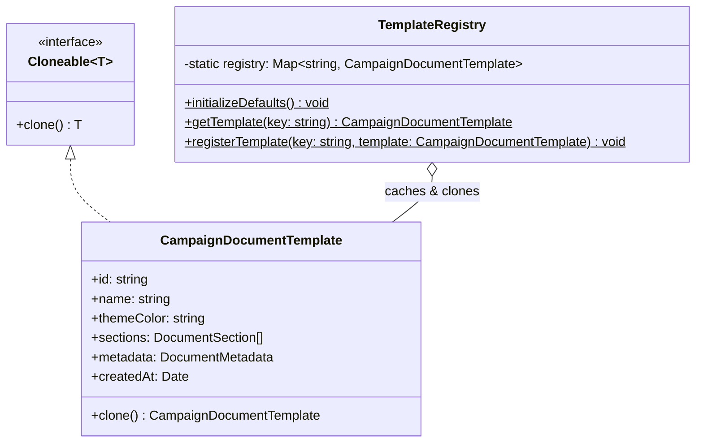
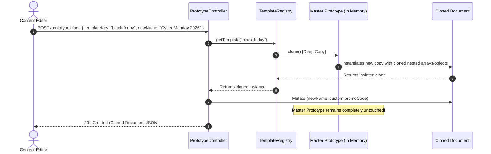

# 🧬 Prototype Pattern: Deep Cloning Document & Campaign Blueprints

## 1. 🚨 The Real Production Problem
In marketing, e-commerce, and enterprise workflow engines, users frequently create new campaigns, pages, or email workflows starting from a standardized blueprint or existing template.

### What happens without Prototype?
1. **Costly Repetitive Queries & Parsing:**
   Every time an editor creates a new campaign, the backend must execute heavy relational joins across multiple tables (`templates`, `sections`, `permissions`, `custom_field_schemas`), followed by complex JSON deserialization and validation.
2. **The Shallow Copy Reference Bug (Shared State Mutation):**
   Developers often write naive copies (`Object.assign()` or `{ ...template }`).
   ```typescript
   // ❌ Severe Production Bug: Shallow Copy
   const newCampaign = { ...masterTemplate };
   newCampaign.sections[0].heading = "Flash Sale";
   // BUG: masterTemplate.sections[0].heading was also changed!
   // All future users now get the corrupted template!
   ```

---

## 2. 💡 How Prototype Solves It
The **Prototype Pattern** allows cloning existing objects without making your code dependent on their concrete classes or re-running expensive initialization logic from scratch.

### Architectural Solution:
* Implement a `Cloneable<T>` contract with an explicit `.clone()` method.
* **Deep Copying:** Ensures nested reference structures (sections arrays, permission lists, metadata dictionaries) are completely duplicated in memory.
* **Prototype Registry:** Pre-loads and caches heavy blueprints once in memory (`TemplateRegistry`). When a user needs a template, the registry returns a fresh, isolated clone in sub-millisecond time.

---

## 3. 📊 Visual Diagram (Flow & Structure)

### Class Diagram


### Flow Sequence


---

## 4. 💻 Code Explanation

### Core Implementation: [Article.ts](file:///d:/Desgin-Patterns/src/Creational-Patterns/Prototype/Article.ts)
1. **Deep Cloning Logic:**
   ```typescript
   public clone(): CampaignDocumentTemplate {
     const clonedSections = this.sections.map((section) => ({ ...section }));
     const clonedMetadata = {
       ...this.metadata,
       permissions: {
         canEdit: [...this.metadata.permissions.canEdit],
         canView: [...this.metadata.permissions.canView],
       },
       customFields: JSON.parse(JSON.stringify(this.metadata.customFields)),
     };
     return new CampaignDocumentTemplate(`Copy of ${this.name}`, this.themeColor, clonedSections, clonedMetadata);
   }
   ```
2. **Template Registry Cache:**
   `TemplateRegistry.getTemplate(key)` serves ready-to-use clones instantly from memory without hitting the database, drastically reducing latency under high concurrent load.

---

## 5. 🧪 How to Test

### Prerequisites
Make sure the server is running on port 3000 (default):
```bash
npm run dev
# or
npx tsc && node ./dist/server.js
```

### Test 1: List Available Master Blueprints in Registry
```bash
curl -X GET http://localhost:3000/api/prototype/templates
```
**Expected Response (200 OK):**
```json
{
  "message": "Available prototype templates in registry",
  "templates": [
    "black-friday",
    "product-launch"
  ]
}
```

### Test 2: Clone "Black Friday" Blueprint with Custom Modifications
```bash
curl -X POST http://localhost:3000/api/prototype/clone \
  -H "Content-Type: application/json" \
  -d '{
    "templateKey": "black-friday",
    "newName": "Cyber Monday Super Sale 2026",
    "overrideCustomFields": {
      "discountPercent": 65,
      "promoCode": "CYBER65"
    }
  }'
```
**Expected Response (201 Created):**
```json
{
  "message": "✅ Prototype cloned successfully from blueprint: \"black-friday\"",
  "clonedDocument": {
    "id": "tpl_...",
    "name": "Cyber Monday Super Sale 2026",
    "themeColor": "#FF0033",
    "sections": [
      { "heading": "Hero Banner", "body": "50% Off Everything this Weekend", "order": 1 },
      { "heading": "Featured Collection", "body": "Hand-picked gadgets and electronics", "order": 2 },
      { "heading": "Terms & Conditions", "body": "Offer valid while stocks last", "order": 3 }
    ],
    "metadata": {
      "category": "Marketing",
      "version": 1,
      "permissions": {
        "canEdit": ["marketing-lead"],
        "canView": ["all-staff"]
      },
      "customFields": {
        "discountPercent": 65,
        "promoCode": "CYBER65"
      }
    }
  }
}
```

### Test 3: Clone "Product Launch" Blueprint
```bash
curl -X POST http://localhost:3000/api/prototype/clone \
  -H "Content-Type: application/json" \
  -d '{
    "templateKey": "product-launch",
    "newName": "Alpha AI Platform Launch",
    "overrideCustomFields": {
      "tier": "Global Enterprise Tier",
      "sla": "99.999%"
    }
  }'
```
**Expected Response (201 Created):**
```json
{
  "message": "✅ Prototype cloned successfully from blueprint: \"product-launch\"",
  "clonedDocument": {
    "name": "Alpha AI Platform Launch",
    "themeColor": "#0066FF",
    "metadata": {
      "category": "Product",
      "customFields": {
        "tier": "Global Enterprise Tier",
        "sla": "99.999%"
      }
    }
  }
}
```

### Test 4: Verify Master Prototype State Independence (Deep Copy Check)
```bash
# Clone the same template a second time
curl -X POST http://localhost:3000/api/prototype/clone \
  -H "Content-Type: application/json" \
  -d '{
    "templateKey": "black-friday"
  }'
```
**Expected Response (201 Created):**
The second clone contains the original `"discountPercent": 50` and `"promoCode": "BF50"`. The edits from Test 2 did **not** contaminate or mutate the master prototype in the registry!

### Test 5: Missing / Invalid Template Key (Error Handling)
```bash
curl -X POST http://localhost:3000/api/prototype/clone \
  -H "Content-Type: application/json" \
  -d '{
    "templateKey": "non-existent-blueprint"
  }'
```
**Expected Response (404 Not Found):**
```json
{
  "error": "Template prototype with key \"non-existent-blueprint\" not found in registry."
}
```
