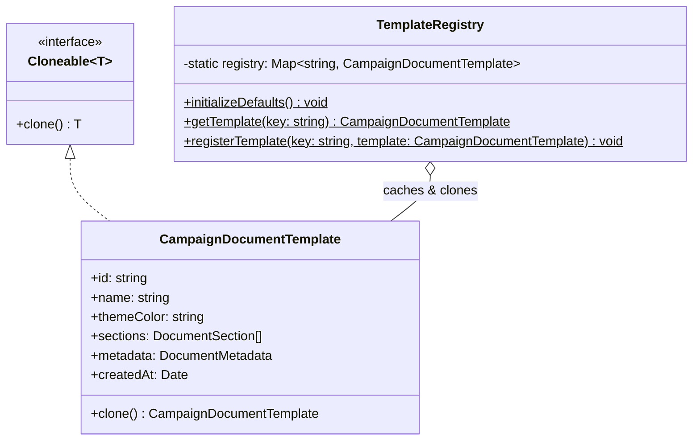
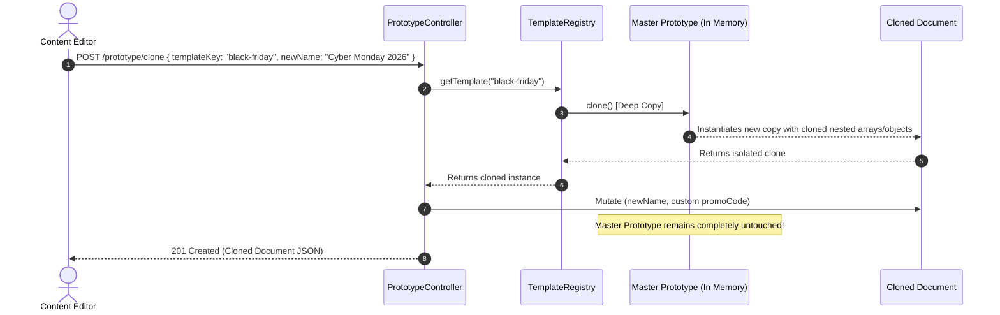

# 🧬 Prototype Pattern: Deep Cloning Document & Campaign Blueprints

## 1. 🚨 The Real Production Problem
In marketing, e-commerce, and enterprise workflow engines, users frequently create new campaigns, pages, or email workflows starting from a standardized blueprint or existing template.

### What happens without Prototype?
1. **Costly Repetitive Queries & Parsing:**
   Every time an editor creates a new campaign, the backend must execute heavy relational joins across multiple tables (`templates`, `sections`, `permissions`, `custom_field_schemas`), followed by complex JSON deserialization and validation.
2. **The Shallow Copy Reference Bug (Shared State Mutation):**
   Developers often write naive copies (`Object.assign()` or `{ ...template }`).
   ```typescript
   // ❌ Severe Production Bug: Shallow Copy
   const newCampaign = { ...masterTemplate };
   newCampaign.sections[0].heading = "Flash Sale";
   // BUG: masterTemplate.sections[0].heading was also changed!
   // All future users now get the corrupted template!
   ```

---

## 2. 💡 How Prototype Solves It
The **Prototype Pattern** allows cloning existing objects without making your code dependent on their concrete classes or re-running expensive initialization logic from scratch.

### Architectural Solution:
* Implement a `Cloneable<T>` contract with an explicit `.clone()` method.
* **Deep Copying:** Ensures nested reference structures (sections arrays, permission lists, metadata dictionaries) are completely duplicated in memory.
* **Prototype Registry:** Pre-loads and caches heavy blueprints once in memory (`TemplateRegistry`). When a user needs a template, the registry returns a fresh, isolated clone in sub-millisecond time.

---

## 3. 📊 Visual Diagram (Flow & Structure)

### Class Diagram


### Flow Sequence


---

## 4. 💻 Code Explanation

### Core Implementation: [Article.ts](file:///d:/Desgin-Patterns/src/Creational-Patterns/Prototype/Article.ts)
1. **Deep Cloning Logic:**
   ```typescript
   public clone(): CampaignDocumentTemplate {
     const clonedSections = this.sections.map((section) => ({ ...section }));
     const clonedMetadata = {
       ...this.metadata,
       permissions: {
         canEdit: [...this.metadata.permissions.canEdit],
         canView: [...this.metadata.permissions.canView],
       },
       customFields: JSON.parse(JSON.stringify(this.metadata.customFields)),
     };
     return new CampaignDocumentTemplate(`Copy of ${this.name}`, this.themeColor, clonedSections, clonedMetadata);
   }
   ```
2. **Template Registry Cache:**
   `TemplateRegistry.getTemplate(key)` serves ready-to-use clones instantly from memory without hitting the database, drastically reducing latency under high concurrent load.
