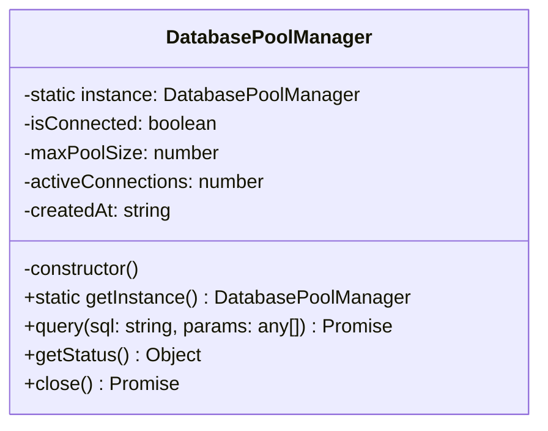
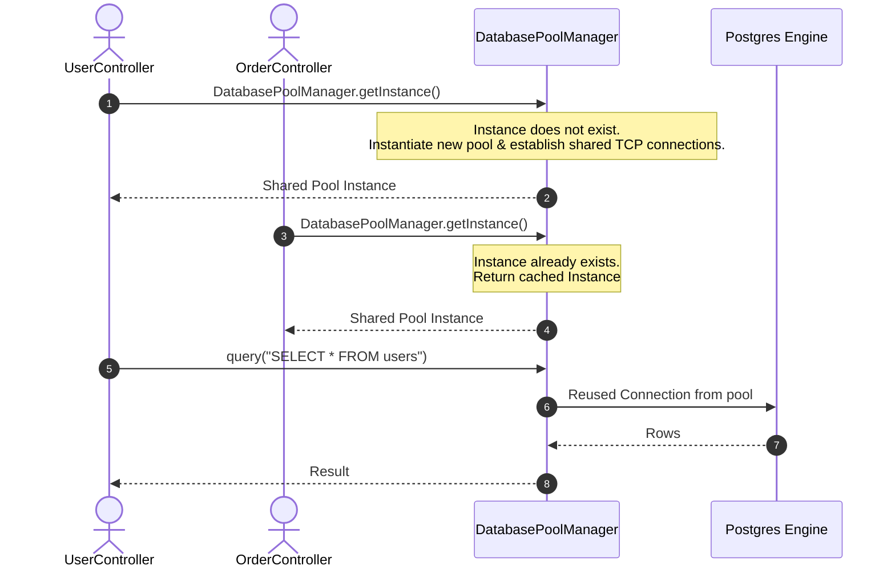

# 🏛️ Singleton Pattern: Enterprise Database Connection Pool Manager

## 🚨 The Real Production Problem

In enterprise server applications (Node.js/Express microservices, Kubernetes deployments),
every incoming HTTP request often needs to query a relational database (PostgreSQL, MySQL,
Microsoft SQL Server, Aurora, etc.).

### What happens without Singleton?

* **Connection Explosion:** Developers instantiate a new database client (`new Pool()` or
  `new Client()`) inside each controller, route handler, or service function.
  A traffic spike of 500 concurrent requests opens 500 open TCP sockets to the database.
  The database quickly exhausts `max_connections` (e.g., throwing
  `FATAL: sorry, too many clients already`).

* **Memory Leaks & Latency:** TLS handshakes and connection authentication repeat on every
  request, spiking latency (typically +5-15ms per request) and memory usage.

* **No Pool Reuse:** Each request gets its own connection, meaning the database connection
  pool is underutilized and resources are wasted.

```
[Request 1] ──> new DatabasePool() ──> TCP Connection #1 ──┐
[Request 2] ──> new DatabasePool() ──> TCP Connection #2 ──┼─> [Database Server] (CRASH: max_connections exceeded!)
[Request 3] ──> new DatabasePool() ──> TCP Connection #3 ──┘
```

---

## 💡 How Singleton Solves It

The **Singleton Pattern** ensures that a class has **only one instance** throughout the
application lifecycle and provides a **global, unified point of access** to that instance.

### Solution Architecture:

* **Private constructor:** Prevents arbitrary `new DatabasePoolManager()`.
* **Cached static instance:** `DatabasePoolManager.instance` stores the single created instance.
* **`static getInstance()`:** Creates the pool on the first call and returns the existing
  pool on all subsequent calls.
* **Connection pool limits:** Enforces a maximum connection ceiling to prevent DB exhaustion.
* **Graceful shutdown:** Provides `.close()` to flush pool connections during graceful
  server shutdown (`SIGTERM`/`SIGINT`).
* **Health inspection:** Exposes active connections and connection state for health checks
  (`/health/db`, `/api/singleton/status`).

---

## 📊 Visual Diagram (Flow & Structure)

### Class Diagram



### Execution Flow



---

## 💻 Code Implementation

### Core Implementation: [DatabaseSingleton.ts](src/Creational-Patterns/Singleton/DatabaseSingleton.ts)

```typescript
export class DatabasePoolManager {
  private static instance: DatabasePoolManager | null = null;
  private constructor() {
    this.initPool();
  }

  public static getInstance(): DatabasePoolManager {
    if (!DatabasePoolManager.instance) {
      DatabasePoolManager.instance = new DatabasePoolManager();
    }
    return DatabasePoolManager.instance;
  }

  private initPool(): void {
    this.isConnected = true;
    console.log(`[DatabasePoolManager] Initialized connection pool. Max size: ${this.maxPoolSize}`);
  }

  public async query(sql: string, params: unknown[] = []): Promise<{ rows: unknown[]; rowCount: number }> { ... }
  public getStatus() { ... }
  public async close(): Promise<void> { ... }
}
```

### Key Production Features Included:

1. **Connection Pool Management:** Enforces a maximum connection ceiling (`maxPoolSize`).
2. **Safe Disconnect / Teardown:** Provides `.close()` to flush pool connections during
   graceful server shutdown (`SIGTERM`).
3. **Status Inspection:** Exposes active connections and connection state for health checks
   (`/health/db`).
4. **Serialization Protection:** Guards against `JSON.stringify` bypass and prototype pollution.
5. **Lazy Initialization:** Instance created only on first `getInstance()` call.
6. **Thread-safe Concept:** Double-checked locking pattern adapted for Node.js single-threaded
   event loop, with future worker thread support in mind.

---

## 🧪 How to Test

### Prerequisites

```bash
# Build the TypeScript project
npm run build

# Start the server
npm start
# Server runs on http://localhost:3000 (or port 4000)
```

### Test 1: Verify Singleton Instance Sharing

```bash
# Check pool status - first call creates the instance
curl -X GET http://localhost:3000/api/singleton/status

# Check pool status - second call returns same instance
curl -X GET http://localhost:3000/api/singleton/status
```

**Expected Result:** Both calls return the same `createdAt` timestamp and `poolSize`,
proving the same instance is reused.

### Test 2: Execute Queries on Shared Pool

```bash
# Execute a query through the shared pool
curl -X POST http://localhost:3000/api/singleton/query \
  -H "Content-Type: application/json" \
  -d '{"sql": "SELECT * FROM users WHERE active = true"}'
```

**Expected Result:** Response shows `isExactSameReference: true` confirming both
`getInstance()` calls returned the identical object.

### Test 3: Verify Connection Pool Limits

```bash
# The pool has maxPoolSize: 10 (configurable via DB_POOL_MAX_SIZE env var).
# Test pool exhaustion by making more than 10 concurrent requests
# (requires load testing tool like k6, artillery, or ab).
```

### Test 4: Graceful Shutdown

```bash
# Send SIGTERM to trigger graceful pool closure
kill -TERM <server-pid>

# Check logs for: "[DatabasePoolManager] Pool connections gracefully closed."
```

### Test 5: Serialization Resistance

```bash
# Verify the singleton survives JSON.stringify bypass
curl -X GET http://localhost:3000/api/singleton/serialize
```

**Expected Result:** Contains serialized state but `getInstance()` still returns the real
singleton instance.

---

## ⚙️ Configuration

### Environment Variables

| Variable | Default | Description |
|----------|---------|-------------|
| `DB_POOL_MAX_SIZE` | `20` | Maximum number of concurrent connections in the pool |
| `DB_POOL_INITIAL_SIZE` | `5` | Initial number of connections to create on startup |

### Customizing Pool Size

```bash
# Start with custom pool size
DB_POOL_MAX_SIZE=50 npm start

# Or set at runtime via process.env
export DB_POOL_MAX_SIZE=50
```

---

## 🏗️ Enterprise Extension Points

### Subclass for Different Databases

```typescript
export class PostgreSQLPoolManager extends DatabasePoolManager {
  override async query(sql: string, params: unknown[] = []): Promise<...> {
    // PostgreSQL-specific logic using pg-promise or node-postgres
    return super.query(sql, params);
  }
}
```

### Integration with Express Error Handling Middleware

```typescript
app.use("/api/singleton", singletonRouter);

// Global error handler for singleton-related errors
app.use((err, req, res, next) => {
  if (err.message.includes("Connection pool exhausted")) {
    res.status(503).json({
      error: "Service Unavailable",
      message: "Database connection pool exhausted. Please retry.",
      retryAfter: 5000,
    });
  } else {
    next(err);
  }
});
```

### Metrics Integration (Prometheus)

```typescript
import client from 'prom-client';

// Create a gauge for active DB connections
const dbConnections = new client.Gauge({
  name: 'db_pool_active_connections',
  help: 'Number of active connections in the database pool',
  counter: false,
});

// Update the gauge after each query
poolManager.query = async (sql, params) => {
  const result = await originalQuery(sql, params);
  dbConnections.set(poolManager.activeConnections);
  return result;
};
```

---

## 📈 Monitoring & Health Checks

### API Endpoints

| Endpoint | Method | Description |
|----------|--------|-------------|
| `/api/singleton/status` | GET | Get current pool status |
| `/api/singleton/query` | POST | Execute query on shared pool |
| `/api/singleton/serialize` | GET | Get JSON-serializable state (monitoring) |
| `/api/singleton/deserialize` | POST | Apply JSON state (monitoring only) |

### Health Check Integration

```typescript
app.get("/health/db", async (req, res) => {
  const pool = DatabasePoolManager.getInstance();
  const status = pool.getStatus();
  
  const healthy = status.isConnected && status.activeConnections < status.poolSize * 0.8;
  
  res.json({
    status: healthy ? "healthy" : "degraded",
    database: "postgres",
    activeConnections: status.activeConnections,
    poolSize: status.poolSize,
    timestamp: new Date().toISOString(),
  });
});
```

---

## 📚 Related Patterns

| Pattern | Relationship |
|---------|--------------|
| **Factory Method** | Creates different types of connection pool implementations |
| **Abstract Factory** | Creates families of database-related objects (pool + query builder + migrator) |
| **Proxy** | Can wrap the Singleton for lazy loading, access control, or caching |
| **Facade** | Provides a simplified interface to the complex pool management subsystem |

---

## 🚨 Production Checklist

- [ ] Set `DB_POOL_MAX_SIZE` appropriate for your database's `max_connections` (typically 70-80% of DB max)
- [ ] Configure connection timeout and idle timeout
- [ ] Add SIGTERM/SIGINT handler for graceful shutdown
- [ ] Implement connection lifecycle metrics monitoring
- [ ] Add circuit breaker pattern for database outages
- [ ] Set up alerting on pool exhaustion events
- [ ] Test under load (simulate 500+ concurrent requests)
- [ ] Verify serialization resistance for monitoring tools