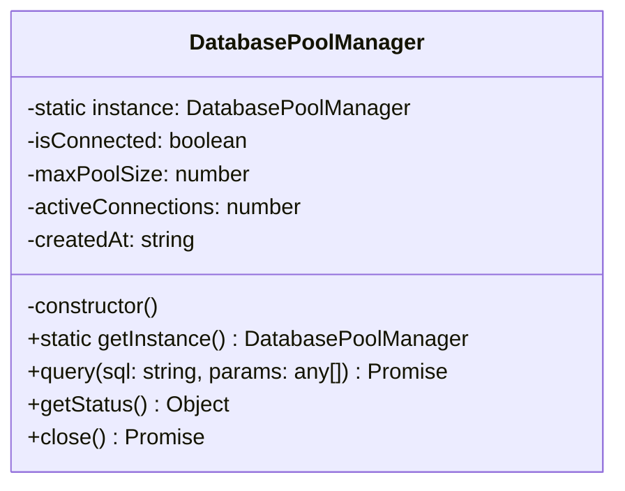
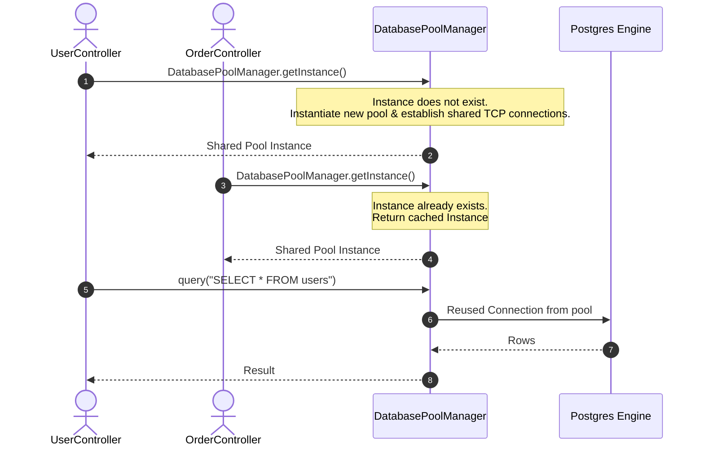

# 🏛️ Singleton Pattern: Database Connection Pool Manager

## 1. 🚨 The Real Production Problem
In server applications (Node.js/Express, microservices), every incoming HTTP request often needs to query a relational or document database (PostgreSQL, MySQL, MongoDB).

### What happens without Singleton?
* Developers instantiate a new database client instance (`new Client()` or `new Pool()`) inside each controller, route, or service function.
* **Connection Explosion:** A traffic spike of 500 concurrent requests opens 500 open TCP sockets to Postgres. The database quickly exhausts `max_connections` (e.g., throwing `FATAL: sorry, too many clients already`).
* **Memory Leaks & Latency:** TLS handshakes and connection authentication repeat on every request, spiking latency and memory usage.

```
[Request 1] ──> new DatabasePool() ──> TCP Connection #1 ──┐
[Request 2] ──> new DatabasePool() ──> TCP Connection #2 ──┼─> [Database Server] (CRASH: max_connections exceeded!)
[Request 3] ──> new DatabasePool() ──> TCP Connection #3 ──┘
```

---

## 2. 💡 How Singleton Solves It
The **Singleton Pattern** ensures that a class has **only one instance** throughout the application lifecycle and provides a global, unified point of access to that instance.

### Solution Architecture:
* Mark constructor as `private` to prevent arbitrary `new DatabasePoolManager()`.
* Store a cached static instance `DatabasePoolManager.instance`.
* Expose `static getInstance()`: creates the pool on the first call and returns the existing pool on subsequent calls.

---

## 3. 📊 Visual Diagram (Flow & Structure)

### Class Diagram


### Execution Flow


---

## 4. 💻 Code Explanation

### Core Implementation: [DatabaseSingleton.ts](file:///d:/Desgin-Patterns/src/Creational-Patterns/Singlton/DatabaseSingleton.ts)
```typescript
export class DatabasePoolManager {
  private static instance: DatabasePoolManager | null = null;

  // 1. Private constructor: Enforces no external instantiation
  private constructor() {
    this.initPool();
  }

  // 2. Controlled access point: Returns the same instance everywhere
  public static getInstance(): DatabasePoolManager {
    if (!DatabasePoolManager.instance) {
      DatabasePoolManager.instance = new DatabasePoolManager();
    }
    return DatabasePoolManager.instance;
  }
}
```

### Key Production Features Included:
1. **Connection Pool Management:** Enforces a maximum connection ceiling (`maxPoolSize`).
2. **Safe Disconnect / Teardown:** Provides `.close()` to flush pool connections during graceful server shutdown (`SIGTERM`).
3. **Status Inspection:** Exposes active connections and connection state for health checks (`/health/db`).
