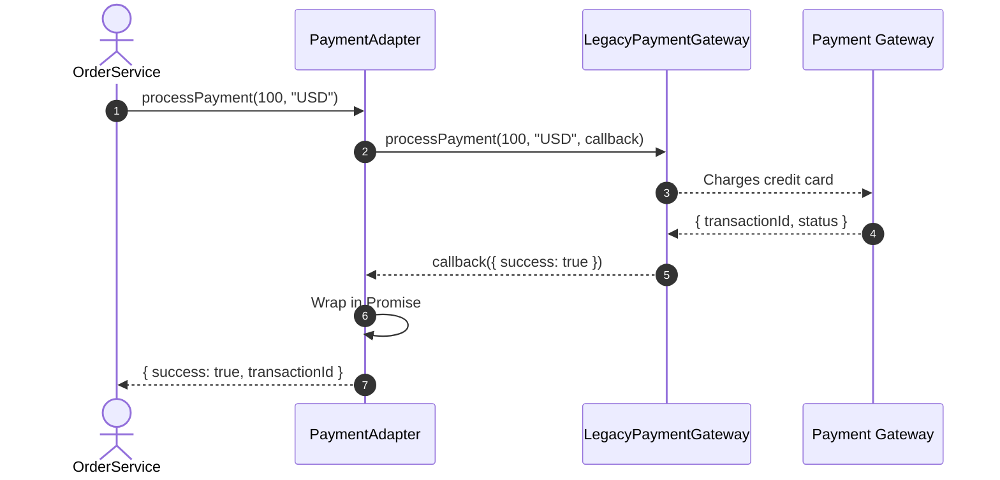

# 🔌 Adapter Pattern: Cross-Service Protocol Interoperability

## 1. 🚨 The Real Production Problem
In enterprise integrations, systems often need to work together despite incompatible interfaces. A common scenario:

- **Legacy API:** An old payment gateway that expects `processPayment(amount, currency, callback)` 
- **Modern Service:** A new order system that calls `charge(amount, currency)` returning a Promise
- **Third-party SDK:** A shipping provider that requires a specific class structure

Without Adapter, you must either:
- Modify the legacy code (risky, may break existing functionality)
- Duplicate logic with wrapper classes everywhere
- Force the modern system to depend on the legacy API's quirks

## 2. 💡 How Adapter Solves It
The **Adapter Pattern** converts the interface of a class into another interface clients expect. It lets classes work together that couldn't otherwise because of incompatible interfaces.

### Core Benefits:
* **Zero Modifications to Existing Code:** Adaptee's source remains untouched
* **Single Responsibility:** Adapter focuses solely on interface conversion
* **Open/Closed Friendly:** Add new adapters without touching existing ones
* **Testability:** Easy to mock adapters in unit tests

## 3. 📊 Visual Diagram (Flow & Structure)

### Class Diagram
```mermaid
classDiagram
    class PaymentProcessor {
        +processPayment(amount: number, currency: string): Promise~PaymentResult~
    }

    class LegacyPaymentGateway {
        +processPayment(amount: number, currency: string, callback: (result: any) => void): void
    }

    class PaymentAdapter {
        +processPayment(amount: number, currency: string): Promise~PaymentResult~
        #adaptee: LegacyPaymentGateway
    }

    PaymentProcessor <|.. PaymentAdapter
    PaymentAdapter <|.. LegacyPaymentGateway : adapts

    Note for PaymentAdapter "Converts Promise-based API\nto callback-based Legacy API"
```

### Execution Flow


## 4. 💻 Code Implementation

### Product Interface (Target)
```typescript
export interface PaymentProcessor {
  processPayment(amount: number, currency: string): Promise<{ success: boolean; transactionId: string }>;
}

export interface PaymentResult {
  success: boolean;
  transactionId: string;
  amount: number;
  currency: string;
  timestamp: string;
}
```

### Adaptee (Legacy Class - untouched)
```typescript
export class LegacyPaymentGateway {
  // This class remains unchanged - we cannot modify it
  processPayment(amount: number, currency: string, callback: (result: any) => void): void {
    // Simulate legacy callback-based API
    setTimeout(() => {
      const success = Math.random() > 0.1; // 90% success rate
      callback({
        success,
        transactionId: `legacy_tx_${Date.now()}`,
        amount,
        currency,
        response: "Legacy gateway response"
      });
    }, 100);
  }
}
```

### Adapter (Bridge Between Interfaces)
```typescript
export class PaymentAdapter implements PaymentProcessor {
  private adaptee: LegacyPaymentGateway;

  constructor(adaptee: LegacyPaymentGateway) {
    this.adaptee = adaptee;
  }

  public async processPayment(amount: number, currency: string): Promise<PaymentResult> {
    return new Promise((resolve) => {
      this.adaptee.processPayment(amount, currency, (result) => {
        const paymentResult: PaymentResult = {
          success: result.success,
          transactionId: result.transactionId,
          amount,
          currency,
          timestamp: new Date().toISOString()
        };
        resolve(paymentResult);
      });
    });
  }
}
```

### Usage
```typescript
// Client code - works with modern interface
const legacyGateway = new LegacyPaymentGateway();
const adapter = new PaymentAdapter(legacyGateway);

const result = await adapter.processPayment(100, "USD");
console.log(result);
// { success: true, transactionId: "legacy_tx_1234567890", amount: 100, currency: "USD", timestamp: "2024..." }