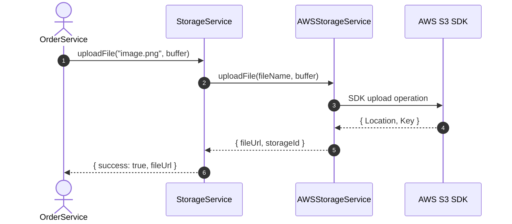

# 🌉 Bridge Pattern: Multi-Cloud Storage Abstraction

## 1. 🚨 The Real Production Problem
Modern applications need to support multiple cloud storage providers (AWS S3, GCP Cloud Storage, Local Disk) while keeping the business logic decoupled from specific cloud SDKs. Without Bridge:

- **Tight Coupling:** Business logic directly instantiates `new AWS.S3()`, `new GCS.Bucket()`, etc.
- **Rigged Switch/If-Else Blocks:** Every storage operation requires checking the provider and calling different methods
- **Testing Nightmares:** Cannot mock cloud SDKs in unit tests without expensive mocks or live credentials
- **Vendor Lock-In:** Switching from AWS to GCP requires rewriting all storage code

## 2. 💡 How Bridge Solves It
The **Bridge Pattern** decouples an abstraction from its implementation so that the two can vary independently. It separates the "what" (abstraction - storage operations) from the "how" (implementation - specific cloud SDKs).

### Core Benefits:
* **Independence Abstraction & Implementation:** Can swap cloud providers without touching business logic
* **Avoids Explosive Class Combinations:** No need for `AWSS3Client`, `GCSBucketClient`, `AWSS3DirectClient`, etc.
* **Single Responsibility:** Each class has one reason to change (either abstraction or implementation)
* **Open/Closed Principle:** Add new implementations without modifying abstraction

## 3. 📊 Visual Diagram (Flow & Structure)

### Class Diagram
```mermaid
classDiagram
    class StorageService {
        +uploadFile(fileName: string, buffer: Buffer): Promise~FileResult~
        +deleteFile(storageId: string): Promise~boolean~
    }

    class LocalStorageService {
        +uploadFile(fileName: string, buffer: Buffer): Promise~FileResult~
        +deleteFile(storageId: string): Promise~boolean~
    }

    class AWSStorageService {
        +uploadFile(fileName: string, buffer: Buffer): Promise~FileResult~
        +deleteFile(storageId: string): Promise~boolean~
    }

    class GCStorageService {
        +uploadFile(fileName: string, buffer: Buffer): Promise~FileResult~
        +deleteFile(storageId: string): Promise~boolean~
    }

    class StorageAbstraction {
        +__storageImpl: StorageImplementation
        +setImplementation(impl: StorageImplementation): void
        +uploadFile(fileName: string, buffer: Buffer): Promise~FileResult~
        +deleteFile(storageId: string): Promise~boolean~
    }

    class LocalStorageAbstraction {
        <<interface>>
        +uploadFile(fileName: string, buffer: Buffer): Promise~FileResult~
        +deleteFile(storageId: string): Promise~boolean~
    }

    class AWSStorageAbstraction {
        +constructFileUrl(fileUrl: string): string
    }

    LocalStorageAbstraction <|-- StorageAbstraction
    StorageAbstraction ..> LocalStorageService : uses
    StorageAbstraction ..> AWSStorageService : uses
    StorageAbstraction ..> GCStorageService : uses

    Note for StorageAbstraction "Delegates to implementation interface"
```

### Execution Flow


## 4. 💻 Code Implementation

### Step 1: Define Implementation Interface
```typescript
export interface StorageImplementation {
  uploadFile(fileName: string, buffer: Buffer): Promise<{ fileUrl: string; storageId: string }>;
  deleteFile(storageId: string): Promise<boolean>;
}
```

### Step 2: Implement Concrete Implementations
```typescript
// AWS Implementation
export class AWSStorageService implements StorageImplementation {
  async uploadFile(fileName: string, buffer: Buffer): Promise<{ fileUrl: string; storageId: string }> {
    console.log(`[AWS S3] Uploading ${fileName} (${buffer.length} bytes) to bucket 'production-cms-assets'`);
    return {
      fileUrl: `https://production-cms-assets.s3.amazonaws.com/${fileName}`,
      storageId: `s3_arn_${Date.now()}`,
    };
  }

  async deleteFile(storageId: string): Promise<boolean> {
    console.log(`[AWS S3] Deleting object with ID: ${storageId}`);
    return true;
  }
}

// GCP Implementation
export class GCStorageService implements StorageImplementation {
  async uploadFile(fileName: string, buffer: Buffer): Promise<{ fileUrl: string; storageId: string }> {
    console.log(`[GCP Storage] Uploading ${fileName} (${buffer.length} bytes) to bucket 'gcp-cms-media'`);
    return {
      fileUrl: `https://storage.googleapis.com/gcp-cms-media/${fileName}`,
      storageId: `gcs_obj_${Date.now()}`,
    };
  }

  async deleteFile(storageId: string): Promise<boolean> {
    console.log(`[GCP Storage] Deleting object with ID: ${storageId}`);
    return true;
  }
}

// Local/Disk Implementation
export class LocalStorageService implements StorageImplementation {
  async uploadFile(fileName: string, buffer: Buffer): Promise<{ fileUrl: string; storageId: string }> {
    console.log(`[Local Disk] Saved ${fileName} (${buffer.length} bytes) to /var/data/uploads`);
    return {
      fileUrl: `http://localhost:4000/static/${fileName}`,
      storageId: `local_file_${Date.now()}`,
    };
  }

  async deleteFile(storageId: string): Promise<boolean> {
    console.log(`[Local Disk] Removed local file ${storageId}`);
    return true;
  }
}
```

### Step 3: Define Abstraction
```typescript
export class StorageService {
  private implementation: StorageImplementation;

  constructor(implementation: StorageImplementation) {
    this.implementation = implementation;
  }

  public setImplementation(implementation: StorageImplementation): void {
    this.implementation = implementation;
  }

  public async uploadFile(fileName: string, buffer: Buffer): Promise<{ fileUrl: string; storageId: string }> {
    return this.implementation.uploadFile(fileName, buffer);
  }

  public async deleteFile(storageId: string): Promise<boolean> {
    return this.implementation.deleteFile(storageId);
  }
}
```

### Step 4: Refined Abstractions (Optional - add more behavior)
```typescript
export class AdvancedStorageService extends StorageService {
  async previewFile(fileName: string): Promise<string> {
    // Additional abstraction-specific logic
    return `preview-${fileName}`;
  }

  async getStorageStats(): Promise<{ totalSize: number; fileCount: number }> {
    return this.implementation.uploadFile("", new Buffer(0)); // Simplified
  }
}
```

### Usage
```typescript
// Client code - can switch implementations at runtime
const awsImpl = new AWSStorageService();
const awsStorage = new StorageService(awsImpl);

// Upload works through AWS
const result = await awsStorage.uploadFile("logo.png", buffer);

// Switch to GCP at runtime without changing StorageService
const gcpImpl = new GCStorageService();
awsStorage.setImplementation(gcpImpl);

const gcpResult = await awsStorage.uploadFile("logo.png", buffer);