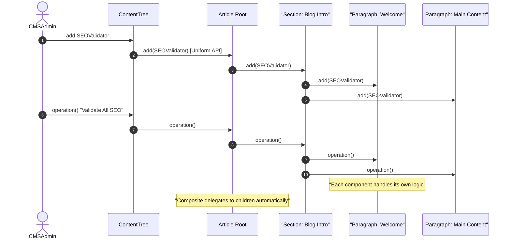

# 📦 Composite Pattern: hierarchical Content Management

## 1. 🚨 The Real Production Problem
In CMS and content management systems, content entities often form hierarchical structures - a blog post contains sections, sections contain subsections, which contain paragraphs, images, and metadata. Without Composite:

- **Treating Uniforms and Composites Differently:** Must check `if (isLeaf)` before every operation
- **Recursive Operations Become Verbose:** Calculating total word count, applying SEO rules, or validating across a tree requires manual recursion
- **Adding New Component Types:** Requires modifying every level of the hierarchy
- **Inconsistent API:** Sometimes you work with a single Article, sometimes with the entire ArticleTree

## 2. 💡 How Composite Solves It
The **Composite Pattern** composes objects into tree structures to represent part-whole hierarchies. It lets clients treat individual objects and compositions of objects uniformly.

### Core Benefits:
* **Uniform Treatment:** `component.operation()` works the same for both leaf and composite
* **Recursive Operations Made Easy:** Traverse the tree naturally; operations apply to entire hierarchies
* **Open/Closed:** Add new component types without modifying existing code
* **Single Responsibility:** Each component (leaf or composite) handles its own behavior

## 3. 📊 Visual Diagram (Flow & Structure)

### Class Diagram
```mermaid
classDiagram
    class ContentComponent {
        +add(child: ContentComponent): void
        +remove(child: ContentComponent): void
        +getChild(index: number): ContentComponent
        +operation(): string
    }

    class Article {
        +title: string
        +content: string
        +operation(): string
        +add(child): void  ^^^ "Articles are leaves - cannot add"
        +remove(child): void  ^^^ "Articles are leaves - cannot remove"
    }

    class Section {
        +title: string
        +children: ContentComponent[]
        +operation(): string
        +add(child: ContentComponent): void
        +remove(child: ContentComponent): void
        +getChild(index: number): ContentComponent
    }

    class Paragraph {
        +text: string
        +operation(): string
    }

    class SEOValidator {
        +validate(component: ContentComponent): string
    }

    ContentComponent <|-- Article
    ContentComponent <|-- Section
    ContentComponent <|-- Paragraph

    Section "o--" Paragraph : contains
    Section "o--" Article : can contain

    SEOValidator --> Section : validates
    SEOValidator --> Article : validates
    SEOValidator --> Paragraph : validates
```

### Execution Flow


## 4. 💻 Code Implementation

### Step 1: Define Component Interface
```typescript
export interface ContentComponent {
  add(child: ContentComponent): void;
  remove(child: ContentComponent): void;
  getChild(index: number): ContentComponent;
  operation(): string;
}
```

### Step 2: Implement Leaf (Individual Content)
```typescript
export class Paragraph implements ContentComponent {
  private text: string;

  constructor(text: string) {
    this.text = text;
  }

  public add(child: ContentComponent): void {
    throw new Error("Cannot add child to a leaf node (Paragraph).");
  }

  public remove(child: ContentComponent): void {
    throw new Error("Cannot remove child from a leaf node (Paragraph).");
  }

  public getChild(index: number): ContentComponent {
    throw new Error("Cannot get child from a leaf node (Paragraph).");
  }

  public operation(): string {
    return `Paragraph: "${this.text.substring(0, 30)}..."`;
  }
}
```

### Step 3: Implement Composite (Container)
```typescript
export class Section implements ContentComponent {
  private title: string;
  private children: ContentComponent[] = [];

  constructor(title: string) {
    this.title = title;
  }

  public add(child: ContentComponent): void {
    this.children.push(child);
  }

  public remove(child: ContentComponent): void {
    const index = this.children.indexOf(child);
    if (index > -1) {
      this.children.splice(index, 1);
    }
  }

  public getChild(index: number): ContentComponent {
    return this.children[index] || new Paragraph("Empty section slot");
  }

  public operation(): string {
    const childOperations = this.children.map(child => child.operation()).join("\n  ");
    return `Section: "${this.title}"\n  Children:\n  ${childOperations}`;
  }
}
```

### Step 4: Implement Another Leaf
```typescript
export class Article implements ContentComponent {
  private title: string;
  private content: string;

  constructor(title: string, content: string) {
    this.title = title;
    this.content = content;
  }

  public add(child: ContentComponent): void {
    throw new Error("Articles are leaf nodes - cannot add children. Use Section instead.");
  }

  public remove(child: ContentComponent): void {
    throw new Error("Articles are leaf nodes - cannot remove children.");
  }

  public getChild(index: number): ContentComponent {
    throw new Error("Articles are leaf nodes - cannot get children.");
  }

  public operation(): string {
    return `Article: "${this.title}" - ${this.content.substring(0, 50)}...`;
  }
}
```

### Usage
```typescript
// Build a content hierarchy
const rootArticle = new Article("My Blog Post", "This is the main content...");

const introSection = new Section("Introduction");
introSection.add(new Paragraph("Welcome to my post..."));
introSection.add(new Paragraph("Here's the background..."));

const featuresSection = new Section("Features");
featuresSection.add(new Paragraph("Feature 1..."));
featuresSection.add(new Paragraph("Feature 2..."));

rootArticle.add(introSection);
rootArticle.add(featuresSection);

// Uniform operation - works for both leaves and composites
console.log(rootArticle.operation());
// Article: "My Blog Post" - This is the main content...
// (internally delegates to children)

console.log(introSection.operation());
// Section: "Introduction"
//   Children:
//   Paragraph: "Welcome to my post..."...
//   Paragraph: "Here's the background..."...
```

## 5. 🔧 Production Enhancements
- **Visitor Pattern:** Can add operations without modifying component classes
- **Iterator:** Traverse hierarchy systematically
- **Security:** Component-level access control
- **Caching:** Cache operation results at composite level