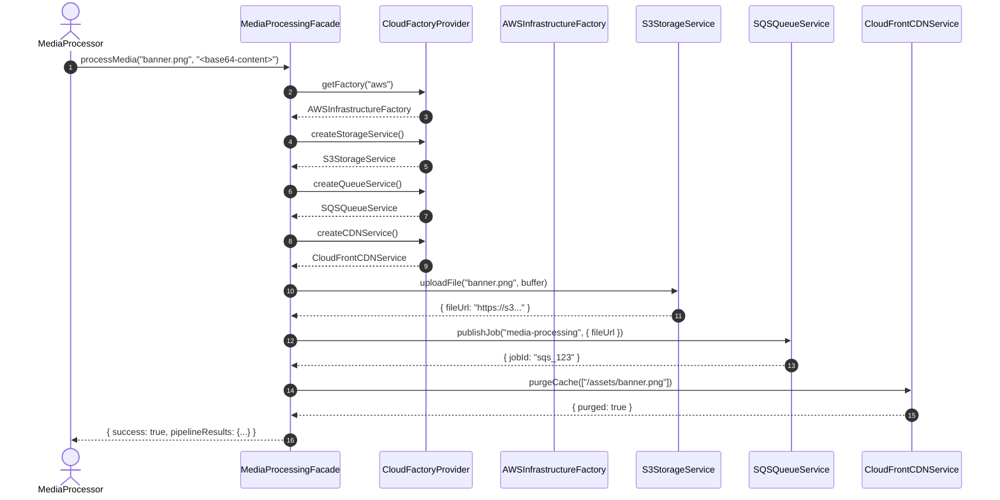

# 🏢 Facade Pattern: Simplified Media Processing Pipeline

## 1. 🚨 The Real Production Problem
In media processing systems, integrating multiple services (storage, queue, CDN) often requires complex orchestration. Without Facade:

- **Complex Constructor Calls:** Must remember exact initialization order and dependencies
- **Tight Coupling:** Business logic directly references concrete factory classes and service methods
- **Error-Prone:** Easy to miss a step or call services in wrong order
- **Difficult Testing:** Each service must be mocked individually; pipeline setup is complex
- **Long Parameter Lists:** Each service call requires different parameters, credentials, configurations

## 2. 💡 How Facade Solves It
The **Facade Pattern** provides a unified, high-level interface to a set of interfaces in a subsystem. It defines a interface that makes the subsystem easier to use, with simpler parameters and fewer steps.

### Core Benefits:
* **Unified Simplified Interface:** One method call instead of many
* **Hides Subsystem Complexity:** Clients don't need to know about factories, implementations, or service dependencies
* **Reduces Coupling:** Business logic depends on facade, not on subsystem classes
* **Improves Testability:** Test the facade in isolation; mock the simplified interface
* **Encapsulates Best Practices:** Facade can enforce correct initialization order and error handling

## 3. 📊 Visual Diagram (Flow & Structure)

### Class Diagram
```mermaid
classDiagram
    class MediaProcessingFacade {
        +processMedia(fileName: string, fileContent: string): PipelineResult
    }

    class AWSInfrastructureFactory {
        +createStorageService(): ICloudStorage
        +createQueueService(): IQueueService
        +createCDNService(): ICDNService
    }

    class ICloudStorage {
        +uploadFile(fileName: string, buffer: Buffer): Promise~FileResult~
    }

    class IQueueService {
        +publishJob(queueName: string, payload: Record~string, unknown~): Promise~JobResult~
    }

    class ICDNService {
        +purgeCache(paths: string[]): Promise~PurgeResult~
    }

    class StorageService {
        +uploadFile(fileName: string, buffer: Buffer): Promise~{fileUrl, storageId}~
    }

    class QueueService {
        +publishJob(queueName: string, payload): Promise~{jobId, status}~
    }

    class CDNService {
        +purgeCache(paths): Promise~{purged, timestamp}~
    }

    class CloudFactoryProvider {
        +getFactory(provider: string): ICloudInfrastructureFactory
    }

    MediaProcessingFacade --> AWSInfrastructureFactory : uses
    MediaProcessingFacade --> CloudFactoryProvider : uses
    MediaProcessingFacade --> StorageService : uses
    MediaProcessingFacade --> QueueService : uses
    MediaProcessingFacade --> CDNService : uses

    Note for MediaProcessingFacade "One method orchestrates entire pipeline"
```

### Execution Flow


## 4. 💻 Code Implementation

### Step 1: Define Subsystem Interfaces (already exist from Abstract Factory)
```typescript
// These are already defined in Abstract-Factory pattern
export interface ICloudStorage {
  uploadFile(fileName: string, buffer: Buffer): Promise<{ fileUrl: string; storageId: string }>;
  deleteFile(storageId: string): Promise<boolean>;
}

export interface IQueueService {
  publishJob(queueName: string, payload: Record<string, unknown>): Promise<{ jobId: string; status: string }>;
}

export interface ICDNService {
  purgeCache(paths: string[]): Promise<{ purged: boolean; timestamp: string }>;
}
```

### Step 2: Create Facade
```typescript
export class MediaProcessingFacade {
  private factory: ICloudInfrastructureFactory;

  constructor(provider?: string) {
    this.factory = CloudFactoryProvider.getFactory(provider);
  }

  public async processMedia(fileName: string, fileContentBase64: string): Promise<PipelineResult> {
    try {
      // Step 1: Resolve cloud factory
      const factory = this.factory;

      // Step 2: Create entire family of services (one line vs many)
      const storageService = factory.createStorageService();
      const queueService = factory.createQueueService();
      const cdnService = factory.createCDNService();

      // Step 3: Execute entire pipeline with consistent configuration
      const buffer = Buffer.from(fileContentBase64 || "Mock File Content Buffer", "utf-8");
      const safeName = fileName || `asset_${Date.now()}.png`;

      // Upload to storage
      const uploadResult = await storageService.uploadFile(safeName, buffer);

      // Publish to queue for processing
      const queueResult = await queueService.publishJob("media-processing-queue", {
        fileUrl: uploadResult.fileUrl,
        storageId: uploadResult.storageId,
        action: "generate-thumbnails",
      });

      // Purge CDN cache
      const cdnResult = await cdnService.purgeCache([`/assets/${safeName}`]);

      // Return unified result
      return {
        success: true,
        provider: factory.constructor.name,
        pipelineResults: {
          storage: uploadResult,
          queue: queueResult,
          cdn: cdnResult,
        },
        processedAt: new Date().toISOString(),
      };
    } catch (error) {
      return {
        success: false,
        error: error instanceof Error ? error.message : "Unknown error",
        processedAt: new Date().toISOString(),
      };
    }
  }
}

export interface PipelineResult {
  success: boolean;
  provider: string;
  pipelineResults: {
    storage: { fileUrl: string; storageId: string };
    queue: { jobId: string; status: string };
    cdn: { purged: boolean; timestamp: string };
  };
  processedAt: string;
}
```

### Step 3: Usage
```typescript
// Before Facade - complex, many steps:
// const factory = CloudFactoryProvider.getFactory("aws");
// const storage = factory.createStorageService();
// const queue = factory.createQueueService();
// const cdn = factory.createCDNService();
// const buffer = Buffer.from(content, "utf-8");
// const upload = await storage.uploadFile("file.png", buffer);
// const queueResult = await queue.publishJob("queue", { fileUrl: upload.fileUrl });
// const cdnResult = await cdn.purgeCache(["/assets/file.png"]);

// After Facade - simple one call:
const facade = new MediaProcessingFacade("aws");
const result = await facade.processMedia("banner.png", base64Content);

// Can switch provider with zero code changes:
const gcpFacade = new MediaProcessingFacade("gcp");
const gcpResult = await gcpFacade.processMedia("banner.png", base64Content);
```

## 5. 🔧 Production Enhancements
- **Configuration Injection:** Read provider from environment variable in constructor
- **Circuit Breaker:** Wrap service calls with circuit breaker pattern
- **Retry Logic:** Add retry decorators around service calls
- **Metrics:** Track pipeline success/failure rates, latency per service
- **Logging:** Automatic pipeline step logging and timing