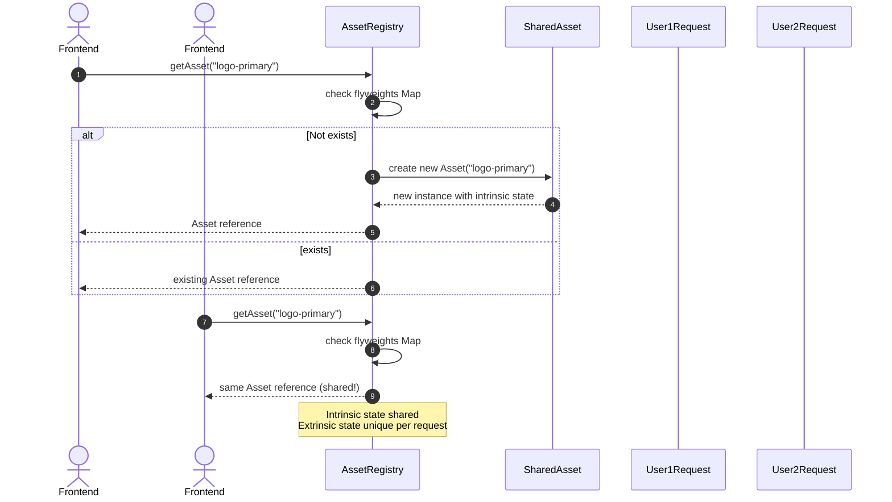

# 🦉 Flyweight Pattern: Memory-Efficient Asset Cache

## 1. 🚨 The Real Production Problem
In web applications serving millions of assets (images, fonts, icons, thumbnails), each asset request creates new object instances consuming significant memory. Without Flyweight:

- **Object Explosion:** Each of 10,000 concurrent users requesting the same 100 images creates 10,000 × 100 = 1,000,000 asset objects
- **Memory Pressure:** Each image object holds file path, metadata, dimensions, cache status → kilobytes per object × millions = GBs of RAM
- **Garbage Collection Overhead:** Browser/Node GC must traverse and collect millions of similar objects
- **Bandwidth Waste:** Re-downloading identical assets instead of reusing cached in-memory representations

## 2. 💡 How Flyweight Solves It
The **Flyweight Pattern** uses sharing to support large numbers of fine-grained objects efficiently. It minimizes memory usage by sharing as much data as possible with similar objects.

### Core Benefits:
* **Extreme Memory Reduction:** Shared data stored once, references shared across all users
* **Cache-Like Behavior:** Common assets (fonts, icons, base images) stored in single instances
* **Scalability:** Handle millions of asset requests with limited memory
* **Interoperable:** Works with existing caching layers (Redis, CDN) as complementary pattern

## 3. 📊 Visual Diagram (Flow & Structure)

### Class Diagram
```mermaid
classDiagram
    class Asset flyweight {
        -intrinsicState: AssetIntrinsicState
        +request(): AssetExtrinsicState
        +getIntrinsicState(): AssetIntrinsicState
    }

    class AssetRegistry {
        -static flyweights: Map~string, Asset~
        +getOrCreate(key: string): Asset
        +get(key: string): Asset~
    }

    class AssetIntrinsicState {
        -assetId: string
        -filePath: string
        -dimensions: string
        -format: string
        -size: number
    }

    class AssetExtrinsicState {
        -requestedBy: string
        -requestTimestamp: Date
        -cacheLevel: "memory" | "disk" | "cdn"
        -priority: number
    }

    AssetRegistry --> Asset : manages
    Asset "o--" AssetIntrinsicState : contains
    Asset "o--" AssetExtrinsicState : contains

    Note for Asset "Intrinsic state shared across all users<br/>(filePath, dimensions, format)<br/>Extrinsic state unique per request"
```

### Execution Flow


## 4. 💻 Code Implementation

### Step 1: Define Intrinsic State (shared)
```typescript
export interface AssetIntrinsicState {
  assetId: string;
  filePath: string;
  dimensions: string; // "200x200"
  format: string; // "PNG", "JPEG", "SVG"
  size: number; // in bytes
}
```

### Step 2: Create Flyweight Class
```typescript
export class Asset {
  private intrinsicState: AssetIntrinsicState;
  private extrinsicState: Map<string, any> = new Map();

  constructor(intrinsicState: AssetIntrinsicState) {
    this.intrinsicState = intrinsicState;
  }

  // Request method - uses intrinsic state + extrinsic state per request
  public request(requester: string, cacheLevel: string = "memory"): AssetExtrinsicState {
    const extrinsic: AssetExtrinsicState = {
      requestedBy: requester,
      requestTimestamp: new Date(),
      cacheLevel,
      priority: this.calculatePriority(),
    };

    // Handle caching logic using intrinsic state
    this.extrinsicState.set(requester, extrinsic);

    return extrinsic;
  }

  private calculatePriority(): number {
    // Simple priority based on file size - smaller assets get higher priority
    if (this.intrinsicState.size < 10000) return 10; // < 10KB
    if (this.intrinsicState.size < 100000) return 5; // 10KB - 100KB
    return 1; // > 100KB
  }

  public getIntrinsicState(): AssetIntrinsicState {
    return this.intrinsicState;
  }

  public getExtrinsicState(requester: string): AssetExtrinsicState | null {
    return this.extrinsicState.get(requester) || null;
  }
}
```

### Step 3: Create Registry (Flyweight Factory)
```typescript
export class AssetRegistry {
  private static flyweights: Map<string, Asset> = new Map();

  public static getOrCreate(
    assetId: string,
    filePath: string,
    dimensions: string,
    format: string,
    size: number
  ): Asset {
    const key = `${assetId}:${dimensions}:${format}`;

    if (!this.flyweights.has(key)) {
      const intrinsicState: AssetIntrinsicState = {
        assetId,
        filePath,
        dimensions,
        format,
        size,
      };
      this.flyweights.set(key, new Asset(intrinsicState));
      console.log(`[Flyweight] Created new asset: ${key}`);
    }

    return this.flyweights.get(key)!;
  }

  public static get(key: string): Asset | null {
    return this.flyweights.get(key) || null;
  }

  public static getStats(): { totalUnique: number; totalRequests: number } {
    return {
      totalUnique: this.flyweights.size,
      totalRequests: Array.from(this.flyweights.values()).reduce(
        (sum, asset) => sum + asset.extrinsicState.size,
        0
      ),
    };
  }
}
```

### Step 4: Usage
```typescript
// Client code - request assets, registry manages sharing

// First request for "logo-primary" at 200x200 PNG
const asset1 = AssetRegistry.getOrCreate(
  "logo-primary",
  "/assets/images/logo.png",
  "200x200",
  "PNG",
  45000
);

// Second request for same asset - gets same instance!
const asset2 = AssetRegistry.getOrCreate(
  "logo-primary",
  "/assets/images/logo.png",
  "200x200",
  "PNG",
  45000
);

console.log(asset1 === asset2); // true - shared flyweight!

// Request with different dimensions creates new flyweight (different intrinsic state)
const asset3 = AssetRegistry.getOrCreate(
  "logo-primary",
  "/assets/images/logo.png",
  "400x400",  // Different dimensions!
  "PNG",
  45000
);

console.log(asset1 === asset3); // false - different intrinsic state (dimensions)

// Request stats
const stats = AssetRegistry.getStats();
console.log(`Unique assets: ${stats.totalUnique}`);
```

## 5. 🔧 Production Enhancements
- **TTL Expiry:** Add time-to-live for flyweight instances
- **Memory Pressure Detection:** Evict least-recently-used flyweights when memory threshold exceeded
- **Integration with LRU Cache:** Combine with LRU for eviction policy
- **CDN Coordination:** Sync flyweight state with CDN cache invalidation
- **Statistics:** Track request patterns to optimize asset pre-loading