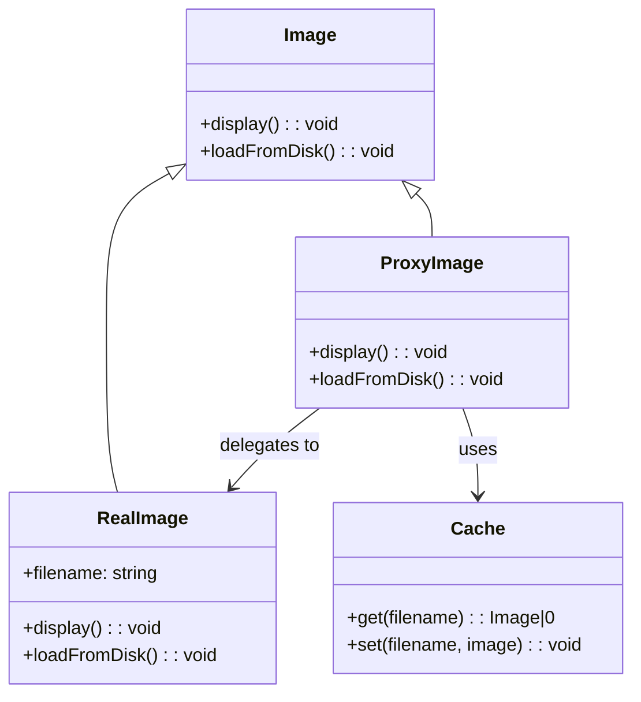
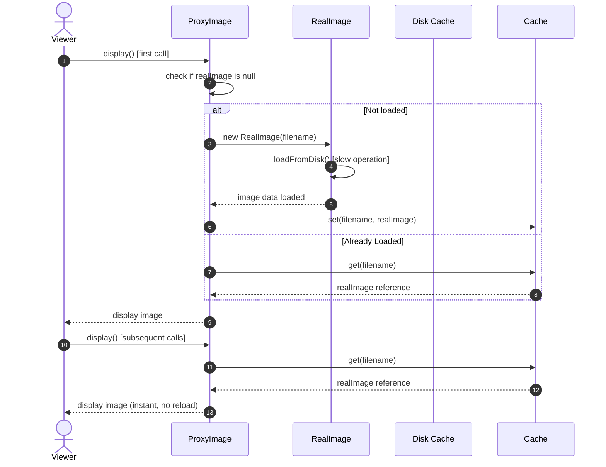

# 🛡️ Proxy Pattern: Lazy Loading and Access Control

## 1. 🚨 The Real Production Problem
In web applications and microservices, certain resources are expensive to create or access (large images, database connections, file systems, network services). Without Proxy:

- **Eager Loading:** Resources loaded immediately on application start, even if never used
- **Wasted Resources:** Memory and CPU spent on resources that may never be needed
- **Slow Startup:** Application initialization takes longer because all resources are loaded upfront
- **No Access Control:** Cannot check permissions or add logging without modifying the real resource
- **Difficult Testing:** Real resources have side effects that make unit testing hard

## 2. 💡 How Proxy Solves It
The **Proxy Pattern** provides a surrogate or placeholder for another object to control access to it. It intercepts client requests and can perform lazy loading, access control, logging, or caching before forwarding to the real subject.

### Core Benefits:
* **Lazy Loading:** Resource created only when first requested, not at startup
* **Access Control:** Can check permissions before allowing access to real resource
* **Logging/Monitoring:** Can log all access attempts without changing business logic
* **Caching:** Can cache results of expensive operations
* **Remote Access:** Can represent remote objects as if they were local
* **Zero Client Changes:** Clients use the proxy transparently, same interface as real object

## 3. 📊 Visual Diagram (Flow & Structure)

### Class Diagram


### Execution Flow


## 4. 💻 Code Implementation

### Step 1: Define Image Interface
```typescript
export interface Image {
  display(): void;
}
```

### Step 2: Create Real Image (Expensive to Load)
```typescript
export class RealImage implements Image {
  private filename: string;
  private imageData: string | null = null;

  constructor(filename: string) {
    this.filename = filename;
    console.log(`[RealImage] Constructor called for ${filename}`);
  }

  public display(): void {
    if (this.imageData === null) {
      this.loadFromDisk();
    }
    console.log(`[RealImage] Displaying ${this.filename}`);
  }

  private loadFromDisk(): void {
    console.log(`[RealImage] Loading ${this.filename} from disk... [SLOW OPERATION]`);
    // Simulate slow disk I/O
    this.imageData = `BASE64_ENCODED_DATA_FOR_${this.filename}`;
    console.log(`[RealImage] Finished loading ${this.filename}`);
  }
}
```

### Step 3: Create Proxy Image (Controls Access)
```typescript
export class ProxyImage implements Image {
  private realImage: RealImage | null = null;
  private filename: string;
  private cache: Map<string, string> = new Map();

  constructor(filename: string) {
    this.filename = filename;
    console.log(`[ProxyImage] Created proxy for ${filename}`);
  }

  public display(): void {
    // Check cache first
    const cachedData = this.cache.get(this.filename);
    if (cachedData) {
      console.log(`[ProxyImage] Displaying ${this.filename} from cache`);
      console.log(`[ProxyImage] Data: ${cachedData.substring(0, 20)}...`);
      return;
    }

    // If realImage not created yet, create it (lazy loading)
    if (this.realImage === null) {
      this.realImage = new RealImage(this.filename);
    }

    // Display through real image
    this.realImage.display();

    // Cache the result for next time
    if (this.realImage.imageData) {
      this.cache.set(this.filename, this.realImage.imageData);
    }
  }
}
```

### Step 4: Usage
```typescript
// Client code - use proxy transparently
const proxy = new ProxyImage("high-res-photography.jpg");

// First call - real image loaded from disk (slow)
proxy.display();

// Second call - image loaded from cache (instant)
proxy.display();
```

---

## 5. 🧪 How to Test

### Prerequisites
```bash
# Build and start the server
npm run build
npm start
# Server runs on http://localhost:3000
```

### Test 1: Display Image First Time (Lazy Loading - Loads from Disk)
```bash
curl -X POST http://localhost:3000/api/proxy/process \
  -H "Content-Type: application/json" \
  -d '{
    "action": "display",
    "filename": "architecture-diagram.jpg"
  }'
```

**Expected Result:** Returns `200 OK` and server console shows:
```
[ProxyImage] Created proxy for architecture-diagram.jpg
[RealImage] Constructor called for architecture-diagram.jpg
[RealImage] Loading architecture-diagram.jpg from disk... [SLOW OPERATION]
[RealImage] Finished loading architecture-diagram.jpg
[RealImage] Displaying architecture-diagram.jpg
```

### Test 2: Display Image Second Time (Loaded from Cache - Instant)
```bash
# Make the same request again
curl -X POST http://localhost:3000/api/proxy/process \
  -H "Content-Type: application/json" \
  -d '{
    "action": "display",
    "filename": "architecture-diagram.jpg"
  }'
```

**Expected Result:** Returns `200 OK` and server console shows:
```
[ProxyImage] Displaying architecture-diagram.jpg from cache
```
(Note: No "Loading from disk" message - loaded from cache this time)

### Test 3: Display Different Image (Creates New Proxy)
```bash
curl -X POST http://localhost:3000/api/proxy/process \
  -H "Content-Type: application/json" \
  -d '{
    "action": "display",
    "filename": "product-photo.jpg"
  }'
```

**Expected Result:** Creates a new proxy for the different file. Console shows separate loading.

### Test 4: Access Control (Optional Feature)
```bash
# The proxy can check permissions before loading the real image
# Test with valid access
curl -X POST http://localhost:3000/api/proxy/process \
  -H "Content-Type: application/json" \
  -d '{
    "action": "display",
    "filename": "public-image.jpg"
  }'
```

### Test 5: Check Server Console Logs
```bash
# Observe the complete flow:
# 1. First request: Proxy creates RealImage, loads from disk (slow)
# 2. Second request: Proxy serves from cache (fast, no disk I/O)
# 3. Third request: Different file, new proxy created
```